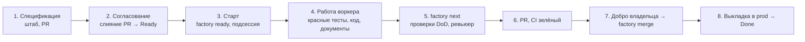

# Studhub — процесс разработки

> Статус: согласовано (2026-11-11), обновлено (2026-11-16, SH-107). Документ описывает, **как** мы делаем продукт. Что делаем — в [`product-concept.md`](product-concept.md), [`use-cases.md`](use-cases.md), [`screens.md`](screens.md), [`technical-design.md`](technical-design.md).

## 1. Принципы

1. **Документы — источник истины.** Код реализует то, что описано. Если по ходу работы поведение или решение меняется, сначала правим документ (в том же PR), потом код.
2. **Спецификация → тесты → код.** Ни одна задача не берётся в работу без критериев приёмки и плана тестов. Тесты по критериям пишутся до реализации.
3. **Одна задача — один вертикальный срез — одна сессия — один PR.** Срез проходит все слои (миграция, домен, API, UI, тесты) и даёт работающую функцию.
4. **Маленькие шаги.** Задача — от 0,5 до 2 дней. Больше — делим.
5. **Не больше одной задачи в работе одновременно.**
6. **После каждого этапа — prod, демо и ретро.**

## 2. Иерархия документов

```
product-concept.md        зачем и что (функционал, стадии)
  └─ use-cases.md         сценарии UC-xx: что делает пользователь и как отвечает система
       └─ screens.md      экраны Э/Ш/Ф/М: что видно и какие действия
            ├─ design-system.md   как выглядит: токены, шрифты, компоненты
            └─ technical-design.md + adr/   модель, правила, API, архитектура
                 └─ backlog/tasks/SH-xxx    задача: срез, критерии приёмки, план тестов
                      └─ тесты → код
```

При противоречии главнее документ выше по дереву. Нашли противоречие — останавливаемся и решаем с владельцем, а не выбираем молча.

**Новое архитектурное решение** (новая библиотека, изменение модели данных или границ, отказ от решения из ТД) оформляется как ADR в `docs/adr/NNNN-slug.md` в том же PR.

## 3. Трекер: Backlog.md

Задачи живут в репозитории в `backlog/` и меняются только через CLI `backlog` (не руками).

| Команда | Что делает |
|---|---|
| `backlog browser` | Канбан-доска в браузере (http://localhost:6420) |
| `backlog board` | Доска в терминале |
| `backlog task list --status "Ready" --plain` | Задачи, готовые к работе |
| `backlog task view SH-017 --plain` | Задача целиком |
| `backlog milestone list` | Этапы и их готовность |

### 3.1 Статусы

| Статус | Значит | Кто переводит |
|---|---|---|
| **Backlog** | Задача в плане, спецификация не готова или не согласована | — |
| **Ready** | Выполнен Definition of Ready (§5), владелец согласовал спецификацию | Штаб в PR спецификаций (владелец согласует слиянием) |
| **Merged** | Код слит в `main` через squash, задача ждёт выкладки в prod | `factory merge` последним коммитом ветки |
| **Done** | Изменения выложены в prod | Шаг `deploy` (скрипт `mark-done`) после успешной выкладки |

Промежуточных статусов ведения задачи нет: её состояние показывает git (ветка, PR, CI) и файл состояния фабрики, а не карточка. Backlog.md хранит задачи файлами в репозитории: каждая смена статуса становится коммитом, а `main` защищён. Статус Ready штаб коммитит в ветку спецификаций, и он попадает в `main` слиянием PR спецификаций (§7, шаги 1–2). Статус Merged фабрика коммитит последним коммитом ветки задачи, и он попадает в `main` вместе со слиянием её PR. Статус Done в `main` приносит лёгкий PR «Done: SH-…» от шага `deploy` (§7, шаг 8). Отдельный PR на закрытие задачи не нужен.

### 3.2 Вехи, метки, приоритеты

- **Вехи** двух видов (ТД §15):
  - этапы плана реализации MVP: «Этап 0 — каркас и проверка рисков» … «Этап 7 — финиш»;
  - вехи стадий после MVP: сейчас «Стадия 2 — закрытая бета». Работа, вынесенная за пределы MVP, лежит здесь: на доске эта веха идёт после этапа 7, и пока в этапах 0–7 есть незавершённые задачи, её задачи не берём. Веху следующей стадии заводим, когда появляется её первая задача.
- **Метки:**
  - слой: `infra`, `backend`, `frontend`, `db`, `docs`, `legal`, `spike`, `landing`, `pwa`;
  - модуль: `auth`, `workspaces`, `students`, `schedule`, `billing`, `context`, `materials`, `messages`, `reports`, `analytics`, `compliance`.
- **Тип:** `feature`, `task`, `chore`, `spike`, `bug`, `docs`.
- **Зависимости** (`--dep`) задают порядок. Задачу нельзя брать, пока зависимости не в Done.

### 3.3 Планирование «катящейся волной»

- Все этапы MVP разбиты на задачи с названием, ссылками на UC и экраны и кратким описанием.
- Полные спецификации (критерии приёмки и план тестов) пишутся на **один этап вперёд**: пока идёт этап N, готовим этап N+1.
  - Текущим считается самый ранний этап, в котором ещё есть задачи не в Done (сейчас Этап 0, `m-0`). Следующий этап идёт за ним (сейчас Этап 1, `m-1`).
  - Задача, которую создают или переносят в текущий или следующий этап, с самого начала содержит «Что нужно сделать», «Зачем», критерии приёмки и план тестов по §4.
  - Задачи более поздних этапов остаются краткими. Существующие задачи не переписываем: их достраивает штаб, когда приходит их этап.

## 4. Структура задачи

**Название:** глагол + результат («Вход через Яндекс ID»).

**Описание** (`-d`), разделы по порядку:

```markdown
## Что нужно сделать
Нумерованный список работ для исполнителя (живого разработчика): что создать, настроить,
сверстать, какие тесты написать, что проверить вручную, какие документы обновить.
Каждый шаг — конкретное действие в повелительном наклонении. Шаги, которые делает
владелец (покупки, регистрации), помечены «Владелец:». Это не замена плана реализации:
исполнитель уточняет подход при старте задачи (`--plan`).

## Зачем
Проблема или потребность, которую закрывает задача. Не пересказывает критерии.

## Контекст
- Сценарии: UC-01 (шаги 3–6, 4а, 5а)
- Экраны: Э-01
- Правила: ТД §4.2, ADR-0006

## Не входит
Что явно не делаем в этой задаче (и в какой задаче сделаем).

## Контракт
Новые и изменённые эндпоинты, таблицы и миграции, события.

## План тестов
| AC | Уровень | Тест |
|---|---|---|
| 1 | API | вход новым пользователем создаёт user и auth_identity |
```

**Поля карточки** (заполняет штаб при спецификации, проверяет `pnpm spec:check`):

- **Права** — список прав воркера поверх базового набора (`scripts/lib/factory-tools.mjs`). Значения из известного списка; каждое раскрывается в правила разрешений поверх базового набора. Неизвестное значение `spec:check` отклоняет.
- **Затрагивает** — файлы и документы, которые меняет задача. `factory ready` сверяет их с состоянием на момент перехода задачи в Ready и при изменениях не готовит задачу без подтверждения владельца.
- **Модель** — `pro` или `flash` (по умолчанию `pro`): модель воркера в подсессии. Неизвестное значение `spec:check` отклоняет.

В колонке AC — номер критерия или диапазон («1–5»). Уровень — один из §8.1 (Юнит, API, E2E) или «Ручная», «Ревью», «Скрипт» для критериев, которые тестом не проверить. Для тестовых уровней `pnpm ac:check` требует метку в тестах (§8.2).

**Критерии приёмки** (`--ac`): каждый — одно проверяемое утверждение в форме «Дано … Когда … Тогда …» или короткое утверждение о результате. Нумерация — порядковая в Backlog.md (AC #1, #2, …). Детали поведения не копируем из UC, а ссылаемся на шаг.

**Definition of Done** подставляется в каждую задачу автоматически (из `backlog/config.yml`). Особые пункты добавляются через `--dod`.

**Оценка** — первая строка заметок при старте: `Оценка: 6 ч`. При завершении добавляется `Факт: 8 ч`.

## 5. Definition of Ready

Задачу переводят в Ready, когда:

- [ ] у неё есть список работ «Что нужно сделать» и раздел «Зачем»;
- [ ] есть ссылки на UC, экраны и разделы ТД;
- [ ] перечислено, что не входит;
- [ ] описаны изменения контракта (API, БД);
- [ ] заполнены поля «Права», «Затрагивает» и «Модель» (§4) допустимыми значениями;
- [ ] критерии приёмки проверяемые, у каждого есть строка в плане тестов;
- [ ] зависимости в Done.

Размер задачи (принцип 4, §1) решает штаб при планировании: большую задачу делит до Ready. Согласие владельца даёт слияние PR спецификаций (§3.1, §7, шаг 2), отдельным пунктом оно не проверяется.

Структуру задачи проверяет скрипт `pnpm spec:check` (`scripts/check-spec.mjs`). Он проверяет разделы шаблона §4, поля «Права» и «Модель» (известные значения), строку плана тестов у каждого критерия, уровни из §8.1 и зависимости (задача есть, веха не позже, «зависит от SH-NNN» записано в зависимостях). Он предупреждает о шагах владельца без «Владелец:» и о зависимости Ready-задачи не в Done. Смысл критериев скрипт не проверяет. Режимы: `pnpm spec:check SH-NNN` (указанные задачи в любом статусе), `pnpm spec:check` (все задачи в Ready), `pnpm spec:check --changed` (Ready-задачи, изменённые относительно `origin/main`). На каждом PR CI запускает режим `--changed`. Порядок работы штаба над спецификацией описывает скилл [`.claude/skills/sh-spec/SKILL.md`](../.claude/skills/sh-spec/SKILL.md). Скилл отсылает к §4 и §5 и не копирует их.

## 6. Definition of Done

Те же пункты, что в `backlog/config.yml`:

1. Каждый критерий приёмки покрыт тестом с меткой `[SH-NNN AC-n]`, все тесты зелёные.
2. Проверки `factory next` зелёные: тесты, линт, типы, `ac:check`, красный коммит, правки тестов после него.
3. Пройдено ревью агентом `sh-reviewer`, замечания закрыты.
4. Документы обновлены в этом же PR, если поведение или решения изменились.
5. Новые эндпоинты покрыты тестом изоляции, в логах и событиях нет ПДн, деньги только в minor units.
6. Изменения выложены в prod: статус Done ставит шаг `deploy` (§7, шаг 8), а не сессия задачи.
7. В заметках задачи — оценка, факт, решения и итоговое резюме.

## 7. Жизненный цикл задачи

Работа идёт через фабрику (`pnpm factory`, [README.md](../README.md#запуск-задачи-pnpm-factory), [ADR-0011](adr/0011-factory-orchestrator.md)) — локальный скрипт без модели — и несколько сессий и процессов модели:

- **Корневая сессия (модель)** — принимает команду владельца `/ready`, запускает скрипт и открывает подсессию с брифом. Дальше в процессе не участвует.
- **Фабрика (скрипт)** — делает всю механику по схеме: `factory ready`, `factory next`, `factory merge`, `factory status`.
- **Подсессия задачи** — в worktree задачи; её основной агент — воркер `sh-worker`.
- **Ревьюер** — отдельный процесс с ролью `sh-reviewer`, только чтение.
- **Ретро** — агент `sh-retro`, только чтение, запускается в `factory merge`.

**Старт выполнения задачи ручной.** Задачу стартует только владелец прямой командой: в приложении — `/ready`, из терминала — `pnpm factory` ([README.md](../README.md#запуск-задачи-pnpm-factory)). Автоматического старта нет: хуки, расписания, скрипты и циклы, которые сами запускают задачи, не добавляем. /ready — прямая команда владельца.

**Основной способ — фабрика, запасной — штаб с sh-worker.** Фабрика ведёт задачу по схеме; модель подключается только там, где нужно суждение или диалог с владельцем (воркер, ревьюер, ретро). Фабрика видит только Ready из `origin/main` и называет ветку транслитерацией названия. Запасной способ — `pnpm factory run` с фоновым воркером и штаб с `sh-worker` (§7.1); подробности в [README.md](../README.md#запуск-задачи-pnpm-factory).



1. **Спецификация.** Штаб пишет описание и критерии по шаблону §4 в своей ветке `specs-<тема>` в отдельном worktree. Задачи, которые предлагает взять в работу, переводит в Ready (`backlog task edit SH-017 -s Ready`) уже в этой ветке. Открывает PR «Спецификации: SH-017, SH-018» на одну или несколько задач. Перед PR запускает `pnpm spec:check` для своих задач и исправляет ошибки (§5). После зелёного `pnpm spec:check` вызывает критика `sh-spec-critic` на каждую задачу PR (подраздел «Проверка спецификации: sh-spec-critic»); порядок шагов — в скилле `sh-spec`.
2. **Согласование.** Владелец читает задачи в дифф PR, просит правки комментариями и сливает PR. Слияние означает согласование: статус Ready попадает в `main` вместе с ним. Задачи, которые владелец не согласовал, штаб убирает из PR или возвращает в Backlog (`-s Backlog`) до слияния.
3. **Старт.** По команде владельца `/ready SH-NNN` корневая сессия запускает `factory ready SH-NNN`. Скрипт проверяет Definition of Ready (§5) скриптом `check-spec.mjs`, проверяет актуальность по git (файлы и документы из поля «Затрагивает» не менялись после перехода задачи в Ready, зависимости в Done), создаёт ветку `sh-NNN-<slug>` и worktree, записывает права задачи и модель воркера в настройки worktree и печатает бриф. Корневая сессия одним вызовом `start_session` открывает подсессию в worktree задачи с брифом. Фабрика видит только Ready из `origin/main`; Ready без коммита — путь штаба (§7.1).
4. **Работа воркера.** Воркер берёт спецификацию и реализует: план и оценка, красные тесты по критериям (`[SH-NNN AC-n]`, отдельный коммит), реализация, документы. Он не проверяет готовность, не меняет статусы, не делает push, PR и слияние. Нужен вопрос владельцу — воркер задаёт его в своей подсессии и записывает в журнал фабрики; не хватило прав — останавливается и сообщает причину.
5. **Проверки и ревью (`factory next`).** Одна команда выбирает шаг по состоянию: проверки Definition of Done скриптами (тесты, линт, типы, `ac:check`, красный коммит, правки тестов после него), проверяющий тестов `sh-verifier` — только при правках тестов после красного коммита, ревьюер `sh-reviewer`, счёт кругов (не больше двух автоматических), push, `gh pr create`, ожидание CI. Первая строка вывода — действие для воркера, вторая — фраза этапа; этап записывается в файл состояния и виден через `factory status`.
6. **PR.** Когда критичных замечаний нет, фабрика создаёт PR сама: заголовок `SH-017: <название>`, описание по шаблону `.github/pull_request_template.md`. После зелёного CI она сообщает одной строкой «PR готов, замечаний: N» со ссылками на PR и подсессию.
7. **Слияние (`factory merge`).** Владелец смотрит PR и подсессию; если всё устраивает, даёт добро. `factory merge` запускает `sh-retro` (запись в [`process-retro.md`](process-retro.md) в том же PR), коммитит статус Merged последним коммитом ветки, пушит, ждёт CI, сливает squash, удаляет ветку и worktree, подтягивает `main` и архивирует подсессию. Если PR не нравится, владелец разбирается с воркером в его подсессии; после правок `factory next` проходит полный круг заново.
8. **Выкладка и Done.** После успешной выкладки в prod шаг `deploy` запускает `scripts/mark-done.mjs`: находит задачи в Merged, чьи squash-коммиты (`^SH-NNN:` в `origin/main`) — предки выложенного SHA, и открывает лёгкий PR «Done: SH-…» с автослиянием, переводя их в Done. При красном `deploy` статусы не меняются, отката нет.

**Изменение объёма.** Нашли работу за рамками критериев — не делаем молча. Спрашиваем владельца: расширить задачу или завести новую (в Backlog).

**Ошибка в спецификации.** Если критерий неверен или противоречит документам — останавливаемся, правим критерий с согласия владельца, потом тест, потом код. **Менять тест под код без изменения критерия нельзя.**

**Шаги владельца.** Шаги с пометкой «Владелец:» (покупки, регистрации, ключи, юридические действия) владелец делает по ходу работы над задачей, а не до Ready. Воркер идёт по списку «Что нужно сделать». Дойдя до шага владельца, он останавливается и пишет владельцу в чат своей подсессии, что сделать и что передать: доступ, имя секрета, адрес. Статус задачи не меняется. Агент не покупает, не регистрирует аккаунты и не вводит ключи и пароли: секреты владелец кладёт в хранилище сам и сообщает воркеру только их имена.

### 7.1 Фабрика, воркер, ревьюер, ретро

Фабрика — скрипт (`pnpm factory`, [README.md](../README.md#запуск-задачи-pnpm-factory), [ADR-0011](adr/0011-factory-orchestrator.md)) без модели. Команды:

- `factory ready SH-NNN` — выбор и проверка задачи, ветка и worktree, права и модель воркера в настройки worktree, бриф для подсессии (§7, шаг 3).
- `factory next` — проверки DoD, ревьюер, круги, push, PR, ожидание CI (§7, шаг 5–6).
- `factory merge` — после добра владельца: ретро, статус Merged, слияние, уборка (§7, шаг 7).
- `factory status` — текущий этап из файла состояния.
- Запасной вариант: `factory run` с фоновым воркером и команды `answer`, `continue`, `drop` ([README.md](../README.md#запуск-задачи-pnpm-factory)).

Файл состояния лежит вне git (в `.gitignore`), фабрика создаёт его сама; в нём — идентификатор подсессии воркера, номер круга ревью, число замечаний, сигнал воркера, журнал вопросов владельцу и накопленные токены по агентам. Шаг процесса вычисляется из git и GitHub.

**Воркер — основной агент подсессии.** Агент [`sh-worker`](../.claude/agents/sh-worker.md) не проверяет статус и Definition of Ready, не меняет статусы, не делает push, PR и слияние и не возвращает блоки `СТОП`/`ЗАМЕЧАНИЯ`/`ГОТОВО` для фабрики. Он пишет тесты и код по спецификации, по завершении хода вызывает `factory next` и сообщает корневой сессии короткую фразу этапа. Вопросы владельцу он задаёт в своей подсессии и записывает в журнал фабрики. Модель воркера задаёт поле «Модель» в карточке (`pro`/`flash`). Права — белый список: базовый набор плюс поле «Права» карточки; запрещены push, `gh`, смена статусов и доступ вне worktree.

**Ревьюер.** Агент [`sh-reviewer`](../.claude/agents/sh-reviewer.md) запускается фабрикой отдельным процессом с ролью `sh-reviewer` на модели `deepseek-v4-pro` и уровне `max`, только чтение: Read, Grep, Glob и Bash для чтения (`git diff`, `git log`, `git show`, `cat`, `ls`, `head`, `tail`, `wc`); Edit, Write, `git commit`, `git push`, `git branch -d`/`-D` и `gh` запрещены. Ответ печатает в stdout: первая строка — вердикт («блокирует: N» или «чисто»), дальше записи трёх типов: «блокирует» (баг, нарушение жёсткого правила кода или расхождение с критерием), «замечание» (остальное) и «вопрос владельцу». Фабрика проверяет формат, сохраняет замечания в файл, считает круги и решает: вернуть воркеру или создать PR.

**Проверяющий тестов: sh-verifier.** Агент [`sh-verifier`](../.claude/agents/sh-verifier.md) вызывается только при правках тестов после красного коммита: он проверяет, что тесты подтверждают критерии и не ослаблены после красного коммита. Ревьюер ищет ошибки в коде, `pnpm ac:check` проверяет только наличие метки, а что тест проверяет именно критерий и что его не подогнали под код, видит только верификатор.

- Вход: только ID задачи (`subagent_type: sh-verifier`, промпт «Проверь SH-NNN»). Задачу читает командой `node scripts/task.mjs SH-NNN --criteria`.
- Инструменты: Read, Bash, Grep, Glob, модель `deepseek-flash`. Хук [`verifier-bash-guard.mjs`](../scripts/hooks/verifier-bash-guard.mjs) пропускает команды чтения и запуск тестов, остальное блокирует кодом 2. Рабочее дерево, ветки и история не меняются.
- Порядок: дифф `git diff origin/main...HEAD`, коммит `test(…): SH-NNN тесты по критериям приёмки`, тесты с меткой `[SH-NNN AC-n]` по каждому критерию с автоматическим уровнем, сравнение тестов в коммите красных тестов и в `HEAD`, запуск тестов задачи. Критерии с уровнем «Ручная», «Ревью» и «Скрипт» он не оценивает, а перечисляет как непроверенные.
- Отчёт `ПРОВЕРКА SH-NNN`: по каждому критерию вердикт «подтверждён», «сомнительно» или «не подтверждён», файл и строка теста, одна фраза почему; отдельно нарушения правила «менять тест под код без изменения критерия нельзя». Краткий итог (вердикты и нарушения) воркер записывает в заметки задачи.
- Верификатор не заменяет ревьюера и не запускается в CI.

**Ретро: sh-retro.** Агент [`sh-retro`](../.claude/agents/sh-retro.md) на `deepseek-flash`, только чтение, запускается шагом `factory merge` перед слиянием. Вход агенту передаёт фабрика: спецификация задачи, файл замечаний ревьюера, число кругов из файла состояния, вопросы воркера владельцу и причины остановок из журнала; агент сам ничего не ищет в git. Каждое «блокирует» и каждый вопрос воркера он относит к причине (неоднозначный критерий, неполная спецификация, нарушение код-правила, баг воркера) и добавляет запись с предложением улучшения в [`docs/process-retro.md`](../docs/process-retro.md). Фабрика коммитит файл в том же PR.

#### Попутные замечания

Воркер замечает мелочи, которые не мешают критериям задачи: плохое имя, дублирование, хрупкий тест, пробел в документе, странное поведение рядом. Сам он их не чинит (работа вне критериев требует согласия владельца), но и терять их нельзя.

- Неисправленные замечания живут в одном файле [`docs/tech-debt.md`](../docs/tech-debt.md). Запись добавляет воркер в том же PR, где замечание появилось; исправленное замечание удаляется в PR, который его исправляет (причина — в описании PR).
- `pnpm remarks` читает `docs/tech-debt.md` и печатает неисправленные замечания; `--all` добавляет исправленные и отклонённые.
- Штаб или владелец периодически разбирает записи: задача в Backlog, правка документа в PR спецификаций или «отклонить». Записи в заметки карточек больше не переносятся.

#### Проверка спецификации: sh-spec-critic

Смысл спецификации проверяет субагент `sh-spec-critic` ([`.claude/agents/sh-spec-critic.md`](../.claude/agents/sh-spec-critic.md)). Скрипт `pnpm spec:check` проверяет форму: разделы, поля, план тестов, зависимости. Критерий «интерфейс удобный» проходит все его проверки, а тест на него написать нельзя. Критик находит такие места до PR.

- Первый шаг критика — `pnpm spec:check SH-NNN`; при ошибках он возвращает их и останавливается, без дальнейшей проверки.
- Вход: только ID задачи (`subagent_type: sh-spec-critic`, промпт «Проверь спецификацию SH-NNN»). Один вызов проверяет одну задачу; несколько задач PR можно проверять параллельно. Задачу читает командой `node scripts/task.mjs SH-NNN --spec`.
- Инструменты: Read, Bash, Grep, Glob, модель `deepseek-v4-pro` + `high`. Хук [`verifier-bash-guard.mjs`](../scripts/hooks/verifier-bash-guard.mjs) в режиме `--mode spec-critic` пропускает команды чтения, `node scripts/task.mjs` и `node scripts/doc.mjs`; запуск тестов блокирует кодом 2.
- Порядок: задача; задачи из зависимостей, «Контекста» и «Не входит»; разделы документов из «Контекста»; поиск непроверяемых критериев, противоречий с документами и пропусков.
- Отчёт `КРИТИКА SH-NNN`: непроверяемые критерии с предложением, как переписать; противоречия с документом, разделом и указанием, какой документ главнее; пропуски; вердикт «можно в PR» или «нужны правки (блокирует: N, замечаний: M)».
- Штаб вызывает критика после зелёного `pnpm spec:check`. Пункты «блокирует» он исправляет и вызывает критика повторно. Вердикт критика по каждой задаче и непринятые замечания с причиной он пишет в описании PR спецификаций. Критик не заменяет согласование владельцем и в CI не запускается.

Шаблон брифа рабочей сессии (его печатает `factory ready`, штаб использует для запасного пути). Процесс в брифе не пересказываем: он описан здесь.

```
Задача SH-NNN. Процесс: docs/process.md §7.1.
Особенности: <несколько строк: решения владельца по задаче, чего не трогать, на что обратить внимание>
```

Плагины проекта. Из шести плагинов аккаунта проекту нужен только `mattpocock-skills@synced` (`grilling`, `research`, `domain-modeling`). Остальные пять (`one-shot-prompting@synced`, `zizi-skills@synced`, `design-skills@synced`, `vectorlab-ux-skills@synced`, `frontend-design@synced`) заточены под другой стек или навязывают свои TDD, планы и работу с ветками, которые спорят с этим документом. Они дают около 110 скиллов и 6 агентов. Замер в приложении: отключение в аккаунте сократило скиллы с 9,9 до 7,1 тыс. токенов и агентов с 2,8 до 0,26 тыс., всего около 5,3 тыс. Список скиллов у приложения упирается в потолок около 1% окна, поэтому отключение части плагинов может не уменьшить строку «Скиллы»: освободившееся место занимают другие скиллы.

- **Приложение (Claude Desktop).** `enabledPlugins` из `.claude/settings.json` и `.claude/settings.local.json` оно не учитывает. Плагины выключает и включает владелец в настройках плагинов аккаунта (приложение или claude.ai). Настройка действует в новой сессии.
- **CLI `claude`.** Учитывает `enabledPlugins` из `.claude/settings.json`: `claude plugin list` в папке проекта показывает пять плагинов как `disabled`, `mattpocock-skills@synced` как `loaded`. Нужен отключённый плагин для задачи на интерфейс: включаем его для себя в личном `.claude/settings.local.json` (личный файл, его не коммитим) записью `"enabledPlugins": { "<имя>@synced": true }`, например `"design-skills@synced": true`. Общий `.claude/settings.json` не меняем.

Правила экономии контекста для любой сессии задачи:

- Задачу читаем через `node scripts/task.mjs SH-NNN`: тот же текст, что в `backlog task view --plain`, без дерева зависимых задач.
- Большие документы читаем по разделам: `node scripts/doc.mjs td 4.1`, `node scripts/doc.mjs uc UC-01`, `node scripts/doc.mjs screens Э-01`. Без раздела скрипт печатает список разделов. ТД, `use-cases.md` и `screens.md` целиком не читаем.
- Проверки запускаем через `pnpm verify`.

Локальные переменные окружения (например, `POSTGRES_PORT=5434`, если порт 5432 занят) владелец пишет в `.env` основной папки клона. Хук SessionStart ([`scripts/hooks/session-env.mjs`](../scripts/hooks/session-env.mjs)) в начале каждой сессии берёт оттуда переменные и передаёт их командам сессии, в том числе в новом worktree. Свой `.env` в worktree важнее.

Хук передаёт только переменные из списка `ALLOWED` в [`scripts/lib/local-env.mjs`](../scripts/lib/local-env.mjs): `POSTGRES_PORT`, `DATABASE_URL`, `TEST_DATABASE_URL`. Тот же список и тот же разбор `.env` использует фабрика: воркер, запущенный фабрикой, получает эти переменные от неё, хук SessionStart ему не нужен. Остальное из `.env` (ключи, секреты, `NODE_ENV`) он пропускает и значения не печатает. Новую переменную добавляем в этот список и сюда. Если `.env` нет, хук молча ничего не делает. Агенты `.env` не создают и не читают.

## 8. Тесты

### 8.1 Уровни

По ТД §14:

| Уровень | Что проверяет | Где |
|---|---|---|
| Юнит (домен) | Правила: переходы статусов, начисления, генерация слотов, цены по дате | `apps/api/src/modules/*/domain/*.test.ts` |
| Юнит (клиент) | Раскладка календаря, форматирование, шаблоны, deep links | `packages/client-core/**/*.test.ts` |
| API | Сценарии через HTTP, чёрным ящиком, через сгенерированный клиент, на реальном Postgres | `tests/api/` |
| E2E | Сценарии с ✓ в `use-cases.md` §3 через интерфейс | `tests/e2e/` |

Правила выбора уровня: правило или расчёт — юнит; поведение API, права, изоляция — API-тест; путь пользователя через экраны — E2E. Каждый критерий проверяется **на самом низком уровне, где его можно проверить честно**.

### 8.2 Именование и трассировка

Каждый тест по критерию начинается с метки задачи и критерия:

```ts
it('[SH-017 AC-3] повторный вход не создаёт нового пользователя', async () => { … })
```

- Один критерий может покрываться несколькими тестами, один тест — несколькими критериями (`[SH-017 AC-3, AC-4]`).
- Вспомогательные и регрессионные тесты пишутся без метки.
- Скрипт `scripts/check-ac-coverage.mjs` (`pnpm ac:check`) проверяет, что у каждой задачи в статусе Merged и Done каждый критерий упомянут меткой хотя бы в одном файле тестов (`*.test.*`, `*.spec.*`). Скрипт входит в CI и падает со списком непокрытых критериев.
- Метку не требуют критерии, которые по таблице «План тестов» (§4) проверяются на уровне «Ручная», «Ревью» или «Скрипт»: скрипт печатает их как пропущенные. Остальные уровни (Юнит, Unit, API, E2E и любые другие) требуют метку. Если у критерия несколько строк в плане и хотя бы одна из них тестовая, метка нужна. Если таблицы в задаче нет или критерия в ней нет, метка тоже нужна.

### 8.3 Прочие правила

- API-тесты не импортируют код сервера: только HTTP и сгенерированный клиент.
- Вход в тестах — через тестового OAuth-провайдера, включённого только в тестовом окружении.
- Время в тестах управляемое (фиксированные часы), никаких `sleep`. Сервер берёт время только из `clock.now()` (`apps/api/src/platform/clock`). Приложение с `APP_MODE=test` принимает `POST /__test/clock` с телом `{ "now": "<ISO 8601 UTC>" }` и стоит на этом времени; `{ "now": null }` возвращает системное время. Без `APP_MODE=test` маршрута нет. Тот же режим даёт `/__test/jobs` (состояние pg-boss и счётчики задач), `POST /__test/jobs/:name/run` (синхронный запуск задачи) и `POST /__test/jobs/:name/send` (задача в очередь); пустое тело значит `{}`, невалидный JSON даёт 400 `validation_failed`; служебная задача `test.flaky` существует только в этом режиме. Сочетание `APP_MODE=test` и `NODE_ENV=production` приложение отклоняет на старте.
- Харнесс API-тестов (`tests/api/src/support`): `startTestApp()` запускает приложение процессом на новой копии шаблонной БД и возвращает клиент, адрес БД и `setClock`. Один вызов на файл (`beforeAll`), `stop()` в `afterAll`. Файлы идут параллельно. Тест, которому нужно чистое состояние, вызывает `startTestApp()` сам. Запуск: `pnpm test:api` (нужен `pnpm db:up`).
- Каждый новый эндпоинт кабинета автоматически попадает в тест «чужой кабинет → 404».
- Ошибка в prod → сначала тест, который её воспроизводит, потом исправление.

## 9. Git

- **Ветки:** `main` защищён. На задачу — ветка `sh-017-slug` в отдельном worktree.
- **Коммиты:** [Conventional Commits](https://www.conventionalcommits.org/ru/) на русском или английском:
  - типы: `feat`, `fix`, `test`, `refactor`, `docs`, `chore`, `ci`, `build`;
  - область — модуль или слой: `feat(schedule): …`, `ci: …`;
  - в теле или заголовке — ID задачи.
- **PR:** один на задачу, заголовок `SH-017: <название задачи>`. Спецификации идут отдельным PR штаба: «Спецификации: SH-017, SH-018» (§7, шаги 1–2), описание по шаблону `.github/pull_request_template.md`. Слияние через squash только при зелёном CI. Статус Merged входит в этот же PR (§7, шаг 7).
- **CI и деплой.** Режим CI определяют изменённые файлы, а не имя ветки или заголовок PR (после squash-слияния в `push` имени ветки нет). Лёгкий режим — все файлы в `docs/` (кроме `docs/process.md`) или в `backlog/`: запускаются `spec:check --changed`, проверка формата карточек и разбор документов `scripts/doc.mjs`, а пропущенные обязательные проверки закрываются job-заглушкой с тем же именем. Любой другой изменённый файл (включая `docs/process.md` и новые папки) — полный режим. Деплой на `push` в `main` запускается только при изменении файлов полного режима. Подробно — ТД §12.
- **Основная папка:** `pnpm sync` приводит её в порядок после слияний PR. Флаги и примеры: [README.md](../README.md#основная-папка-pnpm-sync).
- **Очистка локальных веток:** после squash-слияния локальная ветка остаётся, а `git branch --merged` её не находит; такие ветки находит `pnpm git:prune` ([README.md](../README.md#очистка-локальных-веток)).
- **Миграции** только вперёд, по схеме «расширить → сжать» (ТД §12).
- **Секреты** не попадают в репозиторий. Шаблон переменных — `.env.example`.

## 10. Ревью

Ревью делает агент `sh-reviewer` ([`.claude/agents/sh-reviewer.md`](../.claude/agents/sh-reviewer.md), `deepseek-v4-pro` + `max`, только чтение), его запускает `factory next` (§7, шаг 5). Ревьюер проверяет дифф ветки по двум осям: баги и нарушения жёстких правил кода, расхождение с критериями приёмки. Вердикт первой строкой, записи трёх типов — «блокирует», «замечание», «вопрос владельцу» (§7.1).

Чек-лист, по которому ревьюер сверяет код (и по которому воркер готовит его к ревью):

- [ ] Каждый критерий подтверждён тестом с меткой `[SH-NNN AC-n]`.
- [ ] Границы слоёв (ТД §13) соблюдены: `domain/` чистый, клиент знает только OpenAPI.
- [ ] Бизнес-правила только на сервере.
- [ ] Изоляция: доступ к данным только через `ctx`, тест «чужой кабинет → 404».
- [ ] Деньги в minor units, время в UTC, даты в зоне преподавателя.
- [ ] В логах, событиях и сообщениях об ошибках нет ПДн.
- [ ] Ошибки API в формате `problem+json` с `code`.
- [ ] Нет лишнего: код вне объёма задачи, закомментированный код, TODO без задачи.

## 11. Этапы, релизы, ретро

После последней задачи этапа:
1. **Релиз:** тег `v0.N.0` (N — номер этапа), `CHANGELOG.md` собирается из коммитов.
2. **Демо:** показ партнёру-преподавателю на prod, его замечания — новые задачи в Backlog.
3. **Ретро:** 15 минут, запись в [`retro.md`](retro.md): что помогло, что мешало, что меняем в процессе. Изменения процесса вносятся в этот документ. Ретро исполнения отдельной задачи ведёт `sh-retro` в [`process-retro.md`](process-retro.md) (§7.1).
4. **Калибровка:** сравнить сумму оценок и факта задач этапа, поправить ориентиры следующих этапов.
5. **Следующая волна:** штаб готовит спецификации задач этапа N+2.
