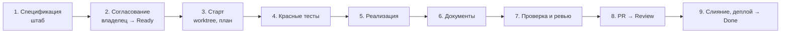

# Studhub — процесс разработки

> Статус: согласовано (2026-11-11). Документ описывает, **как** мы делаем продукт. Что делаем — в [`product-concept.md`](product-concept.md), [`use-cases.md`](use-cases.md), [`screens.md`](screens.md), [`technical-design.md`](technical-design.md).

## 1. Принципы

1. **Документы — источник истины.** Код реализует то, что описано. Если по ходу работы поведение или решение меняется, сначала правим документ (в том же PR), потом код.
2. **Спецификация → тесты → код.** Ни одна задача не берётся в работу без критериев приёмки и плана тестов. Тесты по критериям пишутся до реализации.
3. **Одна задача — один вертикальный срез — одна сессия — один PR.** Срез проходит все слои (миграция, домен, API, UI, тесты) и даёт работающую функцию.
4. **Маленькие шаги.** Задача — от 0,5 до 2 дней. Больше — делим.
5. **Не больше двух задач в работе одновременно.**
6. **После каждого этапа — prod, демо и ретро.**

## 2. Иерархия документов

```
product-concept.md        зачем и что (функционал, стадии)
  └─ use-cases.md         сценарии UC-xx: что делает пользователь и как отвечает система
       └─ screens.md      экраны Э/Ш/Ф/М: что видно и какие действия
            ├─ design-system.md   как выглядит: токены, шрифты, компоненты
            └─ technical-design.md + adr/   модель, правила, API, архитектура
                 └─ backlog/tasks/SH-xxx    задача: срез, критерии приёмки, план тестов
                      └─ тесты → код
```

При противоречии главнее документ выше по дереву. Нашли противоречие — останавливаемся и решаем с владельцем, а не выбираем молча.

**Новое архитектурное решение** (новая библиотека, изменение модели данных или границ, отказ от решения из ТД) оформляется как ADR в `docs/adr/NNNN-slug.md` в том же PR.

## 3. Трекер: Backlog.md

Задачи живут в репозитории в `backlog/` и меняются только через CLI `backlog` (не руками).

| Команда | Что делает |
|---|---|
| `backlog browser` | Канбан-доска в браузере (http://localhost:6420) |
| `backlog board` | Доска в терминале |
| `backlog task list --status "Ready" --plain` | Задачи, готовые к работе |
| `backlog task view SH-017 --plain` | Задача целиком |
| `backlog milestone list` | Этапы и их готовность |

### 3.1 Статусы

| Статус | Значит | Кто переводит |
|---|---|---|
| **Backlog** | Задача в плане, спецификация не готова или не согласована | — |
| **Ready** | Выполнен Definition of Ready (§5), владелец согласовал спецификацию | Владелец |
| **In Progress** | Ведётся работа в отдельной сессии и ветке | Рабочая сессия |
| **Review** | PR открыт, CI зелёный, критерии отмечены с доказательствами | Рабочая сессия |
| **Done** | PR слит, изменения в prod, Definition of Done отмечен | Владелец или рабочая сессия после слияния |

### 3.2 Вехи, метки, приоритеты

- **Вехи** = этапы плана реализации (ТД §15): «Этап 0 — каркас и проверка рисков» … «Этап 7 — сообщения и финиш».
- **Метки:**
  - слой: `infra`, `backend`, `frontend`, `db`, `docs`, `legal`, `spike`, `landing`, `pwa`;
  - модуль: `auth`, `workspaces`, `students`, `schedule`, `billing`, `context`, `materials`, `messages`, `reports`, `analytics`, `compliance`.
- **Тип:** `feature`, `task`, `chore`, `spike`, `bug`, `docs`.
- **Зависимости** (`--dep`) задают порядок. Задачу нельзя брать, пока зависимости не в Done.

### 3.3 Планирование «катящейся волной»

- Все этапы MVP разбиты на задачи с названием, ссылками на UC и экраны и кратким описанием.
- Полные спецификации (критерии приёмки и план тестов) пишутся на **один этап вперёд**: пока идёт этап N, готовим этап N+1.

## 4. Структура задачи

**Название:** глагол + результат («Вход через Яндекс ID»).

**Описание** (`-d`), разделы по порядку:

```markdown
## Что нужно сделать
Нумерованный список работ для исполнителя (живого разработчика): что создать, настроить,
сверстать, какие тесты написать, что проверить вручную, какие документы обновить.
Каждый шаг — конкретное действие в повелительном наклонении. Шаги, которые делает
владелец (покупки, регистрации), помечены «Владелец:». Это не замена плана реализации:
исполнитель уточняет подход при старте задачи (`--plan`).

## Зачем
Проблема или потребность, которую закрывает задача. Не пересказывает критерии.

## Контекст
- Сценарии: UC-01 (шаги 3–6, 4а, 5а)
- Экраны: Э-01
- Правила: ТД §4.2, ADR-0006

## Не входит
Что явно не делаем в этой задаче (и в какой задаче сделаем).

## Контракт
Новые и изменённые эндпоинты, таблицы и миграции, события.

## План тестов
| AC | Уровень | Тест |
|---|---|---|
| 1 | API | вход новым пользователем создаёт user и auth_identity |
```

**Критерии приёмки** (`--ac`): каждый — одно проверяемое утверждение в форме «Дано … Когда … Тогда …» или короткое утверждение о результате. Нумерация — порядковая в Backlog.md (AC #1, #2, …). Детали поведения не копируем из UC, а ссылаемся на шаг.

**Definition of Done** подставляется в каждую задачу автоматически (из `backlog/config.yml`). Особые пункты добавляются через `--dod`.

**Оценка** — первая строка заметок при старте: `Оценка: 6 ч`. При завершении добавляется `Факт: 8 ч`.

## 5. Definition of Ready

Задачу переводят в Ready, когда:

- [ ] у неё есть список работ «Что нужно сделать» и раздел «Зачем»;
- [ ] есть ссылки на UC, экраны и разделы ТД;
- [ ] перечислено, что не входит;
- [ ] описаны изменения контракта (API, БД);
- [ ] критерии приёмки проверяемые, у каждого есть строка в плане тестов;
- [ ] зависимости в Done или в работе с понятным сроком;
- [ ] задача укладывается в 2 дня;
- [ ] владелец прочитал и согласовал.

## 6. Definition of Done

Те же пункты, что в `backlog/config.yml`:

1. Каждый критерий приёмки покрыт тестом с ID критерия в названии, все тесты зелёные.
2. CI зелёный.
3. Документы обновлены в этом же PR, если поведение или решения изменились.
4. Новые эндпоинты покрыты тестом изоляции, в логах и событиях нет ПДн, деньги только в minor units.
5. Пройдено ревью, замечания закрыты.
6. PR слит через squash, изменения в prod.
7. В заметках задачи — оценка, факт, решения и итоговое резюме.

## 7. Жизненный цикл задачи

Работа идёт в двух видах сессий Claude:
- **Штаб** — одна долгая сессия в основной папке: ведёт бэклог, пишет спецификации, запускает рабочие сессии, принимает результаты.
- **Рабочая сессия** — одна на задачу, в отдельном git worktree и ветке.



1. **Спецификация.** Штаб пишет описание и критерии по шаблону §4.
2. **Согласование.** Владелец читает задачу (в `backlog browser` или в чате), правит или подтверждает. Статус → Ready.
3. **Старт.** Рабочая сессия:
   - создаёт ветку `sh-017-oauth-yandex` в отдельном worktree;
   - `backlog task edit SH-017 -s "In Progress" -a @claude`;
   - изучает код и записывает план (`--plan`) и оценку (`--notes "Оценка: …"`).
   - Если план меняет продуктовое или архитектурное решение — показывает владельцу и ждёт ответа.
4. **Красные тесты.** По каждому критерию пишется тест (§8), тесты падают по правильной причине (нет эндпоинта, неверный ответ), а не из-за ошибки в тесте. Отдельный коммит: `test(auth): SH-017 тесты по критериям приёмки`.
5. **Реализация** до зелёных тестов, затем рефакторинг. Маленькие коммиты.
6. **Документы.** Если поведение отличается от UC, экранов или ТД — правим документ. Новое решение — ADR.
7. **Проверка.**
   - Все проверки CI локально (`pnpm check`, когда появится).
   - `/code-review` по диффу ветки, замечания исправлены.
   - Каждый критерий отмечается (`--check-ac`) только при доказательстве: зелёный тест, запуск в браузере.
   - Заметки: решения по ходу, факт времени. Итоговое резюме (`--final-summary`).
8. **PR.** Заголовок `SH-017: Вход через Яндекс ID`, в описании — ссылка на задачу, что сделано, как проверено, что изменилось в документах. Статус → Review.
9. **Слияние.** Владелец смотрит дифф, сливает через squash. После деплоя статус → Done.

**Изменение объёма.** Нашли работу за рамками критериев — не делаем молча. Спрашиваем владельца: расширить задачу или завести новую (в Backlog).

**Ошибка в спецификации.** Если критерий неверен или противоречит документам — останавливаемся, правим критерий с согласия владельца, потом тест, потом код. **Менять тест под код без изменения критерия нельзя.**

**Шаги владельца.** Шаги с пометкой «Владелец:» (покупки, регистрации, ключи, юридические действия) владелец делает по ходу работы над задачей, а не до Ready. Рабочая сессия идёт по списку «Что нужно сделать». Дойдя до шага владельца, она останавливается и пишет владельцу в чат, что сделать и что передать сессии: доступ, имя секрета, адрес. В заметки задачи она добавляет строку «Ждёт владельца: …» и ждёт ответа. Статус остаётся In Progress. Агент не покупает, не регистрирует аккаунты и не вводит ключи и пароли: секреты владелец кладёт в хранилище сам и сообщает сессии только их имена.

## 8. Тесты

### 8.1 Уровни

По ТД §14:

| Уровень | Что проверяет | Где |
|---|---|---|
| Юнит (домен) | Правила: переходы статусов, начисления, генерация слотов, цены по дате | `apps/api/src/modules/*/domain/*.test.ts` |
| Юнит (клиент) | Раскладка календаря, форматирование, шаблоны, deep links | `packages/client-core/**/*.test.ts` |
| API | Сценарии через HTTP, чёрным ящиком, через сгенерированный клиент, на реальном Postgres | `tests/api/` |
| E2E | Сценарии с ✓ в `use-cases.md` §3 через интерфейс | `tests/e2e/` |

Правила выбора уровня: правило или расчёт — юнит; поведение API, права, изоляция — API-тест; путь пользователя через экраны — E2E. Каждый критерий проверяется **на самом низком уровне, где его можно проверить честно**.

### 8.2 Именование и трассировка

Каждый тест по критерию начинается с метки задачи и критерия:

```ts
it('[SH-017 AC-3] повторный вход не создаёт нового пользователя', async () => { … })
```

- Один критерий может покрываться несколькими тестами, один тест — несколькими критериями (`[SH-017 AC-3, AC-4]`).
- Вспомогательные и регрессионные тесты пишутся без метки.
- Скрипт `scripts/check-ac-coverage` (задача этапа 0) проверяет, что у каждой задачи в статусе Review и Done каждый критерий упомянут хотя бы в одном тесте. Скрипт входит в CI.

### 8.3 Прочие правила

- API-тесты не импортируют код сервера: только HTTP и сгенерированный клиент.
- Вход в тестах — через тестового OAuth-провайдера, включённого только в тестовом окружении.
- Время в тестах управляемое (фиксированные часы), никаких `sleep`.
- Каждый новый эндпоинт кабинета автоматически попадает в тест «чужой кабинет → 404».
- Ошибка в prod → сначала тест, который её воспроизводит, потом исправление.

## 9. Git

- **Ветки:** `main` защищён. На задачу — ветка `sh-017-slug` в отдельном worktree.
- **Коммиты:** [Conventional Commits](https://www.conventionalcommits.org/ru/) на русском или английском:
  - типы: `feat`, `fix`, `test`, `refactor`, `docs`, `chore`, `ci`, `build`;
  - область — модуль или слой: `feat(schedule): …`, `ci: …`;
  - в теле или заголовке — ID задачи.
- **PR:** один на задачу, заголовок `SH-017: <название задачи>`, слияние через squash только при зелёном CI.
- **Миграции** только вперёд, по схеме «расширить → сжать» (ТД §12).
- **Секреты** не попадают в репозиторий. Шаблон переменных — `.env.example`.

## 10. Ревью

Перед переводом в Review рабочая сессия проверяет:

- [ ] Каждый критерий подтверждён тестом или проверкой в браузере.
- [ ] Границы слоёв (ТД §13) соблюдены: `domain/` чистый, клиент знает только OpenAPI.
- [ ] Бизнес-правила только на сервере.
- [ ] Изоляция: доступ к данным только через `ctx`, тест «чужой кабинет → 404».
- [ ] Деньги в minor units, время в UTC, даты в зоне преподавателя.
- [ ] В логах, событиях и сообщениях об ошибках нет ПДн.
- [ ] Ошибки API в формате `problem+json` с `code`.
- [ ] Нет лишнего: код вне объёма задачи, закомментированный код, TODO без задачи.
- [ ] `/code-review` пройден.

## 11. Этапы, релизы, ретро

После последней задачи этапа:
1. **Релиз:** тег `v0.N.0` (N — номер этапа), `CHANGELOG.md` собирается из коммитов.
2. **Демо:** показ партнёру-преподавателю на prod, его замечания — новые задачи в Backlog.
3. **Ретро:** 15 минут, запись в [`retro.md`](retro.md): что помогло, что мешало, что меняем в процессе. Изменения процесса вносятся в этот документ.
4. **Калибровка:** сравнить сумму оценок и факта задач этапа, поправить ориентиры следующих этапов.
5. **Следующая волна:** штаб готовит спецификации задач этапа N+2.
