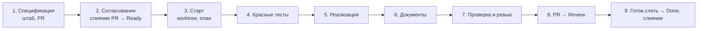

# Studhub — процесс разработки

> Статус: согласовано (2026-11-11). Документ описывает, **как** мы делаем продукт. Что делаем — в [`product-concept.md`](product-concept.md), [`use-cases.md`](use-cases.md), [`screens.md`](screens.md), [`technical-design.md`](technical-design.md).

## 1. Принципы

1. **Документы — источник истины.** Код реализует то, что описано. Если по ходу работы поведение или решение меняется, сначала правим документ (в том же PR), потом код.
2. **Спецификация → тесты → код.** Ни одна задача не берётся в работу без критериев приёмки и плана тестов. Тесты по критериям пишутся до реализации.
3. **Одна задача — один вертикальный срез — одна сессия — один PR.** Срез проходит все слои (миграция, домен, API, UI, тесты) и даёт работающую функцию.
4. **Маленькие шаги.** Задача — от 0,5 до 2 дней. Больше — делим.
5. **Не больше двух задач в работе одновременно.**
6. **После каждого этапа — prod, демо и ретро.**

## 2. Иерархия документов

```
product-concept.md        зачем и что (функционал, стадии)
  └─ use-cases.md         сценарии UC-xx: что делает пользователь и как отвечает система
       └─ screens.md      экраны Э/Ш/Ф/М: что видно и какие действия
            ├─ design-system.md   как выглядит: токены, шрифты, компоненты
            └─ technical-design.md + adr/   модель, правила, API, архитектура
                 └─ backlog/tasks/SH-xxx    задача: срез, критерии приёмки, план тестов
                      └─ тесты → код
```

При противоречии главнее документ выше по дереву. Нашли противоречие — останавливаемся и решаем с владельцем, а не выбираем молча.

**Новое архитектурное решение** (новая библиотека, изменение модели данных или границ, отказ от решения из ТД) оформляется как ADR в `docs/adr/NNNN-slug.md` в том же PR.

## 3. Трекер: Backlog.md

Задачи живут в репозитории в `backlog/` и меняются только через CLI `backlog` (не руками).

| Команда | Что делает |
|---|---|
| `backlog browser` | Канбан-доска в браузере (http://localhost:6420) |
| `backlog board` | Доска в терминале |
| `backlog task list --status "Ready" --plain` | Задачи, готовые к работе |
| `backlog task view SH-017 --plain` | Задача целиком |
| `backlog milestone list` | Этапы и их готовность |

### 3.1 Статусы

| Статус | Значит | Кто переводит |
|---|---|---|
| **Backlog** | Задача в плане, спецификация не готова или не согласована | — |
| **Ready** | Выполнен Definition of Ready (§5), владелец согласовал спецификацию | Штаб в PR спецификаций (владелец согласует слиянием) или владелец сам в основной папке на `main` перед стартом (§7, шаг 3) |
| **In Progress** | Ведётся работа в отдельной сессии и ветке | Рабочая сессия |
| **Review** | PR открыт, CI зелёный, критерии отмечены с доказательствами | Рабочая сессия |
| **Done** | Владелец сказал, что готов слить PR; Definition of Done отмечен | Рабочая сессия последним коммитом в ветке задачи |

Backlog.md хранит задачи файлами в репозитории: каждая смена статуса становится коммитом, а `main` защищён. Поэтому статус Ready штаб коммитит в ветку спецификаций, и он попадает в `main` слиянием PR спецификаций (§7, шаги 1–2). Если владелец поставил Ready сам в основной папке, штаб коммитит эту правку первым коммитом в ветку задачи (§7, шаг 3). Все статусы после Ready рабочая сессия коммитит в ветку задачи, и в `main` они попадают вместе со слиянием её PR. Отдельный PR на закрытие задачи не нужен. Порядок закрытия описан в §7, шаг 9.

### 3.2 Вехи, метки, приоритеты

- **Вехи** двух видов (ТД §15):
  - этапы плана реализации MVP: «Этап 0 — каркас и проверка рисков» … «Этап 7 — финиш»;
  - вехи стадий после MVP: сейчас «Стадия 2 — закрытая бета». Работа, вынесенная за пределы MVP, лежит здесь: на доске эта веха идёт после этапа 7, и пока в этапах 0–7 есть незавершённые задачи, её задачи не берём. Веху следующей стадии заводим, когда появляется её первая задача.
- **Метки:**
  - слой: `infra`, `backend`, `frontend`, `db`, `docs`, `legal`, `spike`, `landing`, `pwa`;
  - модуль: `auth`, `workspaces`, `students`, `schedule`, `billing`, `context`, `materials`, `messages`, `reports`, `analytics`, `compliance`.
- **Тип:** `feature`, `task`, `chore`, `spike`, `bug`, `docs`.
- **Зависимости** (`--dep`) задают порядок. Задачу нельзя брать, пока зависимости не в Done.

### 3.3 Планирование «катящейся волной»

- Все этапы MVP разбиты на задачи с названием, ссылками на UC и экраны и кратким описанием.
- Полные спецификации (критерии приёмки и план тестов) пишутся на **один этап вперёд**: пока идёт этап N, готовим этап N+1.
  - Текущим считается самый ранний этап, в котором ещё есть задачи не в Done (сейчас Этап 0, `m-0`). Следующий этап идёт за ним (сейчас Этап 1, `m-1`).
  - Задача, которую создают или переносят в текущий или следующий этап, с самого начала содержит «Что нужно сделать», «Зачем», критерии приёмки и план тестов по §4.
  - Задачи более поздних этапов остаются краткими. Существующие задачи не переписываем: их достраивает штаб, когда приходит их этап.

## 4. Структура задачи

**Название:** глагол + результат («Вход через Яндекс ID»).

**Описание** (`-d`), разделы по порядку:

```markdown
## Что нужно сделать
Нумерованный список работ для исполнителя (живого разработчика): что создать, настроить,
сверстать, какие тесты написать, что проверить вручную, какие документы обновить.
Каждый шаг — конкретное действие в повелительном наклонении. Шаги, которые делает
владелец (покупки, регистрации), помечены «Владелец:». Это не замена плана реализации:
исполнитель уточняет подход при старте задачи (`--plan`).

## Зачем
Проблема или потребность, которую закрывает задача. Не пересказывает критерии.

## Контекст
- Сценарии: UC-01 (шаги 3–6, 4а, 5а)
- Экраны: Э-01
- Правила: ТД §4.2, ADR-0006

## Не входит
Что явно не делаем в этой задаче (и в какой задаче сделаем).

## Контракт
Новые и изменённые эндпоинты, таблицы и миграции, события.

## План тестов
| AC | Уровень | Тест |
|---|---|---|
| 1 | API | вход новым пользователем создаёт user и auth_identity |
```

В колонке AC — номер критерия или диапазон («1–5»). Уровень — один из §8.1 (Юнит, API, E2E) или «Ручная», «Ревью», «Скрипт» для критериев, которые тестом не проверить. Для тестовых уровней `pnpm ac:check` требует метку в тестах (§8.2).

**Критерии приёмки** (`--ac`): каждый — одно проверяемое утверждение в форме «Дано … Когда … Тогда …» или короткое утверждение о результате. Нумерация — порядковая в Backlog.md (AC #1, #2, …). Детали поведения не копируем из UC, а ссылаемся на шаг.

**Definition of Done** подставляется в каждую задачу автоматически (из `backlog/config.yml`). Особые пункты добавляются через `--dod`.

**Оценка** — первая строка заметок при старте: `Оценка: 6 ч`. При завершении добавляется `Факт: 8 ч`.

## 5. Definition of Ready

Задачу переводят в Ready, когда:

- [ ] у неё есть список работ «Что нужно сделать» и раздел «Зачем»;
- [ ] есть ссылки на UC, экраны и разделы ТД;
- [ ] перечислено, что не входит;
- [ ] описаны изменения контракта (API, БД);
- [ ] критерии приёмки проверяемые, у каждого есть строка в плане тестов;
- [ ] зависимости в Done или в работе с понятным сроком;
- [ ] задача укладывается в 2 дня;
- [ ] владелец прочитал задачу в PR спецификаций и согласовал её слиянием этого PR (штаб до слияния оставляет Ready только у задач, которые предлагает к работе).

Структуру задачи проверяет скрипт `pnpm spec:check` (`scripts/check-spec.mjs`). Он проверяет разделы шаблона §4, строку плана тестов у каждого критерия, уровни из §8.1 и зависимости (задача есть, веха не позже, «зависит от SH-NNN» записано в зависимостях). Он предупреждает о шагах владельца без «Владелец:», о зависимости Ready-задачи не в Done, In Progress и Review и о задаче с более чем 10 критериями. Смысл критериев, срок в 2 дня и чтение задачи владельцем скрипт не проверяет. Режимы: `pnpm spec:check SH-NNN` (указанные задачи в любом статусе), `pnpm spec:check` (все задачи в Ready), `pnpm spec:check --changed` (Ready-задачи, изменённые относительно `origin/main`). На каждом PR CI запускает режим `--changed`. Порядок работы штаба над спецификацией описывает скилл [`.claude/skills/sh-spec/SKILL.md`](../.claude/skills/sh-spec/SKILL.md). Скилл отсылает к §4 и §5 и не копирует их.

## 6. Definition of Done

Те же пункты, что в `backlog/config.yml`:

1. Каждый критерий приёмки покрыт тестом с ID критерия в названии, все тесты зелёные.
2. CI зелёный.
3. Документы обновлены в этом же PR, если поведение или решения изменились.
4. Новые эндпоинты покрыты тестом изоляции, в логах и событиях нет ПДн, деньги только в minor units.
5. Пройдено ревью, замечания закрыты.
6. PR слит через squash, изменения в prod. Сессия отмечает пункт в коммите Done, сразу перед слиянием (§7, шаг 9).
7. В заметках задачи — оценка, факт, решения и итоговое резюме.

## 7. Жизненный цикл задачи

Работа идёт в двух видах сессий Claude:
- **Штаб** — одна долгая сессия: ведёт бэклог, пишет спецификации, запускает рабочие сессии по команде владельца, принимает результаты. Спецификации пишет в своём worktree и ветке `specs-<тема>`, а не в основной папке. Основную папку не правит, кроме старта задачи (§7, шаг 3: ветка и коммит файла задачи): в ней владелец запускает `pnpm sync` и `pnpm status` ([README.md](../README.md#основная-папка-pnpm-sync-и-pnpm-status)).
- **Рабочая сессия** — одна на задачу, в отдельном git worktree и ветке.

**Старт выполнения задачи ручной.** Штаб запускает рабочую сессию или `sh-worker` только по прямой команде владельца («запусти SH-NNN»). Автоматический старт не строим: хуки, расписания, скрипты и циклы, которые сами запускают задачи, не добавляем.



1. **Спецификация.** Штаб пишет описание и критерии по шаблону §4 в своей ветке `specs-<тема>` в отдельном worktree. Задачи, которые предлагает взять в работу, переводит в Ready (`backlog task edit SH-017 -s Ready`) уже в этой ветке. Открывает PR «Спецификации: SH-017, SH-018» на одну или несколько задач. Перед PR запускает `pnpm spec:check` для своих задач и исправляет ошибки (§5). После зелёного `pnpm spec:check` вызывает критика `sh-spec-critic` на каждую задачу PR (подраздел «Проверка спецификации: sh-spec-critic»); порядок шагов — в скилле `sh-spec`.
2. **Согласование.** Владелец читает задачи в дифф PR, просит правки комментариями и сливает PR. Слияние означает согласование: статус Ready попадает в `main` вместе с ним. Задачи, которые владелец не согласовал, штаб убирает из PR или возвращает в Backlog (`-s Backlog`) до слияния.
3. **Старт.** По команде владельца штаб и затем воркер идут по шагам:
   1. Владелец ставит задаче статус Ready в основной папке на `main`. Правка может остаться незакоммиченной. Если Ready уже в `main` (слит PR спецификаций), этот шаг пропускается.
   2. В сессии штаба, открытой из основной папки на `main`, владелец просит взять задачу в работу («запусти SH-NNN»).
   3. Штаб создаёт ветку `sh-NNN-<короткое английское имя по смыслу названия>`, например `sh-017-oauth-yandex`, командой `git switch -c` от актуального `origin/main` (сначала `pnpm sync`, если локальный `main` отстаёт; [README.md](../README.md#основная-папка-pnpm-sync-и-pnpm-status)). Незакоммиченная правка статуса переходит в ветку вместе с ним.
   4. Штаб коммитит в ветке только файл задачи (`git add <файл>`, сообщение `chore(backlog): SH-017 в Ready`) и возвращается на `main`. Если Ready уже в `main`, коммитить нечего: ветка создаётся от `main`.
   5. Штаб создаёт новую сессию (приложение даёт ей свой worktree) и вызывает в ней `sh-worker` с промптом «Новый старт SH-NNN». В промпт передаёт ID задачи, имя ветки и особенности из брифа.
   6. Воркер переключается на ветку задачи командой `git switch sh-NNN-…`, сам её не создаёт и ведёт всю работу только в ней. Дальше он:
      - `backlog task edit SH-017 -s "In Progress" -a @claude`;
      - изучает код и записывает план (`--plan`) и оценку (`--notes "Оценка: …"`);
      - если план меняет продуктовое или архитектурное решение, показывает владельцу и ждёт ответа.

   **Условие старта.** Штаб стартует задачу только из основной папки на `main`. В другой ветке или worktree (включая `specs-…`) он не стартует и сообщает об этом владельцу: версии файлов расходятся. Если `git switch` останавливается из-за других незакоммиченных правок, штаб ничего не обходит (не коммитит чужое, не сбрасывает, не прячет) и сообщает владельцу.
4. **Красные тесты.** По каждому критерию пишется тест (§8), тесты падают по правильной причине (нет эндпоинта, неверный ответ), а не из-за ошибки в тесте. Отдельный коммит: `test(auth): SH-017 тесты по критериям приёмки`.
5. **Реализация** до зелёных тестов, затем рефакторинг. Маленькие коммиты.
6. **Документы.** Если поведение отличается от UC, экранов или ТД — правим документ. Новое решение — ADR.
7. **Проверка.**
   - Все проверки локально одной командой `pnpm verify`: `pnpm check` и тесты, при успехе печатает только итог.
   - Проверка тестов агентом `sh-verifier` (§7.1): тесты подтверждают критерии и не ослаблены после красного коммита.
   - `/code-review` по диффу ветки, замечания исправлены.
   - Каждый критерий отмечается (`--check-ac`) только при доказательстве: зелёный тест, запуск в браузере.
   - Заметки: решения по ходу, факт времени. Итоговое резюме (`--final-summary`).
8. **PR.** Заголовок `SH-017: Вход через Яндекс ID`, описание по шаблону `.github/pull_request_template.md`: ссылка на задачу, что сделано, как проверено, что изменилось в документах, чек-лист ревью §10. Статус → Review (`backlog task edit SH-017 -s Review`): сессия коммитит его в ветку задачи (`chore(backlog): SH-017 на ревью`) и пушит.
9. **Закрытие и слияние.**
   1. Владелец смотрит дифф и пишет сессии, что готов слить.
   2. Сессия ставит статус Done и отмечает пункты Definition of Done «CI зелёный», «ревью» и «PR слит»: `backlog task edit SH-017 -s Done --check-dod 2 --check-dod 5 --check-dod 6`. Номера пунктов она сверяет с `backlog/config.yml` или выводом `node scripts/task.mjs SH-017` до отметки. Коммитит это последним коммитом в ветку задачи (`chore(backlog): SH-017 в Done`) и пушит.
   3. Владелец сливает PR через squash. Статус Done попадает в `main` вместе с кодом задачи.
   4. После слияния GitHub удаляет ветку сам. Ветку, worktree и сессию задачи после слияния убирает штаб, а не сама сессия: §7.1, шаг 7.

   Если после коммита Done владелец просит правки, сессия возвращает статус Review, снимает отметки DoD, поставленные вместе с Done (`backlog task edit SH-017 -s Review --uncheck-dod 2 --uncheck-dod 5 --uncheck-dod 6`), и коммитит это. Потом правит, пушит и ждёт, пока владелец снова напишет, что готов слить. Перед слиянием сессия опять ставит Done последним коммитом.

**Изменение объёма.** Нашли работу за рамками критериев — не делаем молча. Спрашиваем владельца: расширить задачу или завести новую (в Backlog).

**Ошибка в спецификации.** Если критерий неверен или противоречит документам — останавливаемся, правим критерий с согласия владельца, потом тест, потом код. **Менять тест под код без изменения критерия нельзя.**

**Шаги владельца.** Шаги с пометкой «Владелец:» (покупки, регистрации, ключи, юридические действия) владелец делает по ходу работы над задачей, а не до Ready. Рабочая сессия идёт по списку «Что нужно сделать». Дойдя до шага владельца, она останавливается и пишет владельцу в чат, что сделать и что передать сессии: доступ, имя секрета, адрес. В заметки задачи она добавляет строку «Ждёт владельца: …» и ждёт ответа. Статус остаётся In Progress. Агент не покупает, не регистрирует аккаунты и не вводит ключи и пароли: секреты владелец кладёт в хранилище сам и сообщает сессии только их имена.

### 7.1 Агент sh-worker

Тяжёлую работу по задаче рабочая сессия отдаёт субагенту `sh-worker` ([`.claude/agents/sh-worker.md`](../.claude/agents/sh-worker.md)). Его первый запрос занимает около 10 тыс. токенов, у обычной сессии около 77 тыс.: у агента свой короткий системный промпт, только инструменты Read, Edit, Write и Bash, нет описаний скиллов и MCP. Чеклисты старта и финиша он получает из скилла [`sh-task`](../.claude/skills/sh-task/SKILL.md). Хук агента блокирует правку файлов в `backlog/`: задачи меняются только через CLI. Штаб и другие сессии проекта работают как раньше, агент включается только вызовом.

Как работают сессия задачи и агент:

1. Старт идёт по порядку §7, шаг 3, и только по команде владельца. Штаб работает из основной папки на `main`: создаёт ветку `sh-NNN-<короткое английское имя>` (`git switch -c`), коммитит в ней только файл задачи (`chore(backlog): SH-NNN в Ready`), если Ready не закоммичен, и возвращается на `main`. Затем создаёт новую сессию и вызывает в ней агента через Agent: `subagent_type: sh-worker`, промпт «Новый старт SH-NNN», с ID задачи, именем ветки и особенностями из брифа одной строкой. Процесс и блок `СТОП` в промпте не пересказывает: они уже в описании агента. Из другой ветки или worktree (включая `specs-…`) штаб не стартует и сообщает владельцу. Если `git switch` останавливается из-за других незакоммиченных правок, штаб ничего не обходит и сообщает владельцу. Приложение создаёт worktree новой сессии на ветке `claude/…`, поэтому воркер до работы по задаче переключается на ветку задачи: `git switch sh-NNN-…`. Сам ветку не создаёт, в ветке не `sh-NNN-…` останавливается. Автоматического старта нет: хуки, расписания, скрипты и циклы, запускающие задачи, не добавляем.
2. Агент проходит §7 с шага 3 по шаг 7: план и оценка, красные тесты, реализация, документы, `pnpm verify`, отметка критериев с доказательствами, заметки и итог. Коммитит сам, не пушит.
3. Агент не может спросить владельца: у субагентов нет AskUserQuestion. В точке остановки он завершается и возвращает блок `СТОП SH-NNN` с вопросом и вариантами. Точки остановки: задача не в Ready, шаг «Владелец:», план меняет решение из ТД или ADR, работа вне критериев, неверный критерий или противоречие в документах, зависимость не в Done.
4. Сессия задачи задаёт вопрос владельцу и передаёт ответ дословно. Если агент ещё доступен, через SendMessage по его имени или ID: «Ответ владельца: …». Иначе новым вызовом с промптом «Продолжение SH-NNN. Ответ владельца: …»: агент продолжит по плану и заметкам задачи и по коммитам ветки.
5. Когда агент вернул `ГОТОВО SH-NNN`, сессия задачи сначала вызывает `sh-verifier` (подраздел ниже), потом `/code-review`. Замечания верификатора и ревью она передаёт `sh-worker` тем же способом, что и ответы владельца. Если верификатор вернул «не подтверждён» или нарушения, после правок она запускает его повторно и только потом `/code-review`. Затем сессия коммитит статус Review, пушит ветку и открывает PR (шаг 8).
6. Когда владелец пишет, что готов слить, сессия задачи ставит Done последним коммитом в ветке, пушит (шаг 9) и сообщает штабу, что воркер закончил и задача в Done. Агент статусы Review и Done не меняет.
7. Закрытие цикла ведёт штаб, а не сессия задачи. Владелец сливает PR сам. Сессия задачи после Done сообщает штабу, что воркер закончил и задача в Done (до слияния), и сама ничего не удаляет и себя не архивирует. Штаб запускает `pnpm close-task SH-NNN --apply` в основной папке, когда сессия сообщила о Done или владелец написал штабу, что PR слит. Скрипт `scripts/close-task.mjs` перед проверками делает `git fetch --all --prune` и строит вердикт:
   1. PR слит: `gh pr list --state all` находит PR с названием `SH-NNN: …`, его `state` равен `MERGED`.
   2. В `origin/main` у задачи статус Done: `git grep -n "^status:" origin/main -- "backlog/tasks/sh-NNN -*"` (пробел перед `-*` обязателен: без него SH-08 совпал бы с SH-080 и SH-081). Файлы рабочей папки скрипт не читает: в основной папке они устарели. Если в `origin/main` больше одного файла задачи, статус неоднозначен и вердикт «нет».
   3. Все проверки PR (`statusCheckRollup`) завершились `SUCCESS`, `SKIPPED` и `NEUTRAL` допустимы.
   4. Вердикт «да»: `--apply` перематывает локальный `main` до `origin/main`, удаляет worktree задачи (на её ветке или на отсоединённой голове, если сессия перешла на `origin/main` командой `git switch --detach origin/main`), если он чистый, и локальную ветку PR (`git branch -D`: после squash `-d` не сработает), печатая её SHA. Штаб архивирует сессию задачи (`archive_session`, приложение спросит подтверждение).
   5. Основную папку скрипт берёт из первой записи `git worktree list --porcelain`, поэтому он работает и из других папок. Из worktree задачи он не удаляет этот worktree и его ветку, остальное делает и отвечает `ЗАКРЫТЬ СЕССИЮ: нет (worktree этой сессии убирает штаб из основной папки)`, код 1: штаб повторяет запуск из основной папки. Чужой worktree скрипт не трогает.
   6. Вердикт «нет» или код 2: штаб ничего не архивирует и один раз пишет владельцу, чего не хватает (PR не слит, статус не Done, checks, грязный worktree, `main` не перематывается). Когда владелец исправит и напишет, штаб запускает команду повторно. Без `--apply` скрипт ничего не меняет.

   Вывод скрипта не длиннее 12 строк, последняя строка `ЗАКРЫТЬ СЕССИЮ: да` или `ЗАКРЫТЬ СЕССИЮ: нет (<причина>)`. Коды выхода: 0, 1 («нет») и 2 (`gh` недоступен, PR не найден или найдено несколько). Запуск остаётся ручным действием штаба, автоматики по событию нет.

#### Проверка тестов: sh-verifier

Независимую проверку тестов делает субагент `sh-verifier` ([`.claude/agents/sh-verifier.md`](../.claude/agents/sh-verifier.md)). `/code-review` ищет ошибки в коде, а `pnpm ac:check` проверяет только, что у критерия есть тест с меткой. Что тест проверяет именно критерий и что его не подогнали под код после коммита красных тестов, видит только верификатор.

- Вход: только ID задачи (`subagent_type: sh-verifier`, промпт «Проверь SH-NNN»). Плана, заметок и разговора с `sh-worker` он не видит. Задачу читает командой `node scripts/task.mjs SH-NNN --criteria`: критерии приёмки и таблица «План тестов».
- Инструменты: Read, Bash, Grep, Glob, модель sonnet. Хук [`verifier-bash-guard.mjs`](../scripts/hooks/verifier-bash-guard.mjs) пропускает команды чтения и запуск тестов, остальное блокирует кодом 2. Рабочее дерево, ветки и история не меняются.
- Порядок: дифф `git diff origin/main...HEAD`, коммит `test(…): SH-NNN тесты по критериям приёмки`, тесты с меткой `[SH-NNN AC-n]` по каждому критерию с автоматическим уровнем, сравнение тестов в коммите красных тестов и в `HEAD`, запуск тестов задачи. Критерии с уровнем «Ручная», «Ревью» и «Скрипт» он не оценивает, а перечисляет как непроверенные.
- Отчёт `ПРОВЕРКА SH-NNN`: по каждому критерию вердикт «подтверждён», «сомнительно» или «не подтверждён», файл и строка теста, одна фраза почему; отдельно нарушения правила «менять тест под код без изменения критерия нельзя».
- Сессия задачи передаёт замечания `sh-worker`, после правок запускает верификатор повторно, если были «не подтверждён» или нарушения. «Сомнительно» она разбирает сама: исправляет тест или записывает в заметки, почему оставила. Краткий итог проверки (вердикты и нарушения) она записывает в заметки задачи: `backlog task edit SH-NNN --append-notes "Проверка тестов: …"`.
- Верификатор не заменяет `/code-review` и не запускается в CI.

#### Проверка спецификации: sh-spec-critic

Смысл спецификации проверяет субагент `sh-spec-critic` ([`.claude/agents/sh-spec-critic.md`](../.claude/agents/sh-spec-critic.md)). Скрипт `pnpm spec:check` проверяет форму: разделы, план тестов, зависимости. Критерий «интерфейс удобный» проходит все его проверки, а тест на него написать нельзя. Расхождение с ТД или `use-cases.md` иначе находит исполнитель, и его работа останавливается блоком `СТОП`. Критик находит такие места до PR.

- Вход: только ID задачи (`subagent_type: sh-spec-critic`, промпт «Проверь спецификацию SH-NNN»). Один вызов проверяет одну задачу; несколько задач PR можно проверять параллельно. Рассуждений штаба, плана и заметок критик не видит: задачу читает командой `node scripts/task.mjs SH-NNN --spec` (заголовок, описание, критерии приёмки).
- Инструменты: Read, Bash, Grep, Glob, модель sonnet. Хук [`verifier-bash-guard.mjs`](../scripts/hooks/verifier-bash-guard.mjs) в режиме `--mode spec-critic` пропускает команды чтения, `node scripts/task.mjs` и `node scripts/doc.mjs`. Запуск тестов (`pnpm`, `vitest`) он блокирует кодом 2: критику тесты не нужны. Файлы, ветки и история не меняются.
- Порядок: задача; задачи из зависимостей, «Контекста» и «Не входит» (нет дублей и пропусков между задачами); разделы документов из «Контекста» и найденные `grep` по `docs/`; поиск непроверяемых критериев, противоречий с документами и пропусков.
- Отчёт `КРИТИКА SH-NNN`: непроверяемые критерии с предложением, как переписать; противоречия с документом, разделом и указанием, какой документ главнее; пропуски; вердикт «можно в PR» или «нужны правки (блокирует: N, замечаний: M)». «Блокирует»: непроверяемый критерий и противоречие с документом, которое задача не меняет. «Замечание»: пропуск, формулировка, изменение решения. Если задача сама меняет документ (есть шаг и критерий про правку), расхождение записано как замечание: владелец увидит его в PR.
- Штаб вызывает критика после зелёного `pnpm spec:check`. Пункты «блокирует» он исправляет и вызывает критика повторно. Замечание, которое штаб не принимает, он молча не отклоняет: в описании PR спецификаций пишет вердикт критика по каждой задаче и непринятые замечания с причиной.
- Критик не заменяет согласование владельцем: владелец читает и сливает PR как раньше. Критик не запускается в CI и не проверяет задачи вне PR спецификаций. Размер задачи он не оценивает.

Шаблон брифа рабочей сессии (его пишет штаб). Процесс в брифе не пересказываем: он описан здесь.

```
Задача SH-NNN. Процесс: docs/process.md §7.1.
Особенности: <несколько строк: решения владельца по задаче, чего не трогать, на что обратить внимание>
```

Плагины проекта. Из шести плагинов аккаунта проекту нужен только `mattpocock-skills@synced` (`grilling`, `research`, `domain-modeling`). Остальные пять (`one-shot-prompting@synced`, `zizi-skills@synced`, `design-skills@synced`, `vectorlab-ux-skills@synced`, `frontend-design@synced`) заточены под другой стек или навязывают свои TDD, планы и работу с ветками, которые спорят с этим документом. Они дают около 110 скиллов и 6 агентов. Замер в приложении: отключение в аккаунте сократило скиллы с 9,9 до 7,1 тыс. токенов и агентов с 2,8 до 0,26 тыс., всего около 5,3 тыс. Список скиллов у приложения упирается в потолок около 1% окна, поэтому отключение части плагинов может не уменьшить строку «Скиллы»: освободившееся место занимают другие скиллы.

- **Приложение (Claude Desktop).** `enabledPlugins` из `.claude/settings.json` и `.claude/settings.local.json` оно не учитывает: замеры показали, что в сессии на ветке с этим файлом плагины загружены. Плагины выключает и включает владелец в настройках плагинов аккаунта (приложение или claude.ai). Настройка действует в новой сессии.
- **CLI `claude`.** Учитывает `enabledPlugins` из `.claude/settings.json`: `claude plugin list` в папке проекта показывает пять плагинов как `disabled`, `mattpocock-skills@synced` как `loaded`. Нужен отключённый плагин для задачи на интерфейс: включаем его для себя в личном `.claude/settings.local.json` (личный файл, его не коммитим) записью `"enabledPlugins": { "<имя>@synced": true }`, например `"design-skills@synced": true`. Общий `.claude/settings.json` не меняем.

Правила экономии контекста для любой сессии задачи:

- Задачу читаем через `node scripts/task.mjs SH-NNN`: тот же текст, что в `backlog task view --plain`, без дерева зависимых задач.
- Большие документы читаем по разделам: `node scripts/doc.mjs td 4.1`, `node scripts/doc.mjs uc UC-01`, `node scripts/doc.mjs screens Э-01`. Без раздела скрипт печатает список разделов. ТД, `use-cases.md` и `screens.md` целиком не читаем.
- Проверки запускаем через `pnpm verify`.

Локальные переменные окружения (например, `POSTGRES_PORT=5434`, если порт 5432 занят) владелец пишет в `.env` основной папки клона. Хук SessionStart ([`scripts/hooks/session-env.mjs`](../scripts/hooks/session-env.mjs)) в начале каждой сессии берёт оттуда переменные и передаёт их командам сессии, в том числе в новом worktree. Свой `.env` в worktree важнее.

Хук передаёт только переменные из списка `ALLOWED` в скрипте: `POSTGRES_PORT`, `DATABASE_URL`, `TEST_DATABASE_URL`. Остальное из `.env` (ключи, секреты, `NODE_ENV`) он пропускает и значения не печатает. Новую переменную добавляем в этот список и сюда. Если `.env` нет, хук молча ничего не делает. Агенты `.env` не создают и не читают.

## 8. Тесты

### 8.1 Уровни

По ТД §14:

| Уровень | Что проверяет | Где |
|---|---|---|
| Юнит (домен) | Правила: переходы статусов, начисления, генерация слотов, цены по дате | `apps/api/src/modules/*/domain/*.test.ts` |
| Юнит (клиент) | Раскладка календаря, форматирование, шаблоны, deep links | `packages/client-core/**/*.test.ts` |
| API | Сценарии через HTTP, чёрным ящиком, через сгенерированный клиент, на реальном Postgres | `tests/api/` |
| E2E | Сценарии с ✓ в `use-cases.md` §3 через интерфейс | `tests/e2e/` |

Правила выбора уровня: правило или расчёт — юнит; поведение API, права, изоляция — API-тест; путь пользователя через экраны — E2E. Каждый критерий проверяется **на самом низком уровне, где его можно проверить честно**.

### 8.2 Именование и трассировка

Каждый тест по критерию начинается с метки задачи и критерия:

```ts
it('[SH-017 AC-3] повторный вход не создаёт нового пользователя', async () => { … })
```

- Один критерий может покрываться несколькими тестами, один тест — несколькими критериями (`[SH-017 AC-3, AC-4]`).
- Вспомогательные и регрессионные тесты пишутся без метки.
- Скрипт `scripts/check-ac-coverage.mjs` (`pnpm ac:check`) проверяет, что у каждой задачи в статусе Review и Done каждый критерий упомянут меткой хотя бы в одном файле тестов (`*.test.*`, `*.spec.*`). Скрипт входит в CI и падает со списком непокрытых критериев.
- Метку не требуют критерии, которые по таблице «План тестов» (§4) проверяются на уровне «Ручная», «Ревью» или «Скрипт»: скрипт печатает их как пропущенные. Остальные уровни (Юнит, Unit, API, E2E и любые другие) требуют метку. Если у критерия несколько строк в плане и хотя бы одна из них тестовая, метка нужна. Если таблицы в задаче нет или критерия в ней нет, метка тоже нужна.

### 8.3 Прочие правила

- API-тесты не импортируют код сервера: только HTTP и сгенерированный клиент.
- Вход в тестах — через тестового OAuth-провайдера, включённого только в тестовом окружении.
- Время в тестах управляемое (фиксированные часы), никаких `sleep`.
- Каждый новый эндпоинт кабинета автоматически попадает в тест «чужой кабинет → 404».
- Ошибка в prod → сначала тест, который её воспроизводит, потом исправление.

## 9. Git

- **Ветки:** `main` защищён. На задачу — ветка `sh-017-slug` в отдельном worktree.
- **Коммиты:** [Conventional Commits](https://www.conventionalcommits.org/ru/) на русском или английском:
  - типы: `feat`, `fix`, `test`, `refactor`, `docs`, `chore`, `ci`, `build`;
  - область — модуль или слой: `feat(schedule): …`, `ci: …`;
  - в теле или заголовке — ID задачи.
- **PR:** один на задачу, заголовок `SH-017: <название задачи>`. Спецификации идут отдельным PR штаба: «Спецификации: SH-017, SH-018» (§7, шаги 1–2), описание по шаблону `.github/pull_request_template.md`. Слияние через squash только при зелёном CI. Статус Done входит в этот же PR (§7, шаг 9).
- **CI:** workflow `.github/workflows/ci.yml` запускается на каждый PR и push в `main`. Задача `checks` выполняет `pnpm check` (Biome и `tsc`), `pnpm db:check` (схема совпадает с миграциями), `pnpm ac:check` (§8.2), на PR ещё `pnpm spec:check --changed` (§5) и `pnpm test` на Postgres 18 в контейнере. Упавший шаг делает проверку красной, остальные шаги всё равно выполняются, чтобы в одном прогоне были видны все ошибки. Защита `main` требует зелёную проверку `checks`. Новые проверки ТД §12 добавляют задачи, которые создают проверяемое: OpenAPI-клиент и API-тесты (SH-006), E2E (SH-008), сборка образа (SH-011).
- **Пути для CI и деплоя.** Что запускать, решают изменённые файлы, а не имя ветки или заголовок PR: после squash-слияния в `push` имени ветки нет, а код в ветке `specs-…` проверки пропустил бы. Правило записано заранее, чтобы к появлению деплоя и тяжёлых проверок не пересматривать процесс. Пока оно не реализовано: `ci.yml` по-прежнему запускается на каждый PR, деплоя нет (прогон CI занимает около полутора минут).
  - **Деплой** будет отдельным workflow на `push` в `main` с фильтром `paths`. Деплой запускают изменения в `apps/**`, `packages/**`, `infra/**`, `package.json`, `pnpm-lock.yaml`, `pnpm-workspace.yaml`, `.nvmrc` и Dockerfile. Слияние, которое меняет только `backlog/**`, `docs/**`, `.claude/**`, `scripts/**`, `tools/**` или `.github/**`, деплой не запускает. Деплой не входит в обязательные проверки `main`, поэтому фильтр путей ему не мешает. Точный список уточняет задача на деплой (SH-011).
  - **CI** остаётся одним workflow. Проверку `checks` нельзя пропустить фильтром `paths` в `on:`: пропущенная обязательная проверка блокирует слияние. Когда прогон станет тяжёлым (E2E SH-008, образ SH-011, ориентир: дольше 5 минут), вводим «ворота»: первая задача по списку изменённых файлов решает, что запускать, а финальная задача с именем `checks` идёт всегда. PR, где все изменённые файлы лежат в списке «только документы» (`backlog/**` и `docs/**`), получает лёгкий прогон, остальные полный. Из списка исключаем всё, что читают тесты: файл, которого касается тест в `tools/tests`, `scripts` или `packages/*/tests`, лёгкий путь не получает (например, значения токенов тесты SH-073 читают из `docs/design-system.md`). Список сверяют с тестами при создании «ворот» и при каждом новом тесте, который читает документ.
- **Основная папка:** `pnpm sync` приводит её в порядок после слияний PR, `pnpm status` показывает задачи и открытые PR. Флаги и примеры: [README.md](../README.md#основная-папка-pnpm-sync-и-pnpm-status).
- **Очистка локальных веток:** после squash-слияния локальная ветка остаётся, а `git branch --merged` её не находит; такие ветки находит `pnpm git:prune`. Флаги и примеры: [README.md](../README.md#очистка-локальных-веток).
- **Миграции** только вперёд, по схеме «расширить → сжать» (ТД §12).
- **Секреты** не попадают в репозиторий. Шаблон переменных — `.env.example`.

## 10. Ревью

Перед переводом в Review рабочая сессия проверяет:

- [ ] Каждый критерий подтверждён тестом или проверкой в браузере.
- [ ] Границы слоёв (ТД §13) соблюдены: `domain/` чистый, клиент знает только OpenAPI.
- [ ] Бизнес-правила только на сервере.
- [ ] Изоляция: доступ к данным только через `ctx`, тест «чужой кабинет → 404».
- [ ] Деньги в minor units, время в UTC, даты в зоне преподавателя.
- [ ] В логах, событиях и сообщениях об ошибках нет ПДн.
- [ ] Ошибки API в формате `problem+json` с `code`.
- [ ] Нет лишнего: код вне объёма задачи, закомментированный код, TODO без задачи.
- [ ] `/code-review` пройден.

## 11. Этапы, релизы, ретро

После последней задачи этапа:
1. **Релиз:** тег `v0.N.0` (N — номер этапа), `CHANGELOG.md` собирается из коммитов.
2. **Демо:** показ партнёру-преподавателю на prod, его замечания — новые задачи в Backlog.
3. **Ретро:** 15 минут, запись в [`retro.md`](retro.md): что помогло, что мешало, что меняем в процессе. Изменения процесса вносятся в этот документ.
4. **Калибровка:** сравнить сумму оценок и факта задач этапа, поправить ориентиры следующих этапов.
5. **Следующая волна:** штаб готовит спецификации задач этапа N+2.
