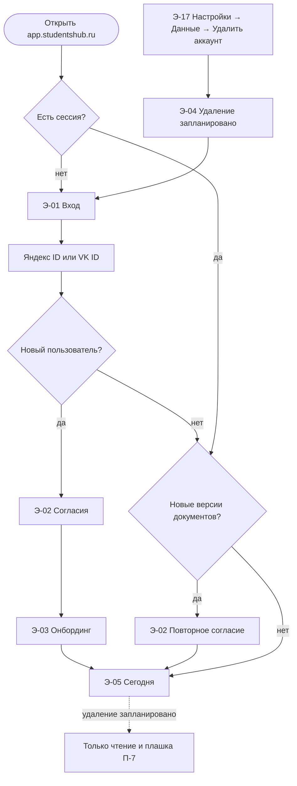
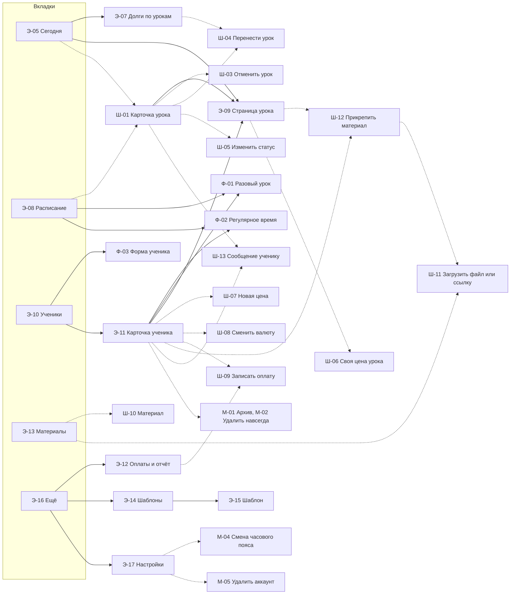

# StudentsHub — экраны MVP

> Статус: согласовано (2026-11-11). Вопросы В-1…В-4, В-14 и В-15 решены, после согласования добавлены решения Р-12 и Р-13, допущения В-5…В-13 подтверждены. Решения и предложения по API (раздел 6) перенесены в ТД, сценарии и концепцию 2026-11-11.
> Функционал описан в [`product-concept.md`](product-concept.md), сценарии — в [`use-cases.md`](use-cases.md) (ссылки «UC-xx»), правила, модель данных и API — в [`technical-design.md`](technical-design.md) (ссылки «ТД §x»).
> Документ описывает поведение и содержимое экранов. Цвета, шрифты, размеры и макеты задаёт [`design-system.md`](design-system.md).

## 1. Как читать документ

**Виды элементов интерфейса и их идентификаторы:**

| Префикс | Что это | Телефон (М) | Компьютер (Д) |
|---|---|---|---|
| **Э-xx** | Экран с собственным адресом | Полный экран | Область справа от боковой панели |
| **Ш-xx** | Шторка: быстрое действие поверх текущего экрана | Нижняя шторка | Боковая панель справа, экран под ней остаётся виден |
| **Ф-xx** | Форма с несколькими полями | Полный экран с кнопками «Отмена» и «Сохранить» | Модальное окно |
| **М-xx** | Подтверждение или сводка | Модальное окно | Модальное окно |
| **П-xx** | Сквозной паттерн (раздел 4) | | |

**Обозначения:**
- (М) — телефон, (Д) — компьютер (широкий экран). Планшет в портретной ориентации ведёт себя как телефон.
- «\*» — обязательное поле.
- `…/` в путях API — префикс `/api/v1/workspaces/{wid}/` (ТД §6.1).
- Состояния экрана (загрузка, ошибка, нет сети, только чтение) по умолчанию работают по П-8. В карточке экрана указаны только отличия.

**Шаблон карточки экрана:** назначение · откуда на него попадают · блоки и поля · действия (→ UC) · API · состояния · отличия (М) и (Д).

## 2. Решения, принятые при описании экранов

Эти решения согласованы с пользователем 2026-11-11 и дополняют источники истины.

| # | Решение | Затрагивает |
|---|---|---|
| Р-1 | **У урока одна страница** `/lessons/{id}` (Э-09) и шторка быстрых действий Ш-01. Отдельного экрана или блока «Подготовка» нет: подготовка — это правка полей урока (план на урок, материалы, место встречи). «Следующий урок» — та же страница для ближайшего урока. С начала урока вверху страницы появляется блок итога | UC-21, UC-27, UC-28; ТД §5.6, §7 |
| Р-2 | **Место встречи** хранится у ученика (по умолчанию для всех его уроков), у урока можно задать своё. Если в поле ссылка, показывается кнопка «Подключиться». Новая переменная шаблонов `{место}`. В iCal место попадает только при выключенных обезличенных событиях | ТД §4.3, §4.4, §4.9; UC-26, UC-43 |
| Р-3 | **Пересечения и сводки изменений показываются до сохранения.** Сервер выполняет команду в режиме `dryRun` и ничего не сохраняет | UC-08, UC-13, UC-17–UC-20, UC-22, UC-23; ТД §5.4, §6.2 |
| Р-4 | **ДЗ выдаётся только из урока**, в блоке итога на странице урока. **ДЗ принадлежит уроку, на котором его проверят**: по умолчанию это ближайший запланированный урок ученика, его можно выбрать из следующих запланированных. Урок, на котором ДЗ выдали, сохраняется для истории. Поле `homework.due_on` не нужно | UC-28, UC-30; ТД §4.7, §5.6 |
| Р-5 | **Пока удаление аккаунта запланировано**, приложение работает только на чтение и показывает плашку с кнопкой «Отменить удаление». Сервер отклоняет изменения с кодом `account_deletion_pending`. iCal-лента не отдаётся | UC-02, UC-05, UC-26; ТД §6.1, §9 |
| Р-6 | **Карточка ученика** — шапка и вкладки «Обзор · Уроки · Деньги · Материалы». На (Д) список учеников и карточка показываются рядом | UC-12–UC-16, UC-30–UC-36, UC-41, UC-45; ТД §7 |
| Р-7 | **На странице урока нет кнопки «Оплата получена».** Оплаты записываются только через шторку Ш-09: отметка урока и оплата остаются разными операциями (ADR-0004) | ТД §4.6 |
| Р-8 | **План на урок хранится только в том уроке, к которому он относится.** В запланированном уроке план можно править. В конце урока появляется поле «План на следующий урок»: текст и урок, на который он назначен (по умолчанию следующий запланированный). Логика та же, что у ДЗ | UC-27, UC-28; ТД §4.7, §5.6 |
| Р-9 | **Статус урока меняется автоматически, явной отметки «Проведён» нет.** Новый статус `in_progress` («Идёт»). Система переводит `scheduled → in_progress` в `starts_at` и `in_progress → completed` в `ends_at` и списывает цену. Если урок не состоялся, преподаватель явно отменяет или переносит его до окончания; «Не пришёл» доступен с начала урока. После окончания «Проведён» можно сменить на «Не пришёл» или отмену, баланс пересчитывается. Нет списка неотмеченных уроков, счётчика «Отметьте» и шторки «Отметить урок». Перенести можно только до окончания урока. Подстраховка от забытой отмены — прошедшие уроки дня видны в блоке «Сегодня» на дашборде со статусом и быстрым «Изменить статус» | UC-21, UC-22, UC-24, UC-25, UC-28, UC-29, UC-46; ТД §4.5, §5.4, §5.7, §12, §15; концепция §3.3 |
| Р-10 | **Активность преподавателя** — доля его уроков, страницу которых он открыл от 2 ч до начала до 24 ч после окончания урока (событие `lesson_opened`). Активен на неделе — открыл ≥ 60% уроков. Критерий стадии 2: «≥ 50% активны на 4-й неделе». Вторая метрика — доля уроков с итогом (резюме, план или ДЗ). «Своевременность отметки» заменяется метрикой «исправления автоматических статусов» | Концепция §6; ТД §11; UC-P1 |
| Р-11 | **Если на дату урока нет цены** (урок раньше первой записи цены), берётся самая ранняя запись цены ученика. Ошибки «нет цены» больше нет | ТД §4.3, §4.5; UC-28 (6а) |
| Р-12 | **Перенос меняет время того же урока.** Статуса «Перенесён» (`rescheduled`) и второго урока нет. Материалы, план и ДЗ остаются на уроке. Перенос пишется в журнал (`lesson_reschedule`): в истории видно «перенесён с вт 12.11 18:00», а изменение слота время такого урока не трогает. Отменить перенос — значит перенести обратно. Новое время может быть в прошлом: так исправляют перенос, сделанный по ошибке. Статус «Перенесён без даты» (`postponed`) остаётся; «Назначить дату» — это обычный перенос, «Отменить перенос» — только до исходного времени | UC-22, UC-23, UC-25; ТД §4.4, §4.5, §5.3, §5.4; ADR-0005; концепция §3.3 |
| Р-13 | **Без сети статус урока уточняется по часам устройства.** Если урок по времени уже начался или закончился, а в кэше он «Запланирован» или «Идёт», показывается ожидаемый статус с пометкой «(обновится при подключении)». Это только отображение в `client-core`: баланс и списания остаются как в кэше | П-8; ТД §8 |

**Что поправлено в других документах** (внесено 2026-11-11, вместе с предложениями по API из раздела 6):
- `use-cases.md`:
  - UC-21: шаг 4 — «Открыть» вместо «Открыть подготовку»;
  - UC-27: подготовка — это страница урока;
  - UC-28 и UC-30: ДЗ и план на следующий урок назначаются на урок, а не на срок; нет «Добавить ДЗ» в карточке ученика;
  - UC-27: план на урок берётся из самого урока;
  - UC-02 и UC-05: режим только чтения;
  - UC-17–UC-23: проверка до сохранения;
  - UC-26 и UC-43: место встречи;
  - UC-26: ссылка iCal показывается один раз (В-1);
  - UC-24, шаг 6: «назначить новый урок» вместо «перенести» (В-3);
  - UC-28 переписать под автоматический статус, UC-29 удалить, UC-21, UC-22, UC-24, UC-25, UC-46 поправить (Р-9);
  - UC-P1: новые метрики (Р-10);
  - UC-22, UC-23, UC-25: перенос меняет время того же урока (Р-12).
- `product-concept.md`: §3.3 — статус `in_progress` и автоматический «Проведён», без напоминания о неотмеченных; §6 — критерий стадии 2 (Р-10).
- `technical-design.md`:
  - §4.3, §4.4: место встречи;
  - §4.7: `lesson_note.plan` вместо `next_plan`; `homework.lesson_id` — урок проверки, новое поле `issued_lesson_id`;
  - §4.5: план и ДЗ делают будущий урок «тронутым»; своя цена у проведённого урока пересчитывает снимок (В-4);
  - §5.4: `dryRun`;
  - §5.6: состав контекста;
  - §6.2: новые эндпоинты;
  - §7: ссылка на этот документ вместо таблицы;
  - §8: кэш расписания;
  - §4.5, §5.4, §5.7: статус `in_progress`, автоматические переходы, удаление понятия «неотмеченный урок» (Р-9);
  - §4.3: цена по умолчанию — самая ранняя (Р-11);
  - §11: метрики активности (Р-10); §12: задача смены статусов раз в минуту; §15: этап 4;
  - §4.4, §4.5, §5.3, §5.4, §6.2: перенос без второго урока, журнал `lesson_reschedule` (Р-12); ADR-0005 — пометка об изменении.

## 3. Карта навигации

### 3.1 Вкладки

| Вкладка | Корневой экран | (М) нижняя панель | (Д) боковая панель |
|---|---|---|---|
| Сегодня | Э-05 `/today` | ✓ | ✓ |
| Расписание | Э-08 `/schedule` | ✓ | ✓ |
| Ученики | Э-10 `/students` | ✓ | ✓ |
| Материалы | Э-13 `/materials` | ✓ | ✓ |
| Ещё | Э-16 `/more` | ✓ | Вкладки нет: «Оплаты и отчёт», «Шаблоны» и «Настройки» стоят отдельными пунктами. Внизу панели — «Написать разработчику», «Установить приложение» и имя преподавателя |

**Правила:**
- Стартовый экран — «Сегодня».
- Нажатие на активную вкладку возвращает к её корневому экрану.
- «Назад» — это история браузера. Шторки и модальные окна закрываются кнопкой «Назад» на Android и жестом вниз (М).
- Пункт «Метрики» (`/admin/metrics`) видят только пользователи с `is_platform_admin`. На (М) он в «Ещё», на (Д) — внизу боковой панели.
- Экраны входа, согласий, онбординга и «Удаление запланировано» показываются без панели навигации.

### 3.2 Адреса экранов

У каждого экрана есть адрес, поэтому на него можно сослаться: iCal ведёт на урок, «Должники» — на вкладку «Деньги» ученика.

| Адрес | Экран | Доступ |
|---|---|---|
| `/login` | Э-01 Вход | Без сессии |
| `/consent` | Э-02 Согласия | Сессия есть, нет действующих согласий |
| `/onboarding/settings`, `/onboarding/students` | Э-03 Онбординг | Сразу после первых согласий |
| `/deletion-scheduled` | Э-04 Удаление запланировано | Без сессии |
| `/today` | Э-05 Сегодня | Сессия |
| `/today/lesson-debts` | Э-07 Долги по урокам | Сессия |
| `/schedule?view=day\|week\|list&date=YYYY-MM-DD` | Э-08 Расписание | Сессия |
| `/lessons/{id}` | Э-09 Страница урока | Сессия; урок кабинета, иначе 404 |
| `/students?status=active\|archived&noConsent=1&sort=name\|debt` | Э-10 Ученики | Сессия |
| `/students/new` | Ф-03 Новый ученик | Сессия |
| `/students/{id}/overview\|lessons\|money\|materials` | Э-11 Карточка ученика | Сессия |
| `/students/{id}/edit` | Ф-03 Изменить ученика | Сессия |
| `/materials?q=&tags=` | Э-13 Материалы | Сессия |
| `/more` | Э-16 Ещё (только М) | Сессия |
| `/more/payments?month=YYYY-MM` | Э-12 Оплаты и отчёт | Сессия |
| `/more/templates`, `/more/templates/{id}` | Э-14 Шаблоны, Э-15 Шаблон | Сессия |
| `/more/settings/profile\|workspace\|login\|calendar\|data` | Э-17 Настройки | Сессия |
| `/admin/metrics/{report}` | Э-18 Метрики платформы | `is_platform_admin`, иначе 404 |

Шторки Ш-xx и модальные окна М-xx собственного адреса не имеют.

### 3.3 Вход в приложение

### 3.4 Экраны, шторки и формы

Сплошная стрелка — переход на экран или форму. Пунктир — шторка или модальное окно.

`/admin/metrics` (Э-18) — отдельная ветка с собственным макетом, без вкладок преподавателя.

## 4. Сквозные паттерны

### П-1 Мгновенный отклик и повтор при сбое сети

ТД §8, §5.7, UC-28 (5а).

**Оптимистичные изменения.** Интерфейс применяет результат сразу и отправляет запрос в фоне. Так работают:
- смена статуса урока (`mark`);
- заметка: резюме и план (`note`);
- теги;
- статус ДЗ;
- цели (отметить, сортировать);
- прикрепление и открепление материала.

**Изменения с ожиданием ответа.** Кнопка показывает «Сохраняется…», повторное нажатие заблокировано. Так работают команды, результат которых считает сервер:
- создание ученика, слота, разового урока;
- перенос;
- оплата;
- изменение слота;
- архивация;
- смена валюты и цены.

**Повтор:**
- Сетевая ошибка или ответ 5xx: повтор с тем же `Idempotency-Key` с паузами 1, 2, 4, 8 и 16 с. Индикатор «Сохраняется…» у изменённого элемента.
- Если не удалось за ~30 с: изменение откатывается, появляется уведомление «Не сохранено. Повторить?». Кнопка «Повторить» отправляет запрос с тем же ключом.
- Бизнес-ошибки (`409`, `422`, `403`) не повторяются. Изменение откатывается, текст ошибки берётся из `problem+json` по полю `code`. Если ошибка относится к полю формы, она показывается под полем.
- Если статус урока уже изменился (на другом устройстве или системой по времени, Р-9), клиент обновляет экран актуальным состоянием и показывает «Статус урока изменился, данные обновлены».
- `426` — принудительная перезагрузка приложения (UC-04).

**Ключ идемпотентности** создаётся при открытии формы или шторки, а не при каждом нажатии. Повторное нажатие «Сохранить» после ошибки не создаёт дубль.

**Без сети** все изменения отключены (П-8, «Только чтение»). Отложенных изменений в MVP нет (ТД §8, задел).

**Автосохранение текста.** Резюме и план на странице урока сохраняются автоматически через 1 с после остановки ввода. Пока текст не сохранён на сервере, черновик хранится на устройстве (IndexedDB) по ключу урока. Если сеть пропала, текст не теряется. После восстановления сети черновик отправляется, если его ещё нет на сервере.

### П-2 Время у ученика

ТД §5.1, UC-21.
- Всё время показывается в зоне профиля преподавателя (`user.timezone`). Если включено отображение по зоне устройства (П-7), то в зоне устройства.
- Если зона ученика отличается, рядом со временем урока показывается «у ученика 20:00». Если у ученика другой день — «у ученика 01:00, ср».
- В формах (Ф-01, Ф-02, Ш-04) подсказка обновляется сразу при вводе времени.
- Формат 24-часовой. Даты — «вт, 17 нояб.», в плотных списках — «17.11».

### П-3 Деньги и валюты

ТД §4.1, §4.6, §5.5.
- Форматирование через `Intl.NumberFormat('ru-RU', { style: 'currency' })`, число знаков после запятой — по справочнику валют. Копейки показываются, только если они не нулевые: «1 500 ₽», «1 500,50 ₽».
- **Баланс:**
  - положительный — «3 000 ₽ · ≈ 2 урока»; подсказка `floor(balance / текущая цена)` показывается, только если баланс больше нуля;
  - отрицательный — «Долг 1 500 ₽», выделен как долг;
  - нулевой — «0 ₽».
- **Выписка и журнал** показывают суммы со знаком: «+3 000 ₽» — оплата, «−1 500 ₽» — начисление или возврат.
- **Суммы в разных валютах не складываются.** Итоги («Доход за месяц», должники) выводятся отдельной строкой по каждой валюте.
- **Ввод суммы:**
  - цифровая клавиатура, принимается и запятая, и точка;
  - знаков после запятой не больше, чем у валюты;
  - пробелы между разрядами ставятся автоматически;
  - валюта ученика показана рядом с полем и не редактируется;
  - отрицательные значения не вводятся: знак задаёт вид операции (Ш-09).

### П-4 Пересечения уроков и предпросмотр изменений

Решение Р-3, ТД §5.4.
- Формы, которые создают или двигают уроки, вызывают ту же команду с `?dryRun=true`. Это Ф-01, Ф-02, Ш-04, онбординг и Ф-03 с регулярным временем. Вызов идёт через 400 мс после изменения даты, времени, длительности или дней недели. Сервер возвращает `warnings` и сводку и ничего не сохраняет.
- **Пересечение** показывается под полем времени: «⚠ Пересекается: Анна, вт 18:00–19:00». Если пересечений больше одного — «(+2 урока)» и ссылка «Показать все» со списком уроков.
- Кнопка «Сохранить» остаётся активной: пересечение — предупреждение, а не запрет.
- В ответ на сохранение сервер тоже возвращает `warnings`. Если за это время появилось новое пересечение (например, с другого устройства), после сохранения показывается уведомление с тем же текстом.
- **Предпросмотр.** Для изменения и завершения слота, новой цены и смены часового пояса `dryRun` возвращает сводку. Она показывается до кнопки подтверждения (М-03).
- Без сети `dryRun` недоступен, а сохранение отключено (П-8).

### П-5 Подтверждения необратимых действий

| Уровень | Когда | Как |
|---|---|---|
| 0. Без подтверждения | Действие можно исправить обычным путём: смена статуса урока (исправляется через «Изменить статус»), прикрепление материала, отметка ДЗ, цели | Сразу, с уведомлением о результате |
| 1. Модальное окно | Действие меняет много данных или его трудно вернуть: архивация ученика, изменение и завершение слота, удаление материала, удаление оплаты, удаление своего шаблона, перевыпуск ссылки iCal, выключение обезличенных событий, отвязка способа входа, выход на всех устройствах, смена часового пояса, закрытие шторки или формы с несохранёнными изменениями | Заголовок-вопрос, последствия с числами (из `dryRun`, если есть), кнопка-глагол («Архивировать», «Удалить материал») и «Отмена». Кнопка «ОК» не используется |
| 2. Ввод для подтверждения | Действие необратимо и удаляет данные: удалить ученика навсегда (ввести имя ученика), удалить аккаунт (отметить «Я понимаю, что данные будут удалены») | Кнопка подтверждения неактивна, пока условие не выполнено. Перед подтверждением предлагается экспорт |

### П-6 Пустые состояния

Пустой экран объясняет, что здесь появится, и предлагает одно главное действие.

| Экран или блок | Текст | Действие |
|---|---|---|
| Сегодня, нет учеников | «Добавьте учеников — и здесь появится ваш день» | «Добавить ученика» |
| Следующий урок, уроков нет | «Уроков пока нет» | «Добавить урок» и «Добавить ученика» (UC-27, 1б) |
| Уроки сегодня | «Сегодня уроков нет» | — |
| Долги по урокам | «Перенесённых без даты уроков нет» | — |
| Должники | «Должников нет» | — |
| Расписание, пустой день или неделя | «На этот день уроков нет» | «Добавить урок» |
| Ученики | «Добавьте первого ученика: имя, цена и время — и всё» | «Добавить ученика» |
| Ученики, архив | «В архиве никого нет» | — |
| Ученики, фильтр «без согласия» | «У всех учеников отмечено согласие» | — |
| Карточка ученика → Уроки | «Уроков ещё не было» | «Регулярное время» и «Разовый урок» |
| Карточка ученика → Деньги, выписка | «Оплат и списаний пока нет» | «Записать оплату» |
| Карточка ученика → Материалы | «Материалов для ученика нет» | «Прикрепить материал» |
| Карточка ученика → цели | «Целей нет» | Поле «Добавить цель» |
| Материалы | «Библиотека пуста. Загрузите файл или добавьте ссылку» | «Загрузить» и «Ссылка» |
| Материалы, поиск без результатов | «Ничего не нашлось по запросу „…“» | «Сбросить фильтры» |
| Оплаты и отчёт, месяц без оплат | «В этом месяце оплат нет» | «Записать оплату» |
| Шаблоны, своих нет | Базовые шаблоны есть всегда | «Новый шаблон» |

### П-7 Плашки

Плашки показываются над содержимым экрана, по одной строке каждая. Если плашек несколько, они идут в порядке приоритета сверху вниз.

| Приоритет | Плашка | Когда | Действия |
|---|---|---|---|
| 1 | «Аккаунт будет удалён ДД.ММ. Пока доступен только просмотр» | `user.deletion_requested_at` задан (Р-5, UC-02, 2в) | «Отменить удаление» (`DELETE /me/deletion`), «Экспорт» |
| 2 | «Нет сети. Данные от ЧЧ:ММ» | Нет сети, экран показан из кэша (UC-04). Время — момент последней успешной загрузки данных экрана | Исчезает сама, когда сеть вернётся. Тогда данные обновляются |
| 3 | «Доступна новая версия» | Service worker нашёл обновление (`registerType: 'prompt'`, ТД §8) | «Обновить» перезагружает приложение. Крестик скрывает плашку до следующего запуска |
| 4 | «Вы в другом часовом поясе (Москва → Бангкок). Показывать время по местному?» | Зона устройства ≠ `user.timezone` (UC-10, 1а) | «Показать по местному»: переключает только отображение, состояние запоминается на устройстве; при этом плашка меняется на «Время показано по местному · Вернуть». «Не сейчас» скрывает плашку до смены зоны устройства |

Отдельные уведомления (toast) не считаются плашками. Это результаты действий: «Урок отменён», «Не сохранено. Повторить?».

### П-8 Стандартные состояния экрана

| Состояние | Поведение |
|---|---|
| **Загрузка** | Первая загрузка — заглушки на месте блоков. Если в кэше уже есть данные, показываются они, а сверху тонкая полоса загрузки |
| **Пусто** | По П-6 |
| **Ошибка** | Блок «Не удалось загрузить» с текстом из `problem+json` и кнопкой «Повторить». Если на экране несколько блоков (как на «Сегодня»), ошибка показывается в том блоке, который не загрузился |
| **Не найдено** (`404`) | «Не найдено: возможно, запись удалена» и кнопка возврата к корню вкладки |
| **Нет сети, есть кэш** | Данные из кэша и плашка «Нет сети. Данные от ЧЧ:ММ». Действует режим «Только чтение». Кэшируются (ТД §8): «Сегодня», страница урока (контекст), список учеников, карточка ученика, текущая неделя расписания (вопрос В-7). Кэш хранится до 7 дней. Статусы уроков из кэша уточняются по часам устройства: если урок по времени уже начался или закончился, показывается ожидаемый статус с пометкой — «Идёт (обновится при подключении)», «Проведён (обновится при подключении)». Баланс и суммы списаний не пересчитываются, остаются как в кэше (Р-13) |
| **Нет сети, кэша нет** | «Нет сети. Этот экран недоступен без интернета» и кнопка «Повторить» |
| **Только чтение** | Кнопки изменений неактивны. При нажатии появляется подсказка с причиной: «Нет сети», «Аккаунт будет удалён ДД.ММ», «Ученик в архиве». Открыть материал, скопировать текст сообщения и перейти по ссылке можно |

Причины режима «Только чтение»:
- нет сети — все экраны;
- удаление аккаунта запланировано — все экраны, кроме отмены удаления, экспорта и выхода (Р-5);
- ученик в архиве — частично, см. Э-11 и В-9.

### П-9 Шторки, формы и несохранённые изменения

- (М) Шторка открывается снизу. Высота подстраивается под содержимое, но не больше 90% экрана. Закрывается жестом вниз, кнопкой «Назад» и нажатием на затемнённую область.
- (Д) Шторка открывается боковой панелью справа, экран под ней остаётся виден. Это особенно полезно в расписании на неделю. Закрывается клавишей Esc.
- Если в шторке или форме есть несохранённые изменения, перед закрытием появляется М: «Отменить изменения?» с кнопками «Отменить изменения» и «Продолжить редактирование».
- Главная кнопка шторки на (М) закреплена внизу и не уезжает под клавиатуру.

### П-10 Формы и проверки

- Обязательные поля отмечены «\*». Кнопка «Сохранить» активна всегда. При нажатии с ошибками фокус переходит на первое поле с ошибкой.
- Поле проверяется при уходе из него и при отправке формы. Ошибка показывается под полем.
- Серверные ошибки `problem+json` с полем `code` связываются с полями формы, например `price_exists` → поле «Действует с». Ошибки без поля показываются вверху формы.
- Общие правила для полей:
  - имя ученика: 1–100 символов, без пробелов по краям;
  - Telegram: `@username`, 5–32 символа: латиница, цифры, «_»; символ «@» добавляется сам;
  - WhatsApp и телефон: «+» и 10–15 цифр, при вводе ставятся пробелы;
  - тексты (резюме, план, ДЗ, «о себе», комментарий): до 5 000 символов;
  - проценты политики отмены: 0–100;
  - окно поздней отмены: 0–168 ч;
  - длительность урока: 15–240 мин, шаг 5, по умолчанию 60.

## 5. Экраны

### A. Доступ и аккаунт

#### Э-01 Вход
`/login` · этап 1 · UC-01, UC-02

- **Назначение.** Войти или зарегистрироваться через внешнего провайдера.
- **Откуда:** открытие приложения без сессии, «Войти» на лендинге, выход, завершение сессии.
- **Блоки:**
  - название продукта и одна строка о нём;
  - кнопки «Войти с Яндекс ID» и «Войти через VK ID»;
  - строка «Продолжая, вы принимаете Пользовательское соглашение и Политику обработки ПДн» со ссылками на лендинг.
- **Действия:** кнопка провайдера → `GET /auth/{yandex|vk}/start` → провайдер → `GET /auth/{provider}/callback`. Дальше по схеме 3.3.
- **Сообщения после возврата** (параметр `?error=` в адресе):
  - `cancelled` — «Вход отменён» (UC-01, 4а);
  - `failed` — «Не удалось войти, попробуйте ещё раз» (5а);
  - `provider_unavailable` — «Яндекс ID сейчас недоступен. Попробуйте войти через VK ID» (5б).
- **Состояния:** без сети — «Нет сети. Для входа нужен интернет», кнопки неактивны.
- **(М)/(Д):** одинаково. Поведение в установленной PWA на iOS уточняется на прототипе (ТД §16, UC-01, 10а).

#### Э-02 Согласия
`/consent` · этап 1 · UC-01 (шаги 7–9), UC-02 (2б)

- **Назначение.** Получить отдельные согласия на обработку ПДн и с офертой (ТД §9).
- **Откуда:** после первого входа нового пользователя или при входе, если опубликованы новые версии документов.
- **Поля:**

| Поле | Обяз. | По умолчанию | Проверка |
|---|---|---|---|
| ☐ «Даю согласие на обработку персональных данных» + ссылка на документ | \* | Не отмечено | — |
| ☐ «Принимаю Пользовательское соглашение» + ссылка | \* | Не отмечено | — |

- **Действия:**
  - «Начать» неактивна, пока не отмечены оба чекбокса (8а). Нажатие → `POST /me/consents`. Первый вход → Э-03, повторное согласие → Э-05.
  - «Выйти» → `POST /auth/logout` → Э-01.
- **Вариант «повторное согласие»:**
  - заголовок «Мы обновили документы»;
  - показываются только документы с новой версией;
  - под каждым — ссылка «Что изменилось».
- **Состояния:** без сети кнопка «Начать» неактивна. Ошибка сохранения — по П-1.
- **(М)/(Д):** одинаково.

#### Э-03 Онбординг
`/onboarding/settings` → `/onboarding/students` · этап 2 (на этапе 1 только первый шаг) · UC-08

- **Назначение.** За 5 минут настроить кабинет и перенести учеников из таблицы.
- **Откуда:** только сразу после первых согласий. Если онбординг прервать, он не возвращается: дальше помогают пустые состояния (В-8).
- **Шаг 1 «Настройки»** — индикатор «1 из 2»:

| Поле | Обяз. | По умолчанию | Проверка |
|---|---|---|---|
| Часовой пояс | \* | С устройства | Зона IANA из списка с поиском по городу |
| Валюта по умолчанию | \* | ₽ (RUB) | Из справочника: RUB, KZT, USD, … |
| Окно поздней отмены, ч | \* | 24 | 0–168 |
| Поздняя отмена, % списания | \* | 100 | 0–100 |
| Неявка, % списания | \* | 100 | 0–100 |

Под полями политики — пояснение одной строкой: «Если ученик отменит урок меньше чем за 24 ч, спишется 100% цены».

- **Шаг 2 «Ученики»** — «2 из 2»:
  - вверху список уже добавленных учеников: имя, цена, время;
  - под ним короткая форма.

| Поле | Обяз. | По умолчанию | Проверка |
|---|---|---|---|
| Имя | \* | — | П-10 |
| Цена урока | \* | — | ≥ 0, валюта кабинета |
| Дни недели | — | — | Несколько, только вместе с временем |
| Время | Если выбраны дни | — | ЧЧ:ММ |
| Длительность, мин | — | 60 | 15–240 |
| Остаток на сегодня | — | «Нет» | Переключатель: «Нет» / «Предоплачено N уроков» (N ≥ 1, сумма = N × цена, 3а) / «Сумма предоплаты» / «Долг» (сумма > 0) |

- **Действия:**
  - «Дальше» на шаге 1 → `PATCH /me` (зона) и `PATCH /workspaces/{wid}` (валюта, политика).
  - «Пропустить» (1а/2а) — значения по умолчанию.
  - «Сохранить и добавить ещё» → `POST …/students` с вложенными ценой, слотами и начальным остатком (А-6). Форма очищается, фокус на «Имя», ученик появляется в списке.
  - Пересечения слота — под временем по П-4 (2б).
  - «Готово» → Э-05 с подсказками на пустых экранах.
- **Состояния:**
  - без сети кнопки сохранения неактивны;
  - ошибка сохранения ученика — форма не очищается, ошибки под полями.
- **(М)/(Д):** (М) список добавленных свёрнут до счётчика «Добавлено: 4», раскрывается нажатием. (Д) список слева, форма справа.

#### Э-04 Удаление запланировано
`/deletion-scheduled` · этап 7 · UC-05 (шаг 4)

- **Назначение.** Подтвердить, что удаление запланировано, и объяснить, как его отменить.
- **Откуда:** после подтверждения в М-05. К этому моменту все сессии уже завершены.
- **Блоки:** «Удаление запланировано на ДД.ММ. Вы вышли на всех устройствах. Чтобы отменить удаление, войдите до ДД.ММ».
- **Действия:** «Войти» → Э-01. После входа приложение работает только на чтение и показывает плашку (Р-5, П-7).
- **(М)/(Д):** одинаково.

### B. Сегодня

#### Э-05 Сегодня (дашборд)
`/today` · этап 5 (на этапах 1–4 — упрощённая версия: список уроков сегодня) · UC-46, UC-27, UC-36, UC-23, UC-37

- **Назначение.** Стартовый экран: что сейчас, что дальше, что требует внимания.
- **Откуда:** запуск приложения, вкладка «Сегодня».
- **Блоки** (сверху вниз):

| Блок | Содержимое | Действия → UC |
|---|---|---|
| Следующий урок | Ближайший урок со статусом `scheduled` или `in_progress` (ТД §5.6). Ученик, время и «у ученика» (П-2), длительность, место встречи. Если урок идёт — «Идёт, до 19:00». Строка контекста: «ДЗ на проверку: 1 · Долг 1 500 ₽» | Нажатие → Э-09 (UC-27): до урока — подготовка, во время урока — блок итога. «Подключиться», если место — ссылка. «Сообщение» → Ш-13 |
| Сегодня | Уроки сегодня по времени: время, ученик, статус. Прошедшие уроки остаются в списке со статусом «Проведён» и суммой списания — это подстраховка от забытой отмены (Р-9) | Нажатие → Ш-01 (UC-21), там «Изменить статус» |
| Долги по урокам | Количество и до 3 уроков: ученик, исходная дата | → Э-07, у строки «Назначить дату» → Ш-04 (UC-23) |
| Должники | До 5 учеников с отрицательным балансом: сначала по валюте, затем по сумме долга | «Напомнить» → Ш-13 с шаблоном «Баланс» (UC-36, UC-43). «Оплата» → Ш-09 (UC-33). «Все» → `/students?sort=debt` |
| Неделя | Следующие 7 дней после сегодняшнего: день и число уроков, ближайшие уроки дня | Нажатие на день → Э-08 в виде «День» |
| Доход за месяц | «Получено» за текущий месяц, по строке на валюту | → Э-12 (UC-37) |

- **API:** `GET …/dashboard` (все блоки, кроме следующего урока), `GET …/lessons/next`.
- **Состояния:**
  - пустые — П-6;
  - без сети — кэш (ТД §8);
  - ошибка одного блока не мешает показать остальные.
- **(М)/(Д):** (М) один столбец в порядке таблицы. (Д) два столбца: слева «Следующий урок» и «Сегодня», справа «Долги по урокам», «Должники», «Неделя» и «Доход».

#### Э-06 Неотмеченные уроки — исключён

Экран не нужен: статус «Проведён» ставится автоматически (Р-9). Номер оставлен, чтобы не сдвигать ссылки.

#### Э-07 Долги по урокам
`/today/lesson-debts` · этап 3 · UC-23

- **Назначение.** Уроки, перенесённые без даты: статус `postponed`.
- **Откуда:** блок «Долги по урокам» на Э-05.
- **Блоки:** список: ученик, исходная дата и время, когда перенесён.
- **Действия:**
  - «Назначить дату» → Ш-04 в режиме «Назначить дату»;
  - «Отменить перенос» → `POST …/lessons/{id}/revert`, урок возвращается в `scheduled` с исходным временем. Кнопка есть, только пока исходное время не наступило (Р-12);
  - нажатие на строку → Э-09.
- **API:** `GET …/lessons/debts`, `…/schedule`, `…/revert`.
- **(М)/(Д):** без отличий по содержанию.

### C. Расписание и уроки

#### Э-08 Расписание
`/schedule` · этап 3 · UC-21, UC-17, UC-20, UC-S1

- **Назначение.** Посмотреть уроки по дням и неделям и управлять ими.
- **Откуда:** вкладка «Расписание», день из блока «Неделя» на Э-05.
- **Блоки:**
  - **Переключатель вида:** «День», «Неделя», «Список». По умолчанию (М) «Список», (Д) «Неделя». Последний выбранный вид запоминается на устройстве.
  - **Навигация по датам:** «‹», «›», «Сегодня», выбор даты в календаре.
  - **«День» и «Неделя»:** сетка времени. Уроки — блоки с временем, учеником, статусом и «у ученика» (П-2). Пересекающиеся уроки стоят рядом (раскладка в `client-core`). Идущий урок выделен как «Идёт». Отменённые и перенесённые показаны приглушённо, но остаются видны.
  - **«Список»:** ближайшие уроки, сгруппированные по дням. При прокрутке подгружаются следующие недели.
  - **Подсказка о горизонте:** если показан период после `generated_until`, внизу выводится «Регулярные уроки построены до 31.01» (UC-21, 1а).
- **Действия:**
  - нажатие на урок → Ш-01 (UC-21);
  - «Добавить» → выбор «Разовый урок» → Ф-01 (UC-20) или «Регулярный урок» → Ф-02 (UC-17, ученик выбирается в форме);
  - (Д) нажатие на пустую ячейку сетки → Ф-01 с этой датой и временем.
- **API:** `GET …/lessons?from&to` (с участниками и их зонами).
- **Состояния:** без сети — кэш последней загруженной недели (UC-21, 1б; В-7). Перелистывание за пределы кэша — «Нет сети».
- **(М)/(Д):**
  - (М) «Неделя» — 7 узких столбцов, по нажатию на день открывается «День»;
  - (М) «Добавить» — плавающая кнопка;
  - (Д) Ш-01 открывается панелью справа, сетка недели остаётся видна.

#### Ш-01 Карточка урока (быстрые действия)
Этап 3 (действия добавляются на этапах 4 и 7) · UC-21, UC-22–UC-25, UC-43

- **Назначение.** Посмотреть урок и выполнить частое действие, не покидая список.
- **Откуда:** нажатие на урок в Э-08, в блоке «Сегодня» на Э-05, в ленте карточки ученика.
- **Блоки:**
  - ученик (ссылка на Э-11), дата, время, длительность, «у ученика»;
  - статус и пометка «перенесён с вт 12.11 18:00», если урок переносили;
  - место встречи с кнопкой «Подключиться»;
  - строка контекста: «ДЗ на проверку: 1 · Баланс 3 000 ₽ ≈ 2 урока»;
  - для проведённых и платно отменённых уроков — «Списано 1 500 ₽»; если статус поставлен системой — пометка «автоматически».
- **Действия по состоянию урока:**

| Состояние | Главное действие | Остальные |
|---|---|---|
| `scheduled`, не начался | «Открыть» → Э-09 | «Перенести» → Ш-04, «Отменить» → Ш-03, «Сообщение» → Ш-13 (шаблон «Напоминание») |
| `in_progress` (идёт) | «Открыть» → Э-09, блок итога | «Урок не состоялся» → Ш-03 (неявка или отмена), «Перенести» → Ш-04, «Сообщение» |
| `completed` | «Открыть» → Э-09, итог | «Изменить статус» → Ш-05 («Не пришёл», отмены), «Сообщение» |
| `no_show`, `cancelled_*` | «Открыть» | «Изменить статус» → Ш-05, «Сообщение» |
| `postponed` | «Назначить дату» → Ш-04 | «Отменить перенос» → `revert` (только до исходного времени), «Отменить» → Ш-03 |

- **API:** `GET …/lessons/{id}`.
- **Состояния:** без сети — данные из списка, под которым открыта шторка; действия неактивны.

#### Э-09 Страница урока (в том числе «Следующий урок»)
`/lessons/{id}` · этапы 3 → 4 → 5 → 6 · UC-27, UC-30, UC-41, UC-22–UC-25, UC-43

- **Назначение.** Всё об одном уроке: подготовка (поля урока), контекст ученика, итог после урока (Р-1).
- **Откуда:**
  - карточка «Следующий урок» на Э-05;
  - «Открыть» в Ш-01;
  - лента ученика;
  - ссылка из события iCal (UC-26);
  - ссылка на урок у ДЗ или плана.
- **Шапка** (всегда):
  - ученик (ссылка), дата и время, длительность, «у ученика», статус;
  - происхождение: «Регулярный: вт 18:00», «Разовый», «Перенесён с вт 12.11 18:00»;
  - действия по таблице Ш-01;
  - в меню «⋯» — «Своя цена урока» (Ш-06).
- **Что показывается в зависимости от состояния:**

| Состояние урока | Вверху | Ниже |
|---|---|---|
| `scheduled` | — | Поля урока → Контекст ученика |
| `in_progress` | Строка «Идёт, до 19:00. После окончания урок станет „Проведён“» с кнопками «Урок не состоялся» → Ш-03 и «Перенести» → Ш-04. Ниже **блок итога** | Поля урока → Контекст ученика |
| `completed` | Строка «Проведён · Списано 1 500 ₽ · баланс 3 000 ₽» и «Изменить статус» → Ш-05. Ниже **блок итога** (правится) | ДЗ, выданные на уроке → Материалы урока → Журнал статусов |
| `no_show`, `cancelled_*` | Строка статуса и списания, «Изменить статус» → Ш-05. Блок итога свёрнут, его можно раскрыть | Материалы урока → Журнал статусов |
| `postponed` | Плашка «Перенесён без даты, исходно вт 12.11 18:00» и кнопка «Назначить дату» | Поля урока |

- **Блок итога** — со статусов `in_progress` и `completed` (Р-1, Р-9). Статуса в нём нет: статус меняется автоматически или через Ш-03 и Ш-05:

| Поле | Обяз. | По умолчанию | Проверка и поведение |
|---|---|---|---|
| Резюме («Что прошли, что не получилось») | — | Пусто или сохранённое | До 5 000 символов. Автосохранение (П-1) → `PUT …/lessons/{id}/note` |
| План на следующий урок: текст | — | План выбранного урока, если он уже есть, иначе пусто | До 5 000 символов. Текст сохраняется в план **выбранного** урока (Р-8). Автосохранение → `PUT …/lessons/{targetId}/note` |
| ↳ На урок | \* если есть текст | Ближайший урок ученика со статусом `scheduled` после этого | Нажатие открывает список следующих запланированных уроков ученика: дата, время. При смене урока в поле подгружается его план. Если запланированных уроков нет — «Нет запланированных уроков» и кнопка «Назначить урок» → Ф-01; созданный урок выбирается сразу, текст не теряется (В-14) |
| Теги навыков | — | — | Выбор из справочника (`kind = skill`), можно создать новый тег. Сохраняются сразу → `PUT …/lessons/{id}/tags` |
| Кнопка «Добавить ДЗ» | — | Свёрнута | Нажатие раскрывает поля ДЗ (ниже). ДЗ можно добавить несколько раз |
| ↳ Текст ДЗ | \* | — | 1–5 000 символов |
| ↳ На урок (проверить) | \* | Ближайший урок ученика со статусом `scheduled` после этого | Тот же выбор, что у плана. ДЗ принадлежит выбранному уроку, этот урок записывается как урок выдачи (Р-4). Если запланированных уроков нет — как у плана (В-14) |
| ↳ Материалы ДЗ | — | — | «Прикрепить» → Ш-12 (цель — ДЗ) |
| ↳ «Сохранить ДЗ» | | | `POST …/homework` → ДЗ появляется строкой в блоке |

Ниже полей — ДЗ, уже выданные на этом уроке, со статусами и уроком, на котором их проверят. Когда урок становится «Проведён», открытая страница обновляется, введённый текст сохраняется.
- **Поля урока** (это и есть подготовка):

| Поле | Поведение | API |
|---|---|---|
| План на этот урок | План, который хранится в самом уроке (Р-8). Его пишут заранее здесь или в конце прошлого урока («План на следующий урок»). Правится, пока урок запланирован, и после начала урока. Под полем — «Записан на уроке ДД.ММ», если план пришёл из итога прошлого урока | `PUT …/lessons/{id}/note` (`plan`) |
| Материалы урока | Список: значок типа, название, «уже проходил ДД.ММ». Нажатие открывает материал (Ш-10, presigned-ссылка). «Прикрепить» → Ш-12. «Открепить» в меню строки | `POST/DELETE …/attachments` |
| Место встречи | Показывает значение ученика с пометкой «как у ученика». «Изменить для этого урока» — текстовое поле, «Сбросить» возвращает значение ученика. Ссылка → кнопка «Подключиться» (Р-2) | `PATCH …/lessons/{id}` (А-3) |

- **Контекст ученика** — только чтение, кроме отметок ДЗ и целей (UC-27):
  - **Прошлый урок ДД.ММ:** резюме последнего проведённого урока. Для первого урока — «Первый урок» и цели ученика (UC-27, 2а).
  - **ДЗ на проверку:**
    - ДЗ, принадлежащие этому уроку (Р-4);
    - ДЗ ученика, которые всё ещё в статусе «выдано», хотя их урок уже прошёл: с пометкой «не проверено ДД.ММ».

    У каждого ДЗ кнопки «Сделано» и «Не сделано» (`PATCH …/homework/{id}`, П-1) и его материалы.
  - **Уровень и цели:** уровень, экзамен и дедлайн, цели с чекбоксами (отметка цели — `PATCH …/goals`).
  - **Баланс:** «3 000 ₽ · ≈ 2 урока» или «Долг 1 500 ₽». Нажатие → Э-11, вкладка «Деньги».
- **Журнал статусов** (свёрнут): дата и время → из какого статуса в какой.
- **API:**
  - `GET …/lessons/{id}`, `GET …/lessons/{id}/context` (кэшируется для просмотра без сети, ТД §5.6);
  - `PUT …/note`, `PUT …/tags`, `POST/PATCH …/homework`;
  - `POST/DELETE …/attachments`;
  - `PATCH …/lessons/{id}` (А-3), `PATCH …/participants/{studentId}`;
  - команды `mark` (неявка, отмена, исправление), `reschedule`, `postpone`, `schedule`, `revert`;
  - `GET …/lessons?studentId&status=scheduled&from=` — для выбора урока проверки.
- **События:** `lesson_opened` (id урока, без ПДн) — при каждом открытии страницы, для критерия активности (Р-10); `next_lesson_opened` — при открытии со «Сегодня».
- **Состояния:**
  - без сети — контекст из кэша (до 7 дней), всё неактивно, кроме открытия уже загруженного материала и «Подключиться»;
  - черновик резюме на устройстве сохраняется (П-1).
- **(М)/(Д):**
  - (М) один столбец;
  - (Д) два столбца: слева шапка, блок итога или итог, поля урока; справа контекст ученика.

#### Ш-02 Отметить урок — исключена

Шторка не нужна: статус «Проведён» ставится автоматически (Р-9). Резюме, план, ДЗ и теги вносятся в блоке итога на странице урока, неявка и отмена — через Ш-03, исправление — через Ш-05. Номер оставлен, чтобы не сдвигать ссылки.

#### Ш-03 Отменить урок / Урок не состоялся
Этап 4 · UC-24

- **Назначение.** Явно отметить, что урок не состоится или не состоялся, с правильным списанием (Р-9).
- **Откуда:** «Отменить» в Ш-01 или Э-09 (урок `scheduled`); «Урок не состоялся» (урок `in_progress`).
- **Поля:**

| Поле | Обяз. | По умолчанию | Поведение |
|---|---|---|---|
| Что случилось | \* | — | «Отменил ученик» / «Отменил я». Для идущего урока первым вариантом добавляется «Ученик не пришёл» → `no_show`, «Списать 100% (1 500 ₽)» по политике неявки (А-5) |
| Вариант (если «Ученик») | \* | Подсказка по окну: «Поздно», если `now > starts_at − окно`, иначе «Вовремя» | «Вовремя — не списывать» / «Поздно — списать 50% (750 ₽)». Пояснение: «До урока 5 ч, окно поздней отмены — 24 ч». Процент и сумма — из `chargePreview` (А-5) |

«Я» → `cancelled_by_teacher`, «Ничего не списывается».

- **Действия:**
  - «Отменить урок» → `POST …/lessons/{id}/mark` (статус отмены, П-1). Результат: «Урок отменён · Баланс 1 500 ₽» (UC-24, 5).
  - После отмены в той же шторке две кнопки (UC-24, 6):
    - «Сообщить ученику» → Ш-13 (шаблон «Перенос»);
    - «Назначить новый урок» → Ф-01 с этим учеником (В-3).
- **Подсказка:** «Ученик не пришёл» появляется только с начала урока (UC-24, 1а). Если урок нужно провести в другое время без списания, выбирайте «Перенести». После окончания урока эта шторка не открывается: статус «Проведён» меняется через Ш-05.

#### Ш-04 Перенести урок / Назначить дату
Этап 3 · UC-22, UC-23

- **Назначение.** Перенести запланированный урок на дату или без даты, либо назначить дату уроку из «долгов».
- **Откуда:** «Перенести» в Ш-01 или Э-09 (урок `scheduled` или `in_progress`; после окончания урока перенос недоступен, Р-9); «Назначить дату» в Э-07, Ш-01, на вкладке «Уроки» карточки ученика.
- **Режимы и поля:**

| Поле | Обяз. | По умолчанию | Проверка |
|---|---|---|---|
| Режим (только при переносе) | \* | «На дату» | «На дату» / «Без даты» |
| Дата | \* | Следующий день | Любая. Если новое время в прошлом — предупреждение «Время в прошлом: урок сразу станет „Проведён“» (перенос по ошибке, Р-12) |
| Время | \* | То же время | ЧЧ:ММ, «у ученика» (П-2) |
| Длительность, мин | \* | Как у урока | 15–240 |

- **Режим «Без даты»:** полей нет, только пояснение «Урок попадёт в „Долги по урокам“, ничего не спишется». Кнопка «Перенести без даты» → `POST …/postpone`.
- **Режим «На дату»:**
  - пересечения по П-4 (`reschedule?dryRun=true`);
  - «Перенести» → `POST …/reschedule` с `Idempotency-Key`;
  - меняется время того же урока, материалы, план и ДЗ остаются на нём (Р-12);
  - результат: «Перенесён на чт 14.11 19:00» и кнопка «Сообщить ученику» → Ш-13 с шаблоном «Перенос» (UC-22, 6);
  - если урок уже переносили, над полями ссылка «Вернуть исходное время: вт 12.11 18:00» — заполняет поля исходным временем. Так отменяют перенос.
- **Режим «Назначить дату»** (урок `postponed`): те же поля, по умолчанию завтра в исходное время. «Назначить» → `POST …/schedule`: тот же урок получает новое время и статус «Запланирован», пересечения по П-4.

#### Ш-05 Изменить статус
Этап 4 · UC-25

- **Назначение.** Сменить автоматический «Проведён» на неявку или отмену или исправить ошибку. Перенос здесь не отменяется: это делается переносом обратно (Ш-04).
- **Откуда:** «Изменить статус» в Ш-01 или Э-09.
- **Варианты:**
  - урок в финальном статусе → список других финальных статусов: «Проведён», «Не пришёл», «Поздняя отмена», «Отмена вовремя», «Отменил я». У каждого — сумма списания из `chargePreview` (А-5). «Проведён» и «Не пришёл» не показываются, если урок ещё не начался (UC-25, 2б);
  - «Вернуть в запланированные» — только для отменённого урока, который ещё не начался. Для прошедшего урока возврат не показывается: система сразу снова поставила бы «Проведён»;
- **Действия:**
  - выбор статуса → `POST …/mark`;
  - «Вернуть в запланированные» → `POST …/revert`;
  - результат: «Баланс: −1 500 ₽ → 0 ₽» (UC-25, 3).

#### Ш-06 Своя цена урока
Этап 4 · ТД §4.4 (`price_override_minor`), UC-20, Р-11

- **Поля:** цена в валюте ученика, ≥ 0. По умолчанию — цена ученика на дату урока.
- **Действия:**
  - «Сохранить» → `PATCH …/lessons/{id}/participants/{studentId}`;
  - «Сбросить к цене ученика» убирает свою цену;
  - если урок уже в финальном статусе (например, «Проведён»), списание пересчитывается и показывается изменение баланса (В-4).

#### Ф-01 Разовый урок
Этап 3 · UC-20

- **Откуда:**
  - «Добавить» → «Разовый урок» в Э-08;
  - пустая ячейка сетки (Д);
  - «⋯» → «Разовый урок» в Э-11;
  - «Назначить новый урок» в Ш-03;
  - «Назначить урок» в поле «На урок» у плана или ДЗ (Э-09). После создания форма закрывается, и новый урок выбирается в этом поле.
- **Поля:**

| Поле | Обяз. | По умолчанию | Проверка |
|---|---|---|---|
| Ученик | \* | Из контекста, иначе пусто | Активные ученики, поиск по имени |
| Дата | \* | Сегодня или дата ячейки | — |
| Время | \* | Ближайший целый час или время ячейки | «у ученика» (П-2) |
| Длительность, мин | \* | Как у слота ученика, иначе 60 | 15–240 |
| Своя цена урока | — | Пусто = цена ученика на дату | ≥ 0 |
| Место встречи | — | Пусто = «как у ученика» | До 500 символов |

- **Действия:**
  - пересечения по П-4;
  - «Создать» → `POST …/lessons` с `Idempotency-Key`;
  - результат: «Урок создан · Открыть», возврат на экран, с которого открыли форму.

#### Ф-02 Регулярное время (создать, изменить с даты, завершить)
Этап 3 · UC-17, UC-18, UC-19

- **Откуда:**
  - вкладка «Обзор» карточки ученика → «Регулярное время»: «Добавить», «Изменить», «Завершить»;
  - «Добавить» → «Регулярный урок» в Э-08.
- В интерфейсе слоты ученика сгруппированы: «вт, чт 18:00 · 60 мин». Изменяется и завершается каждый день недели отдельно, потому что один слот — один день (ТД §4.4).
- **Режим «Создать»:**

| Поле | Обяз. | По умолчанию | Проверка |
|---|---|---|---|
| Ученик (только из Э-08) | \* | — | Активные ученики |
| Дни недели | \* | — | Хотя бы один |
| Время | \* | — | «у ученика» (П-2) |
| Длительность, мин | \* | 60 | 15–240 |
| С | \* | Сегодня | Не раньше сегодняшнего дня |
| По | — | Пусто | ≥ «С» |

Пересечения по П-4 (`POST …/slots?dryRun=true`). «Создать» → `POST …/slots`. Результат: «Создано 2 слота, 18 уроков до 31.01».

- **Режим «Изменить с даты»:**

| Поле | Обяз. | По умолчанию | Проверка |
|---|---|---|---|
| День недели | \* | Текущий | Один день |
| Время | \* | Текущее | — |
| Длительность | \* | Текущая | 15–240 |
| С какой даты | \* | Дата ближайшего урока слота | Не раньше сегодняшнего дня (UC-18, 2а) |

«Дальше» → `POST …/slots/{id}/change?dryRun=true` → М-03 с предпросмотром: «Будет перенесено 6, удалено 1. Останутся как были: урок 25.11 (есть материалы)». «Подтвердить» → без `dryRun` → М-03 со сводкой и ссылками на уроки «проверьте вручную» (UC-18, 7).

- **Режим «Завершить»:** поле «С какой даты», по умолчанию сегодня. Предпросмотр `POST …/slots/{id}/end?dryRun=true` (А-1): «Удалится 7 уроков, станут разовыми: урок 25.11». «Завершить» → М-03 со сводкой.

#### М-03 Сводка изменений расписания

- Показывает результат или предпросмотр изменения слота, архивации, смены часового пояса:
  - перенесено N;
  - удалено M;
  - «Проверьте вручную»: список уроков со ссылками на Э-09.
- В режиме предпросмотра кнопки — «Подтвердить» и «Отмена», в режиме результата — «Готово».

### D. Ученики

#### Э-10 Ученики
`/students` · этап 2 (баланс — этап 4, «без согласия» — этап 7) · UC-36, UC-15, UC-45, UC-11

- **Назначение.** Список учеников с балансом и следующим уроком.
- **Блоки:**
  - **Поиск** по имени, фильтрация на клиенте: учеников ≤ 30, список загружается целиком.
  - **Фильтры:** «Активные» / «Архив»; переключатель «Без согласия» (UC-45).
  - **Сортировка:** «По имени» / «Должники сверху» (UC-36).
  - **Строка ученика:** имя, уровень, следующий урок («вт 18:00»), баланс по П-3, метка «нет согласия».
- **Действия:**
  - нажатие → Э-11;
  - «Добавить» → Ф-03 (UC-11);
  - в архиве нажатие открывает карточку с плашкой «В архиве» и кнопкой «Вернуть» (UC-15).
- **API:** `GET …/students?status=` (с балансом, ТД §5.5).
- **Лимит тарифа:** для `plan = free` при 5 активных учениках «Добавить» показывает «На тарифе Free до 5 активных учеников. Архивируйте неактивных или перейдите на Pro» (UC-11, 3а). В MVP у всех `beta`, сообщение не показывается.
- **Состояния:** без сети — кэш.
- **(М)/(Д):** (М) плавающая кнопка «Добавить». (Д) список слева, карточка выбранного ученика справа (Р-6).

#### Э-11 Карточка ученика
`/students/{id}/{tab}` · этапы 2 → 3 → 4 → 5 → 6 → 7 · UC-12–UC-17, UC-19, UC-23, UC-30–UC-36, UC-41, UC-43, UC-45, UC-06

- **Назначение.** Всё об ученике: профиль, расписание, прогресс, история, деньги, материалы (Р-6).
- **Откуда:** Э-10, ссылка с имени ученика в любом месте, «Должники» на Э-05 (→ вкладка «Деньги»).
- **Шапка** (видна на всех вкладках):
  - имя, уровень;
  - баланс по П-3, нажатие → «Деньги»;
  - следующий урок с «у ученика», нажатие → Э-09;
  - кнопки: «Сообщение» → Ш-13, «Оплата» → Ш-09;
  - меню «⋯»: «Изменить» → Ф-03, «Разовый урок» → Ф-01, «Запросить согласие» → Ш-13 (шаблоны согласия, UC-45), «Экспорт данных ученика» (`GET …/students/{id}/export`, UC-06), «В архив» → М-01, «Удалить навсегда» → М-02.

**Вкладка «Обзор»** (по умолчанию):

| Блок | Содержимое | Действия → UC |
|---|---|---|
| Согласие | Если `consent_received_on` пусто — «Согласие на обработку данных не отмечено». Если отмечено — «Согласие получено ДД.ММ», мелко | «Запросить» → Ш-13. «Отметить полученным» → выбор даты (по умолчанию сегодня) → `PATCH …/students/{id}` (UC-45) |
| ДЗ на проверку | ДЗ в статусе «выдано»: текст, на каком уроке выдано, на каком уроке проверить | «Сделано» / «Не сделано» (UC-30). Нажатие → Э-09 урока выдачи. Кнопки «Добавить ДЗ» здесь нет (Р-4) |
| Регулярное время | Сгруппированные слоты: «вт, чт 18:00 · 60 мин · с 01.09» | «Добавить», «Изменить», «Завершить» → Ф-02 (UC-17–UC-19) |
| Прогресс | Уровень (A1–C2), экзамен и дедлайн. Цели с чекбоксами. Навыки: тег и дата последней отработки | Уровень, экзамен — «Изменить» → Ф-03. Цели: добавить (поле внизу списка), отметить, перетащить, удалить → `…/goals` (UC-31). Навыки — только просмотр |
| Контакты и место | Telegram, WhatsApp, телефон, место встречи, часовой пояс («сейчас у ученика 20:15»), «О себе» | Нажатие на контакт открывает мессенджер или звонок |

**Вкладка «Уроки»** (UC-32, UC-23, UC-30):
- вверху «Долги по урокам» этого ученика с кнопками «Назначить дату» → Ш-04 и «Отменить перенос»;
- лента уроков от новых к старым:
  - дата, статус, план этого урока, резюме (2 строки), ДЗ к проверке и выданные на уроке со статусами, теги, материалы, начисление;
  - у перенесённого урока — пометка «перенесён с …»;
- фильтр по статусу;
- нажатие на урок → Ш-01;
- курсорная подгрузка.

**Вкладка «Деньги»** (UC-13, UC-14, UC-33–UC-36):

| Блок | Содержимое | Действия |
|---|---|---|
| Баланс | Сумма, подсказка «≈ N уроков» или «Долг» | «Записать оплату» → Ш-09 |
| Цена | Текущая цена и валюта. История: «1 500 ₽ с 01.09», «1 800 ₽ с 01.12 (будущая)» | «Новая цена» → Ш-07. «Сменить валюту» → Ш-08 |
| Политика отмены | «Как в кабинете (24 ч, 100%, 100%)» или своя | «Изменить» → Ф-03, раздел «Политика отмены» |
| Выписка | Записи по местной дате от новых к старым: оплаты (вид, способ, комментарий, метка «изменено») и уроки с начислением. Остаток после каждой записи. Удалённые оплаты не показываются (UC-36, 3) | Нажатие на оплату → Ш-09 в режиме правки (UC-34). Нажатие на урок → Ш-01 |

**Вкладка «Материалы»** (UC-41, UC-40):
- материалы, прикреплённые к ученику, и материалы, использованные с ним (ТД §4.8): название, тип, «проходил ДД.ММ на уроке»;
- «Прикрепить материал» → Ш-12 (цель — ученик);
- «Открепить» доступно только у прикреплённых к ученику напрямую.

- **API:**
  - `GET …/students/{id}` (с расширенной сводкой: А-7), `PATCH …/students/{id}`;
  - `GET …/students/{id}/timeline`, `GET …/students/{id}/statement`;
  - `GET/POST/PATCH/DELETE …/students/{id}/goals`;
  - `GET …/slots?studentId=`, `GET …/lessons/debts?studentId=`;
  - `GET …/materials?studentId=` (А-8);
  - `POST …/students/{id}/archive|unarchive`, `DELETE …/students/{id}`, `GET …/students/{id}/export`.
- **Архивный ученик:**
  - плашка «В архиве с ДД.ММ» и кнопка «Вернуть» (`unarchive`, «Регулярное время не восстанавливается — добавьте заново», UC-15);
  - недоступно: добавление слотов, разовых уроков, переносов;
  - доступно: просмотр, оплаты, правка профиля, смена статуса прошедших уроков (В-9).
- **Состояния:**
  - без сети — кэш карточки (ТД §8), вкладки «Уроки» и «Материалы» — если загружались;
  - в карточке без согласия — ненавязчивое напоминание в «Обзоре» (UC-45, 5).
- **(М)/(Д):**
  - (М) вкладки закреплены под шапкой при прокрутке;
  - (Д) в правой части экрана Э-10: шапка и «Обзор» слева, вкладки «Уроки», «Деньги», «Материалы» справа.

#### Ф-03 Форма ученика (добавить и изменить)
`/students/new`, `/students/{id}/edit` · этап 2 · UC-11, UC-12, UC-31

- **Поля в режиме «Добавить»** — основные; необязательные свёрнуты в раздел «Ещё»:

| Поле | Обяз. | По умолчанию | Проверка |
|---|---|---|---|
| Имя | \* | — | 1–100 |
| Цена урока | \* | — | ≥ 0 |
| Валюта | \* | Валюта кабинета | Справочник |
| Регулярное время: дни, время, длительность | — | Длительность 60 | Как в Ф-02, пересечения по П-4 |
| Остаток на сегодня | — | «Нет» | Как в Э-03 |
| *Ещё:* Telegram, WhatsApp, телефон | — | — | П-10 |
| Место встречи | — | — | До 500 символов; ссылка или адрес |
| Часовой пояс | \* | Зона преподавателя | IANA |
| Уровень | — | — | A1–C2 |
| Экзамен, дедлайн экзамена | — | — | Текст до 100 символов; дата |
| Цели | — | — | Список строк |
| Политика отмены | \* | «Как в кабинете» | «Как в кабинете» / «Своя»: окно (0–168 ч), поздняя отмена (0–100%), неявка (0–100%) |
| О себе | — | — | До 5 000 |

- **Режим «Изменить»:** без цены, валюты, регулярного времени и остатка: они меняются отдельными действиями (Ш-07, Ш-08, Ф-02, Ш-09). Под часовым поясом пояснение: «Влияет только на подсказку „у ученика“, время уроков не меняется» (UC-12, 3).
- **Действия:**
  - «Добавить» → `POST …/students` (с вложенными ценой, слотами и остатком, А-6) → Э-11 (UC-11, 4);
  - «Сохранить» → `PATCH …/students/{id}`.
- **Ошибки:** формат контактов — под полем (UC-11, 3б); лимит тарифа — сообщение по Э-10.

#### Ш-07 Новая цена
Этап 2 · UC-13

| Поле | Обяз. | По умолчанию | Проверка |
|---|---|---|---|
| Сумма | \* | Текущая цена | ≥ 0 |
| Действует с | \* | Сегодня | Любая дата, в том числе прошлая и будущая |

- **Предпросмотр** (`POST …/students/{id}/prices?dryRun=true`, А-1): «Цена применится к 7 запланированным урокам с 01.12. Уже проведённые и отменённые уроки не изменятся».
- **Действия:**
  - «Сохранить» → `POST …/students/{id}/prices`;
  - если на эту дату цена уже есть (`price_exists`): «На 01.12 уже задана цена 1 800 ₽. Заменить?» → повтор с `replace: true` (UC-13, 4а; А-9).

#### Ш-08 Сменить валюту
Этап 4 · UC-14

- **Если баланс не равен нулю:** «Сначала обнулите баланс: сейчас Долг 1 500 ₽». Кнопки «Записать оплату» и «Корректировка» открывают Ш-09 с суммой, которая обнуляет баланс (UC-14, 3а).
- **Если баланс равен нулю:**

| Поле | Обяз. | По умолчанию | Проверка |
|---|---|---|---|
| Новая валюта | \* | — | ≠ текущей |
| Новая цена | \* | — | ≥ 0 |

«Сменить» → `POST …/students/{id}/currency` (А-10). Цена записывается с сегодняшнего дня.

#### М-01 Архивировать ученика
Этап 2 · UC-15

- **Текст:** «Архивировать Анну? Регулярное время завершится сегодня, будущие уроки без заметок и материалов удалятся. Баланс и история сохранятся».
- Если есть долг: «У ученика долг 2 000 ₽. Он останется в архиве».
- **Действия:** «Архивировать» → `POST …/archive` → М-03 со списком уроков, которые стали разовыми.

#### М-02 Удалить ученика навсегда
Этап 7 · UC-16

- **Текст:** «Удалить Анну навсегда? Будут удалены цены, цели, оплаты, ДЗ, уроки, где Анна единственный участник, и их заметки. Действие необратимо. Из резервных копий данные исчезнут в течение 30 дней».
- **Действия:**
  - «Скачать данные ученика» (UC-06);
  - поле «Введите имя ученика»;
  - «Удалить навсегда» активна только при совпадении имени → `DELETE …/students/{id}` → Э-10.

### E. Деньги

#### Ш-09 Записать оплату (и изменить)
Этап 4 · UC-33, UC-34, UC-35

- **Откуда:**
  - «Оплата» в карточке ученика и в блоке «Должники»;
  - «Записать оплату» в выписке и в Э-12;
  - нажатие на оплату в выписке или журнале (правка);
  - «Записать оплату» / «Корректировка» в Ш-08.
- **Поля:**

| Поле | Обяз. | По умолчанию | Проверка |
|---|---|---|---|
| Ученик | \* (если не из контекста) | — | Ученики, в том числе архивные |
| Вид | \* | «Оплата» | «Оплата» / «Возврат» / «Корректировка» |
| Знак (только корректировка) | \* | «+» | «+ Начислить» / «− Списать» |
| Сумма | \* | Оплата: размер долга, если он есть, иначе одна цена урока (UC-33). Остальные виды: пусто | > 0 (П-3). Знак суммы при сохранении задаётся видом (ТД §4.6) |
| Пакет на N уроков (только оплата) | — | Выключено | N ≥ 1. При вводе сумма = N × текущая цена, её можно изменить |
| Дата | \* | Сегодня | Не позже сегодняшнего дня |
| Способ (оплата и возврат) | \* | Способ прошлой оплаты, иначе «Перевод» | «Перевод», «Наличные», «Карта», «Другое» |
| Начальный остаток (только корректировка) | — | Выключено | Флажок `is_opening_balance` |
| Комментарий | \* для корректировки | — | До 500 |

- **Действия:**
  - «Сохранить» → `POST …/payments` с `Idempotency-Key` или `PATCH …/payments/{id}`;
  - результат: «Баланс 6 000 ₽ ≈ 4 урока» (UC-33, 5);
  - в режиме правки — «Удалить оплату» → П-5, уровень 1: «Оплата будет исключена из баланса и отчётов» → `POST …/payments/{id}/void` (UC-34, 3).
- **Пометки:**
  - у изменённой оплаты в списках метка «изменено»;
  - удалённая оплата видна только в журнале Э-12 с меткой «удалена» и открывается только на чтение.

#### Э-12 Оплаты и отчёт
`/more/payments` · этап 4 · UC-37, UC-34

- **Назначение.** Доход за месяц по валютам, журнал оплат, выгрузка для «Мой налог».
- **Откуда:** «Ещё» → «Оплаты и отчёт», блок «Доход за месяц» на Э-05.
- **Блоки:**
  - **Месяц:** «‹ Ноябрь 2026 ›», по умолчанию текущий; месяц считается в зоне преподавателя.
  - **По каждой валюте отдельная карточка:**
    - «Получено» — оплаты минус возвраты по дате оплаты;
    - «Стоимость проведённых уроков» — справочно, с пояснением;
    - корректировки в доход не входят.
  - **Журнал оплат за месяц:** дата, ученик, вид, сумма, способ, комментарий, метки «изменено» и «удалена». Фильтр по ученику.
- **Действия:**
  - «Выгрузить CSV» → `GET …/reports/income.csv?month=` (дата, ученик, сумма, валюта, способ, комментарий);
  - «Записать оплату» → Ш-09;
  - нажатие на запись → Ш-09 в режиме правки.
- **API:** `GET …/reports/income?month=`, `GET …/payments?month=&studentId=&includeVoided=1` (А-11).
- **Состояния:** без сети не кэшируется.
- **(М)/(Д):** (Д) журнал — таблица.

### F. Материалы

#### Э-13 Материалы (библиотека)
`/materials` · этап 6 · UC-40, UC-38, UC-39, UC-S2

- **Назначение.** Общая библиотека файлов и ссылок преподавателя.
- **Блоки:**
  - **Поиск** по названию и описанию: `q`, через 300 мс после ввода.
  - **Фильтры:** теги по группам «Уровень», «Тема», «Навык» (выбор нескольких), тип «Файлы» / «Ссылки».
  - **Список:**
    - миниатюра (изображения, обложка YouTube) или значок типа;
    - название, теги, размер или провайдер;
    - число прикреплений.
  - **Хранилище:** строка «Использовано 1,2 ГБ из 20 ГБ» (А-12).
- **Действия:**
  - нажатие → Ш-10;
  - «Загрузить» и «Ссылка» → Ш-11 (UC-38, UC-39).
- **API:** `GET …/materials?q=&tagIds=` (курсор), `GET …/tags`.
- **Состояния:**
  - пусто и пустой поиск — П-6;
  - миниатюра ещё не готова — значок типа (UC-S2);
  - без сети — «Нет сети», материалы не кэшируются.
- **(М)/(Д):** (М) фильтры в шторке «Фильтры (2)». (Д) фильтры в столбце слева, сетка карточек.

#### Ш-10 Материал: просмотр и правка
Этап 6 · UC-40, UC-42, UC-41

- **Блоки:**
  - **Просмотр:**
    - изображение;
    - PDF открывается встроенным просмотрщиком браузера в новой вкладке;
    - аудио — проигрыватель;
    - DOCX, PPTX, XLSX — «Скачать»;
    - ссылка — «Открыть» (новая вкладка), у YouTube обложка.

    Файлы открываются по presigned-ссылке на 15 минут: `GET …/files/{id}/url`.
  - **Поля:** название (\*, 1–200), описание (до 2 000), теги.
  - **Где используется:** список уроков, ДЗ и учеников, к которым прикреплён материал.
- **Действия:**
  - «Сохранить» → `PATCH …/materials/{id}`;
  - «Удалить» → П-5, уровень 1: «Материал будет откреплён от 3 уроков и 1 ДЗ. Восстановить можно только через поддержку в течение 30 дней» → `DELETE …/materials/{id}` (UC-42).

#### Ш-11 Загрузить файл / Добавить ссылку
Этап 6 · UC-38, UC-39

- **Откуда:** Э-13; «Новый файл» и «Ссылка» в Ш-12. После сохранения материал сразу прикрепляется к цели Ш-12.
- **Файл:**
  1. Выбор одного или нескольких файлов.
  2. Проверка на клиенте:
     - тип — PDF, JPEG, PNG, WebP, MP3, M4A, OGG, WAV, DOCX, PPTX, XLSX;
     - размер — до 100 МБ.

     Ошибка показывается до загрузки. Для видео — «Видео не загружается. Добавьте ссылку на YouTube или VK Видео» (3а).
  3. `POST …/files/uploads`. Если квота исчерпана — «Хранилище заполнено (1 ГБ из 1 ГБ). Удалите ненужные материалы» (4а).
  4. Загрузка прямо в S3 с прогрессом у каждого файла.
  5. При обрыве — «Повторить» или «Отменить» (5а).
  6. `POST …/files/{id}/complete`. Если сигнатура не совпала — «Файл повреждён или не того типа» (6а).
  7. Поля материала: название (по умолчанию имя файла), теги → `POST …/materials`.
- **Ссылка:**

| Поле | Обяз. | По умолчанию | Проверка |
|---|---|---|---|
| URL | \* | Из буфера обмена, если там ссылка | `http(s)://…`. Провайдер определяется по домену: значок YouTube, Google Docs, Wordwall… |
| Название | \* | Для YouTube — из oEmbed, иначе пусто | 1–200. Если oEmbed недоступен — ввод вручную |
| Теги | — | — | — |

«Сохранить» → `POST …/materials`.

- **Состояния:** без сети шторка не открывается: кнопки неактивны (П-8).
- **(М)/(Д):** (Д) файл можно перетащить на Э-13 или в шторку.

#### Ш-12 Прикрепить материал
Этап 6 · UC-41

- **Откуда:**
  - «Прикрепить» в материалах урока (Э-09);
  - поля ДЗ (Э-09);
  - вкладка «Материалы» карточки ученика.
- **Блоки:**
  - заголовок с целью: «К уроку Анны 14.11», «К ДЗ», «Ученику Анна»;
  - поиск и теги, как в Э-13;
  - у материалов, которые ученик уже проходил, — «проходил 12.10» (UC-40, 3);
  - выбор нескольких материалов;
  - кнопки «Новый файл» и «Ссылка» → Ш-11.
- **Действия:**
  - при выборе уже использованного материала — предупреждение «Уже использовали 12.10 на уроке», выбрать всё равно можно (UC-41, 3);
  - «Прикрепить (2)» → `POST …/attachments`.
- **API:** `GET …/materials?q=&tagIds=&studentId=` (А-8).

### G. Сообщения

#### Ш-13 Сообщение ученику
Этап 7 · UC-43, UC-45

- **Откуда:**
  - «Сообщение» в Ш-01, Э-09, шапке Э-11;
  - «Напомнить» в «Должниках»;
  - после переноса (Ш-04) и отмены (Ш-03);
  - «Запросить согласие» в Э-11.
- **Блоки:**
  - **Шаблон** — выбор из базовых и своих, по умолчанию по контексту:

| Откуда | Шаблон по умолчанию |
|---|---|
| Урок до начала | «Напоминание об уроке» |
| Урок проведён, на нём выдано ДЗ | «ДЗ» |
| Должники | «Баланс» |
| После переноса или отмены | «Перенос» |
| Запросить согласие | «Согласие ученика» или «Согласие родителя» — выбор обязателен |
| Карточка ученика | Последний использованный |

  - **Текст:** готовый текст с подставленными переменными (`{имя}`, `{дата}`, `{время_ученика}`, `{место}`, `{баланс}`, `{долг}`, `{дз}`, `{ссылка_на_материал}`) можно править. Если данных для переменной нет, она выделяется и показывается подсказка «Нет ДЗ — уберите строку».
- **Действия:**
  - «Скопировать» → буфер обмена и событие `template_copied`;
  - «Открыть в WhatsApp» → `https://wa.me/{телефон}?text=…`;
  - «Открыть в Telegram» → копирование текста и открытие `https://t.me/{username}`, механизм уточняется на прототипе (ТД §16);
  - после нажатия на мессенджер — событие `messenger_opened`, без текста;
  - кнопки мессенджеров неактивны без нужного контакта, с подсказкой «Нет номера WhatsApp» (UC-43, 4а).
- **Подстановка** выполняется на клиенте (`client-core`). **Без сети:** работает на кэшированных данных, события отправляются позже (`POST /events` пачкой).

#### Э-14 Шаблоны и Э-15 Шаблон
`/more/templates`, `/more/templates/{id}` · этап 7 · UC-44

- **Э-14:** список базовых шаблонов (метка «базовый», в том числе шаблоны согласия) и своих. «Новый шаблон» → Э-15.
- **Э-15, поля:**

| Поле | Обяз. | По умолчанию | Проверка |
|---|---|---|---|
| Название | \* | Новый: «Мой шаблон» | 1–100 |
| Текст | \* | — | 1–2 000. Над полем кнопки переменных, нажатие вставляет переменную в позицию курсора |

Ниже — предпросмотр на примере: «Анна, вт 18:00, у ученика 20:00».

- **Действия:**
  - «Сохранить» → `PATCH/POST …/message-templates`;
  - «Вернуть исходный текст» (только базовые, П-5, уровень 1) → А-13;
  - «Удалить» (только свои, П-5, уровень 1) → `DELETE`.
- **(М)/(Д):** (Д) список слева, редактор справа.

### H. Ещё и настройки

#### Э-16 Ещё
`/more` · только (М) · этап 1 (пункты добавляются по этапам) · UC-07, UC-04

- **Пункты:**
  - «Оплаты и отчёт» → Э-12;
  - «Шаблоны сообщений» → Э-14;
  - «Настройки» → Э-17 (точка-напоминание, если привязан один способ входа, В-10);
  - «Установить приложение» — если PWA не установлена. Android — системный диалог, iOS — шторка с подсказкой «Поделиться → На экран „Домой“» (UC-04);
  - «Написать разработчику» → `https://t.me/{developer}`; если Telegram не открылся, показывается username для копирования (UC-07);
  - «Метрики» — только `is_platform_admin`;
  - внизу версия приложения.

#### Э-17 Настройки
`/more/settings/{section}` · этап 1 (календарь — этап 3, данные — этап 7) · UC-02, UC-03, UC-05, UC-06, UC-09, UC-10, UC-26

**Профиль** (`profile`):

| Поле | Обяз. | По умолчанию | Поведение |
|---|---|---|---|
| Имя | \* | От провайдера | 1–100 → `PATCH /me` |
| Аватар | — | От провайдера | Только просмотр |
| Часовой пояс | \* | Текущий | Смена открывает М-04 (UC-10) |
| Оформление | \* | «Как в системе» | «Как в системе» / «Светлая» / «Тёмная». Применяется сразу, хранится на устройстве, на сервер не отправляется (design-system.md, ДС-6) |

**Кабинет** (`workspace`, UC-09):

| Поле | Обяз. | Поведение |
|---|---|---|
| Название кабинета | \* | 1–100 |
| Валюта для новых учеников | \* | Справочник |
| Политика отмены по умолчанию: окно, поздняя отмена %, неявка % | \* | Пояснение: «Действует для учеников без своих значений и только для уроков, статус которых изменится после этого» |
| Тариф | — | Только просмотр: «Бета». Хранилище: «1,2 ГБ из 20 ГБ» |

«Сохранить» → `PATCH /workspaces/{wid}`.

**Способы входа** (`login`, UC-03):
- список: провайдер, email, дата привязки;
- «Привязать VK ID» или «Привязать Яндекс ID» — для непривязанного провайдера → `GET /auth/{provider}/link` → возврат сюда с результатом. Ошибка `identity_in_use`: «Этот аккаунт уже используется другим пользователем» (3а);
- «Отвязать» — только если способов больше одного (П-5, уровень 1) → А-2;
- если способ один — подсказка «Привяжите второй способ, чтобы не потерять доступ».

**Календарь** (`calendar`, UC-26):
- ссылка на iCal-ленту показывается один раз (В-1):
  - пока ссылки нет — кнопка «Создать ссылку» → `POST /me/calendar-feed/rotate`;
  - сразу после создания или перевыпуска — ссылка, кнопка «Скопировать» и текст «Скопируйте сейчас: потом показать её снова нельзя»;
  - после ухода с экрана — «Ссылка создана ДД.ММ» и кнопка «Перевыпустить»;
- инструкции для Google, Apple и Яндекс Календаря (раскрывающиеся);
- переключатель «Обезличенные события в календаре», по умолчанию включён:
  - пояснение: «В календаре будет „Урок · 60 мин“ без имени ученика и места встречи»;
  - выключение — П-5, уровень 1: «Имена учеников и места встреч будут видны сервису календаря» → `PATCH /me` (`ical_anonymized`);
- «Перевыпустить ссылку» (П-5, уровень 1): «Старая ссылка перестанет работать, календарь нужно подключить заново» → `POST /me/calendar-feed/rotate`.

**Данные и аккаунт** (`data`):
- «Экспорт данных» → `GET …/export` → скачивание архива. Пока архив готовится, на кнопке «Готовим архив…» (UC-06);
- «Выйти» → `POST /auth/logout`, очистка кэша IndexedDB → Э-01 (UC-02);
- «Выйти на всех устройствах» (П-5, уровень 1) → `POST /auth/logout-all` → Э-01;
- «Удалить аккаунт» → М-05.

**Состояния:** без сети — только просмотр. В режиме «удаление запланировано» доступны экспорт, выход и отмена удаления.

**(М)/(Д):** (М) список разделов → отдельный экран раздела. (Д) разделы слева, содержимое справа.

#### М-04 Смена часового пояса
Этап 3 · UC-10

- Шаги:
  1. Выбор новой зоны.
  2. Вопрос: «Как поступить с регулярными уроками?»:
     - «Оставить в то же местное время (вт 18:00 останется 18:00)»;
     - «Оставить в то же абсолютное время (время сдвинется)».
  3. Предпросмотр (`PATCH /me?dryRun=true`, А-1, А-14): «Изменится 12 слотов, прошедшие уроки не изменятся».
  4. «Сменить» → М-03 со сводкой.

#### М-05 Удалить аккаунт
Этап 7 · UC-05

- **Текст:**
  - «Аккаунт и все данные — ученики, уроки, оплаты, файлы — будут удалены через 30 дней. До этого удаление можно отменить, войдя в приложение»;
  - «В резервных копиях данные хранятся ещё до 30 дней».
- **Действия:**
  - «Сначала скачать данные» (UC-06);
  - флажок «Я понимаю, что данные будут удалены»;
  - «Удалить аккаунт» → `POST /me/deletion` → Э-04.

### I. Платформа

#### Э-18 Метрики платформы
`/admin/metrics/{report}` · этап 7 · UC-P1

- **Доступ:** только `is_platform_admin`, иначе 404. Каждое открытие пишется в `admin_audit` (на сервере).
- **Блоки:**
  - переключатель отчётов: «Открытые уроки по неделям» (критерий активности, Р-10), «Уроки с итогом», «Исправления автоматических статусов», «Активные преподаватели», «Когорты удержания», «Воронка онбординга», «Использование функций», «Преподаватели» (имя, тариф, дата регистрации, активность);
  - каждый отчёт — таблица (ТД §11);
  - данных учеников нет.
- **API:** `GET /admin/metrics/{report}`.
- **Состояния:** без сети не кэшируется.
- **(М)/(Д):** рассчитан на (Д). На (М) таблицы прокручиваются по горизонтали внутри блока.

## 6. Пробелы в модели и API

Это предложения, которые следуют из экранов. Все изменения добавляют новое и не ломают совместимость (ТД §6.1). Внесены в ТД §4, §5, §6 2026-11-11.

| # | Что добавить | Зачем (экран, UC) |
|---|---|---|
| А-1 | Параметр `?dryRun=true` у `POST …/slots`, `POST …/lessons`, `…/reschedule`, `…/schedule`, `POST …/slots/{id}/change`, `POST …/slots/{id}/end`, `POST …/students/{id}/prices`, `PATCH /me` (смена зоны). Ответ — `warnings` и сводка, ничего не сохраняется, ключ идемпотентности не записывается | Р-3, П-4; Ф-01, Ф-02, Ш-04, Ш-07, М-04 |
| А-2 | `DELETE /me/identities/{id}`; `409 last_identity`, если способ входа последний | Э-17, UC-03 |
| А-3 | Поля `student.meeting_place text NULL`, `lesson.meeting_place text NULL` (`NULL` = как у ученика). `PATCH …/lessons/{id}` только для `meeting_place`. В ответах урока — вычисленное `effectiveMeetingPlace`. Переменная шаблонов `{место}`. В iCal `LOCATION` только при `ical_anonymized = false` | Р-2; Э-09, Ф-01, Ф-03, Ш-13, UC-26 |
| А-4 | **План и ДЗ принадлежат уроку, на котором их рассмотрят.** • `lesson_note.next_plan` → `lesson_note.plan`: план этого урока. Записывается с его страницы или из итога прошлого урока (`PUT …/lessons/{targetId}/note`). • `homework.lesson_id` — урок проверки. Новое поле `issued_lesson_id NULL` — урок выдачи, для истории. `due_on` удаляется. • При переносе урок тот же (Р-12), поэтому план, ДЗ и материалы остаются на нём. • Будущий урок с планом или ДЗ становится «тронутым» (ТД §4.5). При изменении слота он перепривязывается к паре, если она есть в той же неделе, иначе становится разовым и попадает в сводку «проверьте вручную» • `GET …/lessons/{id}/context`: `plan` этого урока, `summary` последнего проведённого, ДЗ этого урока и непроверенные прошлые | Р-4, Р-8; Э-09, Э-11 |
| А-5 | В `GET …/lessons/{id}` — `chargePreview` по каждому статусу (процент и сумма) и `lateCancelFrom` (момент начала окна поздней отмены). Клиент не считает начисления сам (ТД §1, п. 3) | Ш-03, Ш-05 |
| А-6 | `POST …/students` принимает вложенные `price`, `slots[]` и `openingBalance` (`{ kind: lessons\|amount\|debt, value }`) и создаёт всё в одной транзакции. Ответ содержит `warnings` | Э-03, Ф-03; UC-08, UC-11 |
| А-7 | `GET …/students/{id}` возвращает сводку: `balance`, `lessonsLeftHint`, `nextLesson`, `openHomework[]`, `skills[]` (тег и дата последнего урока с ним), `lessonDebtsCount` | Э-11 «Обзор» |
| А-8 | `GET …/materials?studentId=` добавляет к каждому материалу `usedWithStudent: { lastUsedOn, lessonId }` (по представлению `material_student_usage`). `GET …/materials/{id}` — с числом прикреплений по типам | Э-11, Ш-10, Ш-12; UC-40–UC-42 |
| А-9 | `POST …/students/{id}/prices`: `409 price_exists` и повтор с `replace: true` | Ш-07, UC-13 (4а) |
| А-10 | `POST …/students/{id}/currency` `{ currency, priceMinor }`, ошибка `409 balance_not_zero`. Валюта и цена меняются в одной транзакции | Ш-08, UC-14 |
| А-11 | `GET …/payments?month=&studentId=&includeVoided=` | Э-12, UC-34 |
| А-12 | `GET /workspaces/{wid}` возвращает `storageUsedBytes`, `storageLimitBytes` | Э-13, Э-17 |
| А-13 | `POST …/message-templates/{id}/reset` для базовых шаблонов | Э-15, UC-44 |
| А-14 | `PATCH /me` при смене `timezone` принимает `slotsMode: keep_local\|keep_absolute` и возвращает сводку | М-04, UC-10 |
| А-15 | Код `403 account_deletion_pending` у всех изменяющих запросов, кроме `DELETE /me/deletion`, `POST /auth/logout*` и экспорта. `GET /ical/{token}.ics` → `404`, пока удаление запланировано | Р-5, П-7 |
| А-16 | Статус `in_progress` в `lesson.status` (`CHECK`), начисление 0. Задача pg-boss раз в минуту: `scheduled → in_progress` при `starts_at ≤ now`, `in_progress → completed` при `ends_at ≤ now` (пересчёт снимка, запись в журнал с `changed_by = NULL` — система). Переходы преподавателя: `in_progress →` `no_show`, `cancelled_*`, `postponed`, перенос на новое время; `completed →` `no_show`, `cancelled_*`. Эндпоинты `GET …/lessons/unmarked` и понятие «неотмеченный урок» удаляются | Р-9; Ш-01, Ш-03, Ш-05, Э-09 |
| А-17 | Цена на дату D: запись с максимальным `valid_from ≤ D`, а если её нет — самая ранняя запись цены ученика | Р-11 |
| А-18 | Событие `lesson_opened` (id урока) в закрытом списке `product_event`; представления `analytics` для Р-10 | Р-10; Э-18 |
| А-19 | Убрать статус `rescheduled`, поле `rescheduled_from_id` и правила продолжения. Новая таблица `lesson_reschedule` (урок, старое и новое время и длительность, кто, когда). `reschedule` и `schedule` меняют время того же урока; `revert` для `postponed` — только до исходного `starts_at`. Перенесённый вручную урок «тронут», изменение слота не меняет его время | Р-12; Ш-01, Ш-04, Ш-05, Э-07, Э-09 |

## 7. Открытые вопросы и допущения

**Вопросы, на которые нужен ответ** — рекомендация указана:

| # | Вопрос | Рекомендация |
|---|---|---|
| В-1 | **Показ ссылки iCal.** ТД §4.2 хранит только `ical_token_hash`, поэтому показать уже выданную ссылку повторно нельзя. При этом UC-26 «показывает ссылку» | **Решено 2026-11-11:** ссылка показывается один раз — при первом создании и при перевыпуске (Э-17 «Календарь»). UC-26, шаг 2, нужно поправить |
| В-2 | **План на первый урок ученика.** План хранился как `next_plan` прошлого проведённого урока, и для первого урока его некуда было сохранить | **Решено 2026-11-11:** план хранится в самом уроке (Р-8), поэтому у первого урока он тоже есть |
| В-15 | **Что делать без явной отметки, если на дату урока нет цены** | **Решено 2026-11-11:** берётся самая ранняя запись цены (Р-11) |
| В-14 | **ДЗ или план, когда у ученика нет запланированных уроков**: последний урок перед отпуском, ученик без регулярного времени | **Решено 2026-11-11:** в поле «На урок» показывается «Нет запланированных уроков» и кнопка «Назначить урок» → Ф-01 с этим учеником. Созданный урок выбирается сразу, введённый текст сохраняется. Без урока ДЗ и план не сохраняются |
| В-3 | **«Перенести» после отмены** (UC-24, 6). По ТД §4.5 отменённый урок перенести нельзя: переносятся только запланированный и идущий | **Решено 2026-11-11:** кнопка «Назначить новый урок» открывает Ф-01 с этим учеником, новый урок с отменённым не связан. Если списание не нужно, вместо отмены выбирают «Перенести» — подсказка в Ш-03. UC-24, шаг 6, поправить: «предлагает сообщить ученику (UC-43) или назначить новый урок (UC-20)» |
| В-4 | **Своя цена у проведённого урока.** ТД не говорит, пересчитывается ли начисление | **Решено 2026-11-11:** да, снимок участника пересчитывается, как при исправлении статуса. Шторка показывает изменение баланса, изменение пишется в журнал урока. В ТД §4.5 добавить: «Изменение `price_override_minor` у отмеченного урока пересчитывает снимок участника» |

**Допущения** — нужна только проверка:

| # | Допущение |
|---|---|
| В-5 | Ошибочно созданный разовый урок в MVP нельзя удалить, только отменить с «Отменил я». Удаление нетронутых разовых уроков — в бэклог |
| В-6 | Снято: напоминаний «Отметьте урок» больше нет, статус ставится автоматически (Р-9) |
| В-7 | Текущая неделя расписания кэшируется для просмотра без сети (UC-21, 1б). В ТД §8 её нужно добавить в список сохраняемых экранов |
| В-8 | Онбординг показывается только сразу после первых согласий. Если его прервать, он не возвращается: дальше помогают пустые состояния |
| В-9 | С учеником в архиве можно: смотреть, записывать оплаты и корректировки, править профиль, менять статус прошедших уроков. Нельзя: создавать слоты и разовые уроки, переносить. Нужно сначала «Вернуть» |
| В-10 | Напоминание о втором способе входа (UC-03) — точка на «Ещё» → «Настройки» и подсказка в «Способах входа», пока привязан один способ |
| В-11 | Вид расписания по умолчанию: (М) «Список», (Д) «Неделя». Последний выбранный вид запоминается на устройстве |
| В-12 | «Неделя» на дашборде — 7 дней после сегодняшнего |
| В-13 | Поиск по ученикам выполняется на клиенте: список небольшой и загружается целиком |

## 8. Трассировка

### 8.1 Экран ↔ сценарии ↔ этап плана

Этап — по ТД §15. Если экран развивается по этапам, указана последовательность.

| Экран | Сценарии | Этап |
|---|---|---|
| Э-01 Вход | UC-01, UC-02 | 1 |
| Э-02 Согласия | UC-01, UC-02 | 1 |
| Э-03 Онбординг | UC-08 | 1 → 2 |
| Э-04 Удаление запланировано | UC-05 | 7 |
| Э-05 Сегодня | UC-46, UC-27, UC-36, UC-23, UC-37 | 1 (заглушка) → 4 → 5 |
| Э-07 Долги по урокам | UC-23 | 3 |
| Э-08 Расписание | UC-21, UC-17, UC-20, UC-S1 | 3 |
| Ш-01 Карточка урока | UC-21, UC-22–UC-25, UC-28, UC-43 | 3 → 4 → 7 |
| Э-09 Страница урока | UC-27, UC-28, UC-30, UC-41, UC-22–UC-25 | 3 → 4 → 5 → 6 |
| Ш-03 Отменить урок / не состоялся | UC-24, UC-28 | 4 |
| Ш-04 Перенести / назначить дату | UC-22, UC-23 | 3 |
| Ш-05 Изменить статус | UC-25, UC-28 | 4 |
| Ш-06 Своя цена урока | UC-20 | 4 |
| Ф-01 Разовый урок | UC-20 | 3 |
| Ф-02 Регулярное время | UC-17, UC-18, UC-19 | 3 |
| М-03 Сводка изменений | UC-18, UC-19, UC-15, UC-10 | 3 |
| Э-10 Ученики | UC-11, UC-15, UC-36, UC-45 | 2 → 4 → 7 |
| Э-11 Карточка ученика | UC-12–UC-17, UC-19, UC-23, UC-30–UC-36, UC-41, UC-43, UC-45, UC-06 | 2 → 3 → 4 → 5 → 6 → 7 |
| Ф-03 Форма ученика | UC-11, UC-12, UC-31 | 2 |
| Ш-07 Новая цена | UC-13 | 2 |
| Ш-08 Сменить валюту | UC-14 | 4 |
| М-01 Архивировать | UC-15 | 2 |
| М-02 Удалить навсегда | UC-16 | 7 |
| Ш-09 Записать оплату | UC-33, UC-34, UC-35 | 4 |
| Э-12 Оплаты и отчёт | UC-37, UC-34 | 4 |
| Э-13 Материалы | UC-38, UC-39, UC-40, UC-S2 | 6 |
| Ш-10 Материал | UC-40, UC-41, UC-42 | 6 |
| Ш-11 Загрузить / ссылка | UC-38, UC-39 | 6 |
| Ш-12 Прикрепить материал | UC-41, UC-40 | 6 |
| Ш-13 Сообщение ученику | UC-43, UC-45, UC-36 | 7 |
| Э-14 / Э-15 Шаблоны | UC-44 | 7 |
| Э-16 Ещё | UC-04, UC-07 | 1 → 7 |
| Э-17 Настройки | UC-02, UC-03, UC-05, UC-06, UC-09, UC-10, UC-26 | 1 → 3 → 7 |
| М-04 Смена часового пояса | UC-10 | 3 |
| М-05 Удалить аккаунт | UC-05 | 7 |
| Э-18 Метрики платформы | UC-P1 | 7 |
| Плашки П-7 | UC-02, UC-04, UC-05, UC-10 | 1 → 7 |

### 8.2 Покрытие сценариев

| Сценарий | Где в интерфейсе |
|---|---|
| UC-01 | Э-01, Э-02 → Э-03 |
| UC-02 | Э-01, Э-02 (повторное), П-7, Э-17 «Выйти» |
| UC-03 | Э-17 «Способы входа» |
| UC-04 | Э-16 «Установить», П-7 «Новая версия», «Нет сети» |
| UC-05 | Э-17 → М-05 → Э-04, П-7 |
| UC-06 | Э-17 «Экспорт», Э-11 «⋯ → Экспорт», М-02, М-05 |
| UC-07 | Э-16 |
| UC-08 | Э-03 |
| UC-09 | Э-17 «Кабинет» |
| UC-10 | Э-17 «Профиль» → М-04, П-7 |
| UC-11 | Э-10 → Ф-03 |
| UC-12 | Э-11 → Ф-03 |
| UC-13 | Э-11 «Деньги» → Ш-07 |
| UC-14 | Э-11 «Деньги» → Ш-08 |
| UC-15 | Э-11 → М-01, Э-10 «Архив» |
| UC-16 | Э-11 → М-02 |
| UC-17 | Э-11 «Обзор», Э-08 → Ф-02 |
| UC-18 | Ф-02 «Изменить» → М-03 |
| UC-19 | Ф-02 «Завершить» → М-03 |
| UC-20 | Э-08, Э-11 → Ф-01 |
| UC-21 | Э-08 → Ш-01 |
| UC-22 | Ш-01, Э-09 → Ш-04 |
| UC-23 | Ш-04, Э-07, Э-11 «Уроки», Э-05 |
| UC-24 | Ш-01, Э-09 → Ш-03 |
| UC-25 | Ш-01, Э-09 → Ш-05 |
| UC-26 | Э-17 «Календарь» |
| UC-27 | Э-05 → Э-09 |
| UC-28 | Статус ставится автоматически (Р-9); итог — блок итога Э-09; неявка и отмена — Ш-03; исправление — Ш-05 |
| UC-29 | Исключён (Р-9) |
| UC-30 | Э-09 (выдача); Э-09, Э-11 «Обзор» (проверка); Э-11 «Уроки» (история) |
| UC-31 | Э-11 «Обзор», Ф-03, теги в Э-09 |
| UC-32 | Э-11 «Уроки» |
| UC-33 | Ш-09 |
| UC-34 | Ш-09 (правка), Э-12, Э-11 «Деньги» |
| UC-35 | Ш-09 (вид «Возврат», «Корректировка», «Начальный остаток»), Э-03 |
| UC-36 | Э-10, Э-05 «Должники», Э-11 «Деньги» |
| UC-37 | Э-12 |
| UC-38 | Э-13, Ш-12 → Ш-11 |
| UC-39 | Э-13, Ш-12 → Ш-11 |
| UC-40 | Э-13, Ш-12 |
| UC-41 | Э-09, Э-11 «Материалы», поля ДЗ → Ш-12 |
| UC-42 | Ш-10 |
| UC-43 | Ш-13 |
| UC-44 | Э-14, Э-15 |
| UC-45 | Э-11 «Обзор» → Ш-13, Э-10 «Без согласия» |
| UC-46 | Э-05 |
| UC-S1 | Э-08 — подсказка «Регулярные уроки построены до …» |
| UC-S2 | Э-13 — миниатюры |
| UC-S3, UC-S5 | Без интерфейса |
| UC-S4 | Без интерфейса. Срок удаления показан в Э-04 и П-7 |
| UC-P1 | Э-18 |
