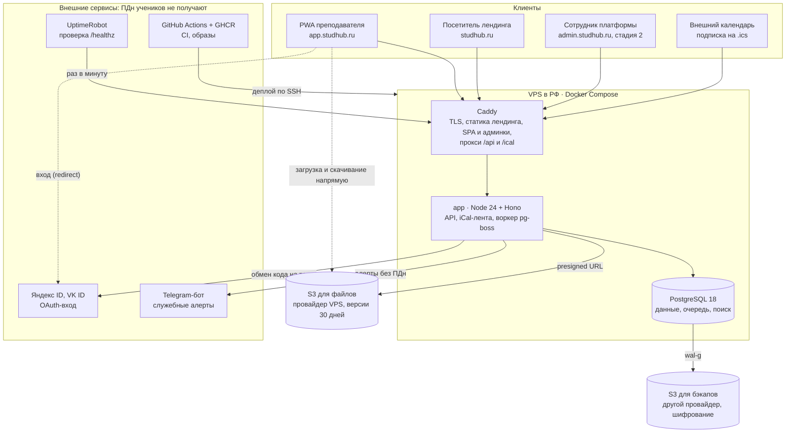
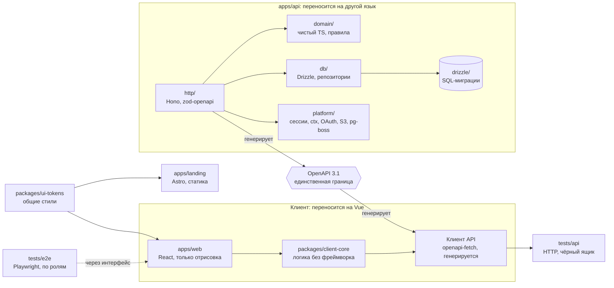
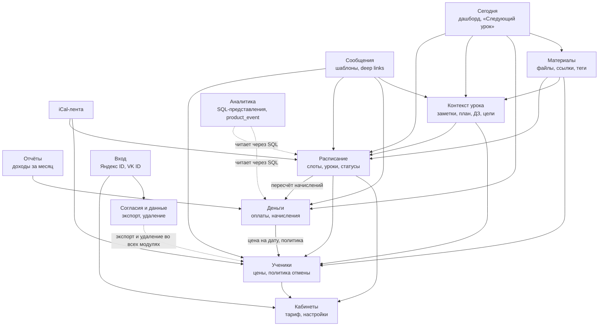
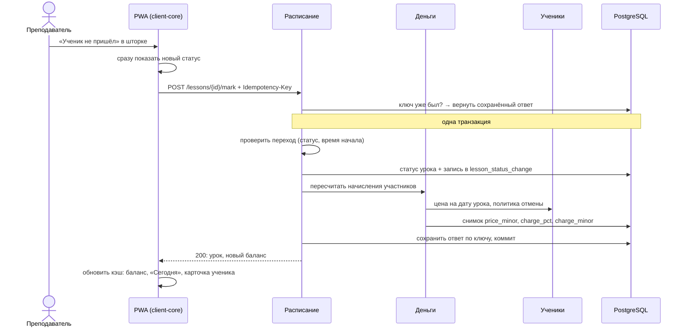

# Studhub — техническое проектирование MVP

> Статус: согласовано (2026-11-11), обновлено по итогам описания экранов (решения Р-1…Р-11 в [`screens.md`](screens.md)). Следующий шаг — реализация MVP по плану из раздела 15.
> Источник истины по функционалу — [`product-concept.md`](product-concept.md). Пользовательские сценарии — в [`use-cases.md`](use-cases.md), экраны — в [`screens.md`](screens.md). Ключевые решения с обоснованием — в [`adr/`](adr/).

## 1. Сквозные принципы

1. **Заменяемость слоёв.** Сервер можно переписать на другом языке (Python, Go), фронтенд — на Vue, не трогая соседние слои. Единственная связь клиента и сервера — контракт OpenAPI. Схема БД — SQL-миграции. Тесты API — чёрный ящик по HTTP.
2. **Простота для соло-разработчика.** Монолит, один Docker-образ, один VPS, одна БД. Без Redis, брокеров, Kubernetes, отдельной BI.
3. **Бизнес-правила только на сервере.** Клиент отображает и вызывает команды, но не дублирует правила списания и переходов статусов.
4. **Инварианты денег и изоляции — в БД, где возможно.** CHECK, уникальные и составные внешние ключи страхуют от ошибок в коде.
5. **ПДн не покидают РФ.** Зарубежные сервисы получают только данные без ПДн.

## 2. Архитектура

### 2.1 Компоненты в продакшене



Всё внутри VPS и оба S3 — наша инфраструктура в РФ, в ней хранятся ПДн. Внешние сервисы ПДн учеников не получают. OAuth-провайдеры видят только данные самого преподавателя при входе.

### 2.2 Устройство кода и границы слоёв



Стрелка означает «зависит от» или «генерируется из».
- Клиент и тесты знают о сервере только через спецификацию OpenAPI.
- `domain/` ни от чего не зависит.
- Правила границ — в §13.

### 2.3 Взаимодействие фичей



**Правила:**
- Стрелка означает «вызывает через публичный `index.ts` модуля».
- Каждый слой использует только слои ниже.
- Ядро — Расписание, Деньги и Ученики:
  - Расписание при смене статуса урока вызывает Деньги, чтобы пересчитать начисления;
  - Деньги берут у Учеников цену на дату и политику отмены.
- Два исключения сделаны сознательно:
  - «Согласия и данные» при экспорте и удалении вызывает все модули;
  - «Аналитика» читает данные через SQL-представления, а не через код модулей.

**Сквозной сценарий — смена статуса урока.** Преподаватель отмечает, что ученик не пришёл. Автоматические переходы по времени (§4.5) выполняет фоновая задача в такой же транзакции, но без ключа идемпотентности.



### 2.4 Компоненты

| Компонент | Ответственность |
|---|---|
| `apps/landing` | Лендинг, юридические документы, лист ожидания (Яндекс Формы → позже `POST /api/v1/waitlist`). Яндекс Метрика только здесь |
| `apps/web` | SPA кабинета преподавателя: компоненты, страницы, обвязка роутера. Без бизнес-логики |
| `packages/client-core` | Клиентская логика без фреймворка: сгенерированный клиент API, фабрики запросов, логика экранов, раскладка календаря, форматирование, схемы форм, карта маршрутов |
| `apps/api` | HTTP API, доменная логика, доступ к БД, фоновые задачи, iCal-лента, интеграции (OAuth, S3) |
| PostgreSQL 18 | Данные, очередь и cron (pg-boss), поиск (полнотекстовый поиск, `pg_trgm`), сессии, ключи идемпотентности |
| S3 | Файлы материалов и миниатюры; отдельный бакет у другого провайдера для бэкапов |

**Модули сервера (по фичам):** `auth`, `workspaces`, `students`, `schedule`, `billing`, `lesson-context` (заметки, ДЗ, прогресс), `materials`, `messages`, `calendar-feed`, `reports`, `analytics`, `compliance` (согласия, экспорт, удаление). Каждый модуль — `domain/` (чистый TS), `db/` (схема Drizzle и репозитории), `http/` (маршруты). Общая инфраструктура — `platform/`.

## 3. Стек

| Слой | Выбор | Почему |
|---|---|---|
| Клиент | React 19, Vite, TanStack Router (маршруты в коде), TanStack Query (+ persist в IndexedDB), TanStack Form + zod | Большая экосистема и качественная помощь AI. TanStack Query и Form есть и для Vue, маршруты описаны картой в `client-core` |
| UI | Tailwind CSS v4, shadcn/ui (Radix), lucide, vaul (нижние шторки), sonner (уведомления). Токены, шрифты Nunito и Manrope, светлую и тёмную темы задаёт [`design-system.md`](design-system.md) | Компоненты копируются в репозиторий. У каждой библиотеки есть Vue-аналог: shadcn-vue, Reka UI, vaul-vue, vue-sonner |
| PWA | vite-plugin-pwa (Workbox) | Кэширует только статику, данными управляет TanStack Query |
| Даты | date-fns v4 + `@date-fns/tz` | Одна библиотека на клиенте и сервере |
| Сервер | Node 24 LTS, Hono, `@hono/zod-openapi` | Минимальный фреймворк. Спецификация OpenAPI генерируется из zod-схем |
| БД | PostgreSQL 18, Drizzle ORM + drizzle-kit | Типы из схемы в TS, миграции — SQL-файлы на ревью. `uuidv7()` встроен в PostgreSQL 18 |
| Фоновые задачи | pg-boss | Очередь и cron на Postgres, без Redis |
| Файлы | S3 (`@aws-sdk/client-s3`, presigned URL), `sharp` для миниатюр | Стандартный S3 API. Локально — Garage ([ADR-0008](adr/0008-garage-local-s3.md)) |
| Вход | Яндекс ID, VK ID: OAuth 2.0 + PKCE, своя реализация (+ `arctic` или прямые запросы) | 406-ФЗ запрещает зарубежных провайдеров. Сессии в своей таблице, логика переносима |
| Контракт клиента | `openapi-typescript` + `openapi-fetch` | Клиент не зависит от кода сервера |
| Логи | pino (JSON в stdout) | Маскировка ПДн |
| Инструменты | pnpm workspaces, TypeScript strict, Biome, Vitest, Playwright, lefthook | Минимум инструментов |
| Лендинг | Astro, статика | SEO, отсутствие JS, островки на React или Vue при необходимости |
| Инфраструктура | VPS в РФ (по умолчанию Selectel), Docker Compose, Caddy, wal-g, GitHub Actions, GHCR | См. раздел 12 |

## 4. Доменная модель

### 4.1 Общие соглашения

- Первичные ключи — `uuid` с `DEFAULT uuidv7()`.
- В каждой таблице арендатора есть `workspace_id NOT NULL`, в том числе в дочерних. Связи внутри арендатора — **составные внешние ключи** `(workspace_id, x_id) → x(workspace_id, id)`. Для этого у родительских таблиц есть `UNIQUE (workspace_id, id)`.
- Время — `timestamptz` (сессия БД в UTC). Даты без времени (`date`) интерпретируются в зоне преподавателя.
- Деньги — `bigint` в минимальных единицах валюты и `char(3)` с кодом ISO 4217. Число знаков после запятой берётся из справочника в коде (RUB, KZT, USD — 2).
- Перечисления — `text` + `CHECK` (а не enum Postgres): их проще менять миграциями.
- `created_at` и `updated_at` есть везде, где строки изменяются.

### 4.2 Пользователи, вход, кабинеты

**`user`** — человек.
`id`, `display_name`, `avatar_url`, `email` (от провайдера, nullable), `timezone` (IANA), `deletion_requested_at`, `created_at`.

**`auth_identity`** — способ входа.
`id`, `user_id`, `provider` (`yandex` | `vk`; позже `telegram`, `email`), `provider_user_id`, `email`, `email_verified`, `created_at`.
`UNIQUE (provider, provider_user_id)`.

**`session`**
`id` = SHA-256 токена (сам токен хранится только в cookie или у клиента), `user_id`, `kind` (`cookie` | `bearer`), `expires_at`, `last_seen_at`, `user_agent`, `ip`, `created_at`.
Срок 90 дней, скользящий: продлевается, когда до истечения остаётся меньше 45 дней.

**`consent`** — журнал согласий.
`id`, `user_id`, `kind` (`pd_processing` | `terms`), `document_version`, `accepted_at`, `ip`, `user_agent`.

**`workspace`** — кабинет, арендатор.
`id`, `name`, `plan` (`beta` | `free` | `pro`), `default_currency`, `default_timezone`, `late_cancel_window_hours` (по умолчанию 24), `late_cancel_charge_pct` (100), `no_show_charge_pct` (100), `deletion_scheduled_at`, `created_at`.

**`workspace_member`**
`workspace_id`, `user_id`, `role` (`owner`; позже `admin` | `teacher` | `assistant`), `ical_token_hash`, `ical_anonymized bool DEFAULT true`, `created_at`.
`PK (workspace_id, user_id)`.

**`platform_staff`** — сотрудники платформы, вход в админку ([ADR-0009](adr/0009-platform-admin.md)). Появляется в задаче SH-084.
`user_id` (PK), `role` (`superadmin` | `support`), `totp_secret_enc` (ключ TOTP в зашифрованном виде, ключ шифрования берётся из окружения), `created_at`, `disabled_at`.
Роль платформы не связана с `workspace_member.role`: одна не даёт другую.

**Инварианты:**
- В MVP у пользователя ровно один кабинет с ролью `owner`. Он создаётся при первом входе.
- Привязка второго провайдера к пользователю — в настройках. Автоматическая связка по email — только если провайдер подтвердил email. Отвязать можно любой способ входа, кроме последнего.
- Ссылка на iCal-ленту показывается один раз: при создании и при перевыпуске. Хранится только хеш токена.
- Пока запрошено удаление (`deletion_requested_at`), изменяющие запросы отклоняются с кодом `account_deletion_pending`. Исключения — отмена удаления, выход и экспорт. iCal-лента в это время не отдаётся.

### 4.3 Ученики

**`student`**
- `id`, `workspace_id`, `name`;
- контакты: `telegram_username`, `whatsapp_phone`, `phone`;
- `timezone`, `currency`;
- `meeting_place text NULL` — место встречи по умолчанию: адрес или ссылка на онлайн-комнату;
- политика отмены, `NULL` = берётся из кабинета: `late_cancel_window_hours`, `late_cancel_charge_pct`, `no_show_charge_pct`;
- `level` (`A1`…`C2`, nullable), `exam` (текст), `exam_deadline` (date), `about` (свободный текст);
- `consent_received_on date NULL` — дата, когда преподаватель получил согласие ученика или родителя на обработку ПДн (отмечает вручную, UC-45);
- `status` (`active` | `archived`), `archived_at`, `created_at`, `updated_at`.

**`student_price`** — история цен.
`id`, `workspace_id`, `student_id`, `price_minor` (≥ 0), `valid_from date`, `created_at`.
`UNIQUE (student_id, valid_from)`. Цена указана в валюте ученика.

**`goal`**
`id`, `workspace_id`, `student_id`, `text`, `done_at`, `position`.

**Инварианты:**
- Цена урока на дату D — запись с максимальным `valid_from ≤ D`. D — местная дата урока в зоне преподавателя. Если такой записи нет (урок раньше первой цены), берётся самая ранняя запись.
- Сменить `currency` можно только при нулевом балансе, вместе с новой записью цены с сегодняшней даты.
- Free: не больше 5 учеников со статусом `active`. Проверка есть в коде, но для `plan = beta` отключена.
- Архивация закрывает слоты и удаляет нетронутые будущие уроки (§5.3). Баланс и история сохраняются.
- Удаление навсегда каскадно удаляет уроки, где ученик — единственный участник, его оплаты, ДЗ, заметки и связи материалов.

### 4.4 Расписание

**`recurring_slot`** — версия регулярного слота.
- `id`, `workspace_id`, `teacher_id`, `series_id` (общий у всех версий одного слота);
- `weekday` (1–7, ISO), `local_time time`, `duration_min`, `timezone` (IANA);
- `valid_from date`, `valid_until date NULL`, `generated_until date NULL`, `created_at`.
- `CHECK (valid_until IS NULL OR valid_until >= valid_from)`.

**`slot_participant`**
`workspace_id`, `slot_id`, `student_id`. `PK (slot_id, student_id)`.

Один слот — это один день недели. «Вт/чт 18:00» — это два слота, в интерфейсе они сгруппированы по ученику.

**`lesson`** — конкретный урок.
- `id`, `workspace_id`, `teacher_id`;
- `starts_at timestamptz`, `duration_min`, `ends_at` (генерируемая колонка: `starts_at + duration_min * interval '1 minute'`);
- `status` (§4.5), `status_changed_at`;
- `meeting_place text NULL` — место этого урока, `NULL` = как у ученика;
- `slot_id NULL`, `occurrence_date date NULL` — из какого повторения слота создан урок; при переносе не меняются;
- `created_at`, `updated_at`.

Ограничения `lesson`:
- `UNIQUE (slot_id, occurrence_date) WHERE slot_id IS NOT NULL` — генерация идемпотентна;
- `CHECK ((slot_id IS NULL) = (occurrence_date IS NULL))`.

**`lesson_reschedule`** — журнал переносов.
`id`, `workspace_id`, `lesson_id`, `from_starts_at`, `from_duration_min`, `to_starts_at NULL` (`NULL` — перенос без даты), `to_duration_min NULL`, `changed_by`, `changed_at`.
Перенос меняет время **того же** урока; отдельного статуса и второго урока нет. Журнал нужен для истории («перенесён с вт 12.11 18:00»), аналитики переносов и защиты урока от изменения слота (§5.3).

**`lesson_participant`**
- `id`, `workspace_id`, `lesson_id`, `student_id`;
- `price_override_minor NULL` — своя цена этого урока;
- снимок на момент перехода в финальный статус: `price_minor NULL`, `charge_pct NULL`;
- `charge_minor bigint NOT NULL DEFAULT 0 CHECK (charge_minor >= 0)`, `currency`, `marked_at NULL`.

Ограничения `lesson_participant`:
- `UNIQUE (lesson_id, student_id)`;
- валюта участника = валюта ученика на момент создания.

**`lesson_status_change`** — журнал смен статуса.
`id`, `workspace_id`, `lesson_id`, `from_status`, `to_status`, `changed_by`, `changed_at`.

> Статус в MVP хранится на уроке, потому что уроки индивидуальные. Для мини-групп (стадия 2) добавится посещаемость на участнике (`lesson_participant.attendance`). Начисление уже считается по участнику, так что модель денег менять не придётся.

### 4.5 Статусы урока и начисления

| Статус | Смысл | Начисление (`charge_pct`) |
|---|---|---|
| `scheduled` | Запланирован | — (0) |
| `in_progress` | Идёт: наступило время начала | — (0) |
| `completed` | Проведён: ставится автоматически по окончании урока | 100 |
| `cancelled_on_time` | Ученик отменил вовремя | 0 |
| `cancelled_late` | Поздняя отмена | `late_cancel_charge_pct` |
| `cancelled_by_teacher` | Отменил преподаватель | 0 |
| `no_show` | Неявка | `no_show_charge_pct` |
| `postponed` | Перенесён без даты: «долг по уроку». `starts_at` хранит исходное время | 0 |

`charge_minor = round_half_up(price × charge_pct / 100)`. Здесь `price` = `price_override_minor`, а если её нет — цена из `student_price` на местную дату урока. Политика берётся у ученика, а если поле пустое — у кабинета. Изменение `price_override_minor` у урока в финальном статусе пересчитывает снимок участника.

**Переходы** (таблица в `schedule/domain`, покрыта тестами). Явной отметки «Проведён» нет: урок становится проведённым сам, преподаватель вмешивается, только если урок не состоялся или нужно исправить статус.

| Из | В | Кто | Условия и эффекты |
|---|---|---|---|
| `scheduled` | `in_progress` | Система | Наступило `starts_at` |
| `in_progress` | `completed` | Система | Наступило `ends_at`. Начисление по цене урока |
| `scheduled` | `cancelled_on_time`, `cancelled_late`, `cancelled_by_teacher` | Преподаватель | До начала урока. Сервер возвращает расчёт начисления для каждого статуса (`chargePreview`), клиент предлагает `cancelled_late`, если `now > starts_at − окно` |
| `in_progress` | `no_show`, `cancelled_*` | Преподаватель | Урок не состоялся |
| `scheduled`, `in_progress` | `scheduled` с новым временем (перенос) | Преподаватель | Меняются `starts_at` и `duration_min` того же урока, запись в `lesson_reschedule`. Материалы, план и ДЗ остаются на уроке. Новое время может быть в прошлом (перенос по ошибке: урок прошёл в исходное время) — тогда урок сразу проходит автоматические переходы. После окончания урока перенос недоступен |
| `scheduled`, `in_progress` | `postponed` | Преподаватель | Возникает «долг по уроку» |
| `postponed` | `scheduled` с новым временем (назначить дату) | Преподаватель | Как перенос: меняется время того же урока, запись в `lesson_reschedule`. Долг закрыт |
| финальные (`completed`, `cancelled_*`, `no_show`) | другой финальный | Преподаватель | Исправление, в том числе смена автоматического «Проведён» на неявку или отмену. `completed` и `no_show` — только после `starts_at`. Начисление пересчитывается |
| `cancelled_*` урока, который ещё не начался | `scheduled` | Преподаватель | Отмена отмены |
| `postponed` | `scheduled` с исходным временем (отмена переноса) | Преподаватель | **Только до исходного `starts_at`**: иначе урок сразу стал бы «Проведён». После исходного времени — «Назначить дату» или отмена урока |

Каждый переход в одной транзакции:
1. меняет `lesson.status` и `status_changed_at`;
2. пишет запись в `lesson_status_change`;
3. для каждого участника пересчитывает снимок (`price_minor`, `charge_pct`, `charge_minor`, `marked_at`). При возврате в `scheduled` снимок обнуляется.

Автоматические переходы выполняет задача pg-boss раз в минуту (§12), в журнале `changed_by = NULL`. Статус может отставать от часов не больше чем на минуту. Урок, созданный задним числом, проходит оба перехода при ближайшем запуске.

**«Тронутый» урок** — у него статус не `scheduled`, или есть заметка (итог или план), ДЗ, назначенное на этот урок, вложения материалов, или его переносили вручную (есть запись в `lesson_reschedule`).

**Производные понятия:**
- **Идущий урок:** `status = 'in_progress'`.
- **Долг по уроку:** `status = 'postponed'`.
- **Перенесённый урок:** есть запись в `lesson_reschedule`.

### 4.6 Деньги

**`payment`** — первичные денежные записи.
- `id`, `workspace_id`, `student_id`;
- `kind` (`payment` | `refund` | `adjustment`), `amount_minor bigint`, `currency`, `paid_on date`;
- `method` (`transfer` | `cash` | `card` | `other`, `NULL` для `adjustment`);
- `package_lessons int NULL`, `is_opening_balance bool`, `comment`;
- `created_by`, `created_at`, `updated_at`, `voided_at NULL`.

Знак суммы задаётся видом:
- `payment` — `amount_minor > 0`;
- `refund` — `amount_minor < 0`;
- `adjustment` — `amount_minor <> 0`.

**Баланс ученика:**

```sql
balance = COALESCE(SUM(p.amount_minor) FILTER (WHERE p.voided_at IS NULL), 0)
        - COALESCE(SUM(lp.charge_minor), 0)
```

Баланс никогда не кэшируется. Отрицательный баланс — долг.

**Инварианты:**
- `payment.currency = student.currency`, проверяет сервер.
- Оплаты редактирует только преподаватель. Удаление мягкое (`voided_at`). Начисления меняет только доменная логика переходов.
- Изменение `student_price` не меняет уже отмеченные уроки: у них снимок.

### 4.7 Контекст урока

**`lesson_note`**
`lesson_id` (PK), `workspace_id`, `summary` (итог: что прошли и что не получилось), `plan` (план на этот урок: пишется заранее на странице урока или в итоге прошлого урока), `updated_at`.

**`tag`**
`id`, `workspace_id`, `kind` (`skill` | `topic` | `level`), `name`.
`UNIQUE (workspace_id, kind, lower(name))`. Базовые навыки для языков добавляются при создании кабинета.

**`lesson_tag`**
`workspace_id`, `lesson_id`, `tag_id` — теги навыков урока.

**`homework`**
`id`, `workspace_id`, `student_id`, `lesson_id` (урок, на котором ДЗ проверят; по умолчанию ближайший запланированный урок ученика), `issued_lesson_id NULL` (урок, на котором ДЗ выдано), `text`, `status` (`assigned` | `done` | `not_done`), `status_changed_at`, `created_at`.
ДЗ создаётся только из урока. План и ДЗ принадлежат уроку, на котором их рассмотрят.

### 4.8 Материалы и файлы

**`file`**
`id`, `workspace_id`, `storage_key` (`workspaces/{wid}/files/{id}`), `original_name`, `mime_type`, `size_bytes`, `status` (`pending` | `ready` | `deleted`), `thumbnail_key`, `created_at`, `uploaded_at`.

**`material`**
`id`, `workspace_id`, `kind` (`file` | `link`), `title`, `description`, `file_id NULL`, `url NULL`, `link_provider NULL` (`youtube` | `google_docs` | `wordwall` | …), `thumbnail_url NULL`, `created_at`, `deleted_at`.
`CHECK` (`kind = 'file'` ⇔ `file_id IS NOT NULL`; `kind = 'link'` ⇔ `url IS NOT NULL`).

**`material_tag`**
`workspace_id`, `material_id`, `tag_id`.

**`material_attachment`**
`id`, `workspace_id`, `material_id`, ровно одна цель: `lesson_id` | `homework_id` | `student_id` (`CHECK num_nonnulls(...) = 1`), `created_at`.

**«Использовано с учеником X»** — представление `material_student_usage`, отдельной таблицы нет. Материал считается использованным, если:
- он прикреплён к ученику X;
- или он прикреплён к ДЗ ученика X;
- или он прикреплён к уроку ученика X, если урок в статусе `completed`.

**Квота кабинета** = `SUM(size_bytes) WHERE status = 'ready'`. Free — 1 ГБ, Pro — 20 ГБ, `beta` — 20 ГБ.

### 4.9 Сообщения, платформа, аналитика

**`message_template`**
`id`, `workspace_id`, `kind` (`lesson_reminder` | `homework` | `balance` | `reschedule` | `consent_student` | `consent_parent` | `custom`), `title`, `body`, `position`.
Переменные: `{имя}`, `{дата}`, `{время_ученика}`, `{место}`, `{баланс}`, `{долг}`, `{дз}`, `{ссылка_на_материал}`.

**`idempotency_key`**
`key`, `workspace_id`, `user_id`, `route`, `request_hash`, `response_status`, `response_body jsonb`, `created_at`. Хранится 24 часа.

**`product_event`**
`id`, `workspace_id`, `user_id`, `name` (из закрытого списка), `props jsonb` (без ПДн), `occurred_at`.

**`admin_audit`** — журнал запросов к `/api/admin/v1` (ADR-0009).
`id`, `staff_user_id` (`NULL` — система, например задача удаления аккаунта), `session_id`, `action`, `object_type`, `object_id` (только технические ID), `workspace_id` (без внешнего ключа: запись переживает удаление кабинета), `result` (`ok` | `denied` | `error`), `ip`, `user_agent`, `details jsonb` (что изменила команда, без ПДн), `at`.
Пишется на каждый запрос, и на чтение, и на команду, в одной транзакции с командой. У приложения право только `INSERT`. Хранится 1 год.

**`waitlist_entry`** — после запуска API. До этого лист ожидания в Яндекс Формах.

### 4.10 Связи (обзор)

```
user 1─* auth_identity, session, consent
user *─* workspace (workspace_member)
workspace 1─* student, recurring_slot, lesson, payment, material, file, tag, message_template
student 1─* student_price, goal, payment, homework, lesson_participant, slot_participant
recurring_slot (series_id) 1─* lesson (slot_id, occurrence_date)
lesson 1─* lesson_participant, lesson_status_change, lesson_reschedule, lesson_tag, homework; 1─1 lesson_note
material *─* lesson | homework | student (material_attachment)
```

## 5. Ключевые алгоритмы

### 5.1 Время и часовые пояса

- Все моменты хранятся в UTC. Интерфейс показывает время в зоне `user.timezone`. Если зона устройства отличается, показываем плашку с предложением переключиться.
- Время урока из слота: `starts_at = toUtc(occurrence_date + local_time, slot.timezone)`.
  - Если такого местного времени нет (весенний перевод часов), берём ближайшее время после перевода.
  - Если время повторяется (осенний перевод), берём первое.
- Подсказка «у ученика 20:00» — это `starts_at` в `student.timezone`.
- Границы «сегодня», «неделя» и «месяц» для дашборда и отчётов считаются в зоне преподавателя.
- **Смена зоны преподавателя.** Спрашиваем, сохранять местное время уроков или абсолютное. Для каждого активного слота создаётся новая версия с сегодняшнего дня (§5.3) с той же или пересчитанной `local_time` в новой зоне. Прошедшие уроки не меняются.

### 5.2 Генерация уроков

**Горизонт** — последний день следующего месяца в зоне слота (`horizon(today)`).

```
generate(slot, until):
  from = max(slot.valid_from, slot.generated_until + 1)
  to   = min(slot.valid_until ?? ∞, until)
  for d in [from..to] where isoWeekday(d) == slot.weekday:
      INSERT lesson (slot_id, occurrence_date = d, starts_at = toUtc(d, local_time, tz), duration, teacher)
          ON CONFLICT (slot_id, occurrence_date) DO NOTHING
      INSERT lesson_participant для каждого slot_participant (если урок вставлен)
  slot.generated_until = to
```

**Когда запускается:**
- при создании слота или новой версии — в той же транзакции;
- задачей pg-boss каждую ночь — для всех слотов, у которых `generated_until < horizon(today)`.

Генерация идемпотентна.

### 5.3 Изменение и завершение слота

**Изменение с даты X** (новый день недели, время, длительность или зона). Пусть O — старая версия, N — новая.

1. Закрываем старую версию: `O.valid_until = X − 1`. Создаём `N` с тем же `series_id` и `valid_from = X`.
2. Для каждого урока L версии O с `occurrence_date ≥ X` ищем повторение N в той же ISO-неделе, дату d.
   - **Если d есть**, урок перепривязывается: `slot_id = N`, `occurrence_date = d`.
     - Если `L.status = 'scheduled'` и урок не переносили вручную, у урока обновляются `starts_at` и `duration_min` по правилу N. Заметки и вложения сохраняются.
     - Перенесённый вручную урок сохраняет своё время: ручной перенос важнее правила слота.
     - Остальные статусы сохраняют своё время: это история. Перепривязка нужна только для того, чтобы N не сгенерировал дубль на эту неделю.
   - **Если d нет** (N в эту неделю не действует):
     - нетронутый `scheduled` урок удаляется;
     - тронутый `scheduled` урок становится разовым (`slot_id = NULL`) и попадает в отчёт об изменении;
     - остальные остаются привязаны к O.
3. Запускаем `generate(N, horizon)`.
4. Возвращаем клиенту сводку: сколько уроков перенесено, удалено и какие уроки стоит проверить вручную.

**Завершение слота с даты X** (ученик ушёл, архивация):
- `valid_until = X − 1`;
- нетронутые `scheduled` уроки с `occurrence_date ≥ X` удаляются;
- тронутые становятся разовыми и попадают в сводку.

### 5.4 Перенос и смена статуса

- **Перенос** меняет время того же урока (`starts_at`, `duration_min`) и пишет запись в `lesson_reschedule`. Статус остаётся или становится `scheduled`. Материалы, план и ДЗ остаются на уроке. В iCal событие с тем же идентификатором сдвигается. Перенос доступен для `scheduled` и `in_progress`, то есть до окончания урока. Новое время в прошлом допускается с предупреждением: так исправляют перенос, сделанный по ошибке.
- **Перенос без даты** переводит урок в `postponed`, исходное время сохраняется. «Назначить дату» — это обычный перенос. «Отменить перенос» возвращает `scheduled` с исходным временем, только пока оно не наступило.
- **Отменить обычный перенос** — значит перенести урок обратно. Отдельной команды нет.
- **Статус «Проведён» ставится автоматически** (§4.5): в `starts_at` урок переходит в `in_progress`, в `ends_at` — в `completed` с начислением. Преподаватель явно меняет статус командой `mark`, только если урок не состоялся (неявка, отмена) или чтобы исправить автоматический «Проведён». Команда идемпотентна по `Idempotency-Key`. Риск забытой отмены снижается тем, что прошедшие уроки дня видны на «Сегодня» со статусом и суммой списания.
- **Пересечения уроков** при создании или переносе дают предупреждение в ответе (`warnings: [{ code: 'overlap', lessonIds }]`), но не блокируют действие. Формы получают предупреждение до сохранения, вызывая ту же команду с `?dryRun=true` (§6.1).

### 5.5 Баланс, выписка, отчёт

- **Баланс** — формула из §4.6, считается одним агрегирующим запросом для списка учеников (`GROUP BY student_id`).
- **Выписка ученика.** Это `UNION ALL` двух наборов, отсортированный по местной дате, с нарастающим итогом через оконную функцию:
  - оплаты (`paid_on`);
  - участия в уроках с `charge_minor > 0` или с финальным статусом (местная дата `starts_at`).
- **Подсказка «осталось ≈ N уроков»** = `floor(balance / текущая цена)`, если баланс больше нуля.
- **«Доходы за месяц»** (месяц в зоне преподавателя, суммы отдельно по каждой валюте):
  - **получено** = `SUM(amount_minor)` по `kind IN ('payment','refund')`, без отменённых, по `paid_on`;
  - **стоимость проведённых уроков** = `SUM(charge_minor)` по урокам с `starts_at` в этом месяце;
  - корректировки не считаются доходом;
  - выгрузка в CSV: дата, ученик, сумма, способ, комментарий.

### 5.6 «Следующий урок» и контекст урока

1. Ближайший урок преподавателя со статусом `scheduled` или `in_progress`. Экран — это страница урока `/lessons/{id}` (Э-09 в [`screens.md`](screens.md)).
2. Для ученика этого урока собираем:
   - имя, уровень, цели;
   - `plan` этого урока и `summary` последнего урока со статусом `completed`;
   - ДЗ этого урока и ДЗ прошлых уроков, всё ещё в статусе `assigned`;
   - место встречи (своё у урока или ученика);
   - материалы, прикреплённые к этому уроку и к ученику;
   - баланс и подсказку по пакету;
   - время у ученика.
3. Всё возвращается одним эндпоинтом `GET …/lessons/{id}/context`. Этот ответ кэшируется в IndexedDB для просмотра без сети.

### 5.7 Идемпотентность

У команд `mark`, `reschedule`, `postpone`, `POST payments` и `POST lessons` клиент передаёт `Idempotency-Key` (UUID).
- Повтор с тем же ключом и тем же телом запроса возвращает сохранённый ответ.
- Повтор с тем же ключом и другим телом — `422`.

## 6. API

### 6.1 Соглашения

- REST поверх JSON, префикс `/api/v1`. Ресурсы кабинета живут под `/api/v1/workspaces/{wid}/…`.
- Изменения урока — команды `POST …/lessons/{id}/{command}`. Произвольного `PATCH status` нет.
- Спецификация OpenAPI 3.1 генерируется из `@hono/zod-openapi`. Клиент `openapi-fetch` генерируется в `client-core`. Типы клиента лежат в `packages/client-core/src/api/schema.ts`: `pnpm gen:client` создаёт их из `apps/api/openapi.json`, `pnpm gen:client:check` в CI падает, если файл устарел.
- Время в ISO 8601 UTC (`2026-11-17T15:00:00Z`), даты в формате `YYYY-MM-DD`, зоны — строки IANA. Деньги передаются как `{ amountMinor: number, currency: "RUB" }`.
- Ошибки — `application/problem+json` (RFC 9457) с полем `code` для машинной обработки.
- **`?dryRun=true`** у команд, которые создают или двигают уроки, меняют цену или зону (список — в §6.2). Сервер выполняет команду в транзакции, возвращает `warnings` и сводку изменений и откатывает транзакцию. Ключ идемпотентности для `dryRun` не сохраняется.
- Пока запрошено удаление аккаунта, изменяющие запросы возвращают `403` с `code: account_deletion_pending` (§4.2).
- Пагинация курсорная: `?cursor=…&limit=…` → `{ items, nextCursor }`.
- Аутентификация — cookie `sh_session` (`httpOnly`, `Secure`, `SameSite=Lax`) или `Authorization: Bearer`. На изменяющих запросах с cookie проверяется заголовок `Origin`.
- Админка платформы: префикс `/api/admin/v1`, своя спецификация OpenAPI и свой сгенерированный клиент. Аутентификация только по cookie `sh_admin_session`: она живёт 8 часов без продления, выдаётся после входа через Яндекс или VK и кода TOTP и действует на `admin.studhub.ru`. Сессия `sh_session` админку не открывает, `sh_admin_session` не открывает `/api/v1`. Команды, которые что-то меняют, просят код TOTP ещё раз.
- Чужой или несуществующий ресурс — `404`.
- Изменения API только добавляют поля и эндпоинты. При несовместимом клиенте сервер отвечает `426`, и клиент перезагружается.

### 6.2 Эндпоинты MVP

| Группа | Эндпоинты |
|---|---|
| Вход | `GET /auth/{yandex\|vk}/start`, `GET /auth/{provider}/callback`, `POST /auth/logout`, `POST /auth/logout-all` |
| Я | `GET /me`, `PATCH /me` (имя, зона со `slotsMode: keep_local\|keep_absolute` и `dryRun`, `ical_anonymized`), `POST /me/consents`, `GET /me/identities`, `DELETE /me/identities/{id}`, `GET /auth/{provider}/link`, `POST /me/calendar-feed/rotate`, `POST /me/deletion`, `DELETE /me/deletion` |
| Кабинет | `GET/PATCH /workspaces/{wid}` (настройки по умолчанию, занятое и доступное хранилище), `GET …/dashboard`, `GET …/export` |
| Ученики | `GET …/students`, `POST …/students` (вместе с ценой, слотами и начальным остатком, одной транзакцией), `GET/PATCH …/students/{id}` (со сводкой: баланс, следующий урок, ДЗ к проверке, навыки), `POST …/students/{id}/archive`, `…/unarchive`, `DELETE …/students/{id}` (навсегда), `GET …/students/{id}/timeline`, `GET …/students/{id}/statement`, `POST …/students/{id}/prices` (`dryRun`, `replace` при `409 price_exists`), `POST …/students/{id}/currency` (`409 balance_not_zero`), `GET/POST/PATCH/DELETE …/students/{id}/goals`, `GET …/students/{id}/export` |
| Слоты | `GET/POST …/slots`, `POST …/slots/{id}/change` (`effectiveFrom`, новые параметры) → сводка, `POST …/slots/{id}/end` → сводка. Все три команды принимают `dryRun` |
| Уроки | `GET …/lessons?from&to&studentId&status`, `POST …/lessons` (разовый), `GET …/lessons/{id}` (с `chargePreview`), `PATCH …/lessons/{id}` (только место встречи), `GET …/lessons/{id}/context`, `GET …/lessons/next`, `GET …/lessons/debts`, `POST …/lessons/{id}/mark` (неявка, отмена, исправление), `…/reschedule` (новое время того же урока), `…/postpone`, `…/schedule` (новое время для `postponed`), `…/revert` (отмена отмены, отмена переноса без даты). `dryRun` у `POST …/lessons`, `reschedule`, `schedule`. `PUT …/lessons/{id}/note` (`summary`, `plan`), `PUT …/lessons/{id}/tags`, `PATCH …/lessons/{id}/participants/{studentId}` (своя цена) |
| ДЗ | `POST …/homework`, `PATCH …/homework/{id}` |
| Оплаты | `GET …/payments?month&studentId&includeVoided`, `POST …/payments`, `PATCH …/payments/{id}`, `POST …/payments/{id}/void` |
| Отчёты | `GET …/reports/income?month=YYYY-MM`, `GET …/reports/income.csv?month=…` |
| Материалы | `GET/POST …/materials` (поиск `q`, фильтр `tagIds`, `studentId` → отметка «уже проходил»), `GET/PATCH/DELETE …/materials/{id}`, `POST …/files/uploads` (presign), `POST …/files/{id}/complete`, `GET …/files/{id}/url`, `POST/DELETE …/attachments` |
| Справочники | `GET/POST/PATCH/DELETE …/tags`, `GET/POST/PATCH/DELETE …/message-templates`, `POST …/message-templates/{id}/reset` |
| Служебные | `POST /events`, `POST /client-errors`, `GET /healthz`, `GET /ical/{token}.ics` (публичная), позже `POST /waitlist` |
| Админка платформы | `/api/admin/v1/…`: отдельная спецификация, описывается в SH-084 |

## 7. Экраны MVP

Экраны, навигация, состояния и сквозные паттерны интерфейса описаны в [`screens.md`](screens.md), внешний вид описан в [`design-system.md`](design-system.md).

Кратко: нижняя панель на телефоне, боковая — на компьютере. Вкладки: **Сегодня · Расписание · Ученики · Материалы · Ещё**. Мобильный интерфейс в приоритете для страницы урока: подготовка до урока и итог во время и после него.

## 8. Клиент

- **Слои:** компоненты в `apps/web` содержат только отрисовку и обвязку. Всё остальное лежит в `packages/client-core`: API, фабрики запросов (`@tanstack/query-core`), логика экранов, раскладка календаря (позиции, пересечения, зоны), форматирование через `Intl`, подстановка в шаблоны, deep links, схемы форм, карта маршрутов. Глобальное состояние минимальное (nanostores): сессия, текущий кабинет, настройки интерфейса.
- **Тексты интерфейса:** русские строки прямо в компонентах. Форматирование чисел, денег и дат — через `Intl`.
- **PWA:**
  - установка: manifest, баннер на Android, подсказка на iOS;
  - service worker кэширует только статику (`registerType: 'prompt'`, «Доступна новая версия»);
  - данные сохраняет TanStack Query в IndexedDB: экраны «Сегодня», страница урока (контекст), «Ученики», карточка ученика, текущая неделя расписания; черновики итога и плана хранятся там же, пока не сохранятся на сервере; хранятся до 7 дней, ключи привязаны к кабинету, при выходе всё стирается;
  - без сети показывается плашка «Нет сети, данные от HH:MM»; статус урока из кэша уточняется по часам устройства с пометкой «обновится при подключении» (только отображение, баланс не пересчитывается);
  - изменения применяются в интерфейсе сразу, при ошибке откатываются, повторяются с нарастающей паузой и `Idempotency-Key`;
  - задел: сохранение отложенных мутаций (TanStack Query) для `note` и `mark`, включается, если бета покажет потребность.
- **Сообщения:**
  - WhatsApp — `https://wa.me/{phone}?text=…`;
  - Telegram — копирование текста и открытие `https://t.me/{username}` (или `t.me/share/url?text=…`, проверить на прототипе).

## 9. Безопасность и 152-ФЗ

**Роли.** По данным преподавателей оператор — Studhub (ИП или ООО основателя). По данным учеников мы обработчик по поручению преподавателя (ч. 3 ст. 6). В оферте преподаватель гарантирует, что у него есть основания, включая согласие учеников. В продукте есть шаблоны согласия ученика и родителя.

**Документы:**
- политика обработки ПДн — публичная, на лендинге;
- согласие на обработку ПДн — отдельный документ и отдельный чекбокс;
- оферта — с поручением обработки, сроками хранения и удаления;
- уведомление в Роскомнадзор — до беты с внешними пользователями;
- при новой версии документов показываем экран повторного согласия.

**Технические меры:**
- **Локализация:** VPS, S3 и бэкапы в РФ. Зарубежным сервисам (GitHub, GHCR, UptimeRobot, Telegram-алерты) ПДн не передаются. Нет внешних CDN, шрифты раздаём сами.
- **Шифрование:** TLS везде, бэкапы wal-g шифруются (libsodium).
- **Доступ:**
  - к prod — только у основателя, по SSH-ключу; firewall пропускает только 22, 80 и 443; автоматические обновления безопасности;
  - Postgres наружу не открыт;
  - сотрудники платформы работают в отдельной админке (ADR-0009). Данные преподавателей (имя, email, провайдеры входа, тариф, часовой пояс) им открыты. Данные учеников маскирует сервер: имя → «Ученик 7F3A», телефон, Telegram, email и место встречи → последние 2 символа; заметки, итоги, планы, ДЗ, цели, описания и файлы материалов скрыты, видны наличие, длина и дата. Деньги, цены, статусы, даты и счётчики открыты. Снять маску нельзя;
  - вход сотрудника: Яндекс ID или VK ID плюс TOTP, сессия 8 часов, каждый запрос пишется в `admin_audit`.
- **Минимизация:** в обезличенной iCal-ленте (по умолчанию) нет имён учеников и мест встреч. Нет полей для особых категорий, в оферте просьба не вносить такие данные. В логах нет ПДн (маскировка pino), в `product_event` тоже.
- **Права субъектов:** экспорт кабинета и отдельного ученика (JSON и CSV), удаление ученика навсегда, удаление аккаунта через 30 дней (`deletion_requested_at` → задача pg-boss удаляет кабинет и префикс в S3). Бэкапы хранятся 30 дней, это указано в политике.
- **Защита веб-приложения:**
  - заголовок CSP с `default-src 'self'` плюс домен S3 для `img-src` и `media-src`;
  - `frame-ancestors 'none'`;
  - файлы отдаются с домена S3;
  - ограничение частоты запросов на OAuth, загрузку файлов и `waitlist`;
  - OAuth: `state` + PKCE, адреса возврата строго заданы.
- **Cookies:** в приложении только техническая cookie сессии. На лендинге баннер согласия для Метрики.
- **Уровень защищённости:** ориентир — 4-й (иные категории, меньше 100 тыс. субъектов). Документ «модель угроз и меры» готовим к бете вместе с юристом.

## 10. Файлы

1. `POST …/files/uploads` (тип, размер, имя). Сервер проверяет список разрешённых типов, лимит 100 МБ и квоту, создаёт `file(pending)` и возвращает presigned PUT.
2. Браузер загружает файл прямо в S3.
3. `POST …/files/{id}/complete`. Сервер делает `HEAD` (размер) и `GET Range: 0-4100` (сигнатура через `file-type`), переводит файл в `ready` и ставит задачу на миниатюру для изображений.
4. Скачивание — presigned GET на 15 минут, `Content-Disposition` с исходным именем.

**Разрешённые типы:** PDF, JPEG, PNG, WebP, MP3, M4A, OGG, WAV, DOCX, PPTX, XLSX. Видео нет.

**Фоновые задачи:**
- записи `pending` старше суток удаляются;
- удаление материала ставит задачу удаления объекта в S3. Удаление необратимо: перед ним пользователь подтверждает действие, при необходимости файл загружают заново ([ADR-0008](adr/0008-garage-local-s3.md)).

**Ссылки:** провайдер определяется по домену. Для YouTube название и обложка берутся через oEmbed. Других запросов к чужим URL нет (защита от SSRF).

**Антивирус** — на стадии 3, когда ученики получат доступ к файлам.

## 11. Аналитика

- **Схема `analytics`** — SQL-представления по доменным данным:
  - доля открытых уроков: преподаватель открыл страницу урока от 2 ч до начала до 24 ч после окончания (событие `lesson_opened`);
  - активные преподаватели: открыли не меньше 60% своих уроков за неделю (критерий стадии 2);
  - доля уроков с итогом: резюме, план на следующий урок или ДЗ;
  - исправления автоматических статусов: сколько «Проведён» сменили на неявку или отмену (по `lesson_status_change`);
  - когорты удержания (1, 2, 4, 8 недель);
  - воронка онбординга (регистрация → ученик → слот → первый проведённый урок → 5 учеников);
  - использование функций (заметки, план, ДЗ, материалы).
- **`product_event`** — закрытый список событий: `login`, `lesson_opened`, `next_lesson_opened`, `template_copied`, `messenger_opened`, `pwa_installed`, … Большая часть пишется на сервере, клиентские приходят пачкой через `POST /events`.
- **Просмотр метрик:** до экрана метрик (SH-088) владелец запускает запросы из `scripts/metrics.sql` по SSH. Потом тот же набор станет экраном Э-18 в `apps/admin`.
- **Яндекс Метрика** — только на лендинге.

## 12. Инфраструктура и эксплуатация

**Окружения:**
- локальное — `docker compose` с Postgres 18 и Garage (S3 API), приложение через `pnpm dev`;
- prod;
- staging появится к стадии 2.

**Prod:**
- VPS в РФ (по умолчанию Selectel, 2 vCPU / 4 ГБ / 40 ГБ SSD);
- `infra/docker-compose.prod.yml`: `caddy`, `app`, `postgres` (порт наружу не открыт);
- секреты в `.env` с правами `600`;
- домены: `studhub.ru` (лендинг), `app.studhub.ru` (SPA, API, iCal).

**Бэкапы:**
- wal-g: непрерывная архивация WAL плюс полный бэкап каждую ночь в S3 **другого** провайдера (например, Yandex Object Storage), с шифрованием, хранение 30 дней;
- раз в неделю проверка восстановления: поднять копию во временном контейнере, сравнить число строк ключевых таблиц, алерт при ошибке;
- переход на Managed PostgreSQL — при появлении платящих пользователей (`pg_dump` / восстановление и смена строки подключения).

**CI (GitHub Actions, на каждый PR):**
- Biome (стиль и границы импортов), `tsc`;
- Vitest: `domain`, `client-core`;
- тесты API через HTTP на Postgres 18 в контейнере;
- `drizzle-kit generate` не даёт новых изменений;
- сгенерированный клиент OpenAPI актуален;
- Playwright E2E (OAuth подменён в тестовом режиме);
- сборка образа.

**CD (по слиянию в `main`):**
1. образ с тегом SHA публикуется в GHCR;
2. Actions подключается к VPS по SSH;
3. `docker compose run --rm app migrate`;
4. `pull` и `up -d`;
5. проверка `/healthz`.

Миграции только вперёд по схеме «расширить → сжать». Откат — повторный деплой предыдущего тега.

**Наблюдение:**
- логи pino в JSON, ротация Docker (10 × 50 МБ);
- необработанные ошибки сервера и клиента (`POST /client-errors`) идут в лог и в Telegram-бот разработчика: группировка, не чаще раза в 5 минут на тип, без ПДн;
- к бете — GlitchTip на отдельном маленьком VPS в РФ, подключение через Sentry SDK;
- UptimeRobot проверяет `/healthz` каждую минуту;
- cron-скрипт присылает алерты, если диск заполнен больше чем на 80%, мало памяти, последнему бэкапу больше 26 часов или проверка восстановления упала.

**Фоновые задачи (pg-boss):**

| Задача | Когда |
|---|---|
| Сменить статусы уроков по времени: `in_progress`, `completed` | Раз в минуту |
| Продлить генерацию уроков | Ночью |
| Миниатюры | После загрузки файла |
| Удалить объект S3 | После удаления материала |
| Очистка: `pending`-файлы, истёкшие сессии и ключи идемпотентности | Ежедневно |
| Удаление аккаунтов через 30 дней | Ежедневно |

**Как устроены задачи (`platform/jobs`):**
- pg-boss работает в том же процессе, что HTTP. Данные очереди лежат в схеме `pgboss` той же БД. pg-boss сам создаёт и обновляет эту схему при старте, Drizzle её не ведёт.
- Модуль объявляет задачу через `jobs.define({ name, schedule?, retry?, handler })`: с cron-выражением (UTC) или без него, для запуска событием через `jobs.send`. Политика повторов по умолчанию: 3 повтора, пауза 30 с, рост паузы экспоненциальный.
- Ошибка задачи попадает в лог с полями `job`, `jobId`, `attempt`, `willRetry`, `errorType`, `errorCode`. Текст ошибки и данные задачи в лог не идут: в них могут быть ПДн. Падение задачи не влияет на HTTP.
- Если pg-boss не запустился (например, БД недоступна), процесс не завершается: HTTP отвечает, `/healthz` показывает состояние БД. Ошибка идёт в лог, запуск повторяется с паузой 1 с, 2 с, 4 с и так до 60 с, пока процесс жив. Состояние pg-boss — `jobs.isRunning()`; в лог оно попадает с номером попытки.
- При старте pg-boss снимает расписания, которых нет в коде: удалённые и переименованные cron-задачи не остаются в `pgboss.schedule`.
- При SIGTERM процесс перестаёт принимать запросы и ждёт запросы в работе до 10 секунд. Потом он останавливает запуск и воркеры pg-boss (до 10 секунд, активные задачи успевают завершиться). Код выхода 0, если всё остановилось штатно, и 1 при ошибке или превышении таймаута.
- Служебная задача `platform.heartbeat` раз в минуту пишет в лог, что задачи работают.
- Тесты запускают задачу синхронно через `/__test/jobs/:name/run` (процесс с `APP_MODE=test`), без очереди и расписания.

## 13. Структура репозитория

```
studhub/
├─ apps/
│  ├─ landing/            Astro: лендинг, юридические страницы
│  ├─ web/                React SPA (только UI)
│  ├─ admin/              React SPA админки платформы (ADR-0009); пока заглушка
│  └─ api/
│     ├─ src/modules/<feature>/{domain,db,http}/
│     ├─ src/db/          подключение к БД и запуск миграций (`migrate`); драйверы БД только здесь и в */db/
│     ├─ src/platform/    ctx и middleware арендатора, сессии, OAuth, идемпотентность,
│     │                   S3, pg-boss, логгер, конфиг (env через zod), OpenAPI
│     ├─ src/main.ts      сборка приложения: HTTP + воркер
│     └─ drizzle/         SQL-миграции (включая представления analytics)
├─ packages/
│  ├─ client-core/        логика клиента без фреймворка и сгенерированный клиент API
│  └─ ui-tokens/          CSS-переменные и тема Tailwind (общие для landing и web)
├─ tests/
│  ├─ api/                чёрный ящик по HTTP, только через сгенерированный клиент
│  └─ e2e/                Playwright, элементы ищем по ролям и текстам
├─ infra/                 docker-compose.prod.yml, Caddyfile, wal-g, скрипты алертов
│                         и проверки восстановления, deploy.sh
├─ docs/                  product-concept.md, technical-design.md, use-cases.md, screens.md, design-system.md, adr/
├─ scripts/               служебные скрипты: проверка сообщения коммита, покрытия критериев
├─ tools/                 тесты инструментов, фикстуры нарушений границ (boundary-fixtures/)
├─ docker-compose.yml     локальная разработка (Postgres 18, Garage)
├─ Dockerfile             один образ: собранная SPA + api
├─ biome.json, pnpm-workspace.yaml, .nvmrc (24), lefthook.yml
├─ tsconfig.base.json (strict), tsconfig.json (ссылки на пакеты), vitest.config.ts (проекты)
```

**Правила границ:**
1. `web`, `admin`, `client-core` и `tests/*` не зависят от `apps/api`: связь только через сгенерированный клиент OpenAPI.
2. `domain/` не импортирует `db/`, `http/`, Hono и Drizzle.
3. `http/` обращается к данным только через функции модуля.
4. Модули общаются друг с другом через публичный `index.ts`.
5. Прямой доступ к `db` есть только в `*/db/`.

Правила 1, 2, 4 и 5 проверяет Biome `noRestrictedImports` с настройками по путям (`overrides` в `biome.json`). Правило 3 Biome проверяет частично: в `http/` запрещены Drizzle и драйверы БД. Тест `tools/tests/boundaries.test.ts` проверяет, что Biome находит каждое нарушение из фикстур `tools/boundary-fixtures/`.

**Админка платформы (`apps/admin`, SH-076).** Пакет `@studhub/admin`: Vite, React и токены `ui-tokens`, без роутера, PWA и клиента API. Сейчас это заглушка: одна страница «Админка платформы» с пометкой, что экраны появятся позже. Страница не обращается к API и не просит вход. Запуск: `pnpm --filter @studhub/admin dev` (порт 5174), сборка: `pnpm --filter @studhub/admin build`. CI собирает приложение отдельным шагом, E2E открывают сборку через свой `vite preview`. Вход, API и экраны добавляют SH-084, SH-085 и SH-088.

## 14. Тестирование

| Уровень | Что | Где |
|---|---|---|
| Юнит-тесты | Переходы статусов (в том числе автоматические по времени), расчёт начислений и округление, генерация и изменение слотов (включая перевод часов), выбор цены по дате, подсказка поздней отмены | `apps/api/src/modules/*/domain` (Vitest) |
| Юнит-тесты клиента | Раскладка календаря, форматирование денег и времени, шаблоны, deep links | `packages/client-core` (Vitest) |
| API (чёрный ящик) | Сценарии вроде «ученик → слот → генерация → автоматический «Проведён» → поздняя отмена → оплата → баланс», изоляция (чужой кабинет → 404 для каждого эндпоинта), идемпотентность, права | `tests/api` (сгенерированный клиент, реальный Postgres). Харнесс устроен так: один раз на прогон создаётся шаблонная БД с миграциями; каждый тестовый файл копирует её и запускает приложение отдельным процессом с `APP_MODE=test`. Файлы идут параллельно, данные и часы файлов не пересекаются. Сочетание `APP_MODE=test` и `NODE_ENV=production` приложение отклоняет на старте |
| E2E | Вход (тестовый провайдер), онбординг, итог урока и смена статуса, оплата, перенос, загрузка материала | `tests/e2e` (Playwright) |

## 15. План реализации MVP

Ориентир для соло-разработчика с AI-ассистентом — 9–11 недель. После каждого этапа работающая версия выкладывается в prod.

| Этап | Содержание | Ориентир |
|---|---|---|
| 0. Каркас и проверка рисков | Монорепозиторий, Biome, CI, Dockerfile, локальный compose. Hono + OpenAPI + генерация клиента + Drizzle + первая миграция. VPS, Caddy, деплой, wal-g, проверка восстановления, алерты. **Прототип:** OAuth Яндекса и VK в установленной PWA на iOS. Лендинг на Astro с Яндекс Формами (для стадии 0, можно раньше всего остального) | 1,5 недели |
| 1. Вход и кабинет | OAuth Яндекс и VK, сессии, экран согласий, создание кабинета, настройки, middleware арендатора, тесты изоляции, `/me` | 1 неделя |
| 2. Ученики | CRUD, история цен, политика отмены, цели и уровень, архив и удаление, онбординг «быстрое добавление», начальный остаток | 1 неделя |
| 3. Расписание | Слоты и версии, генерация и ночная задача, разовые уроки, перенос и `postponed`, день, неделя, список, «у ученика 20:00», iCal | 2 недели |
| 4. Статусы и деньги | Переходы статусов, автоматические «Идёт» и «Проведён», начисления, журнал, идемпотентность, оплаты, баланс, выписка, долги, «Доходы за месяц» + CSV | 1,5 недели |
| 5. Контекст урока | Итог урока, план урока, ДЗ, теги навыков, лента ученика, экран «Следующий урок», дашборд | 1 неделя |
| 6. Материалы | Загрузка в S3, квоты, миниатюры, ссылки и oEmbed, теги, поиск, прикрепления, «уже проходил» | 1 неделя |
| 7. Финиш | Полировка PWA (сохранение кэша, плашка без сети, обновление версии). `product_event`, представления `analytics` и `scripts/metrics.sql`. Экспорт и удаление аккаунта. Юридические тексты. Покрытие E2E. Запуск у партнёра-преподавателя | 1–1,5 недели |

### После MVP

Работа, вынесенная за пределы MVP (этапы 0–7), лежит в вехах стадий. Веха стадии идёт на доске после этапа 7. Пока в этапах 0–7 есть незавершённые задачи, задачи вех стадий не берём.

| Веха | Содержание | Ориентир |
|---|---|---|
| Стадия 2: закрытая бета (10–20 преподавателей) | Админка платформы (`apps/admin`): сотрудники и API, вход с TOTP, журнал `admin_audit`, маскировка ПДн, экран метрик Э-18. Сообщения ученику: шаблоны, deep links в Telegram и WhatsApp (прототип deep links, шаблоны, запрос согласия). Остальное по `product-concept.md` §4 (группы, AI, бот) пока без задач | после MVP |

Стадия 3 и дальше: веха заводится, когда появляется первая задача. Задача, которую откладывают за MVP, попадает в веху своей стадии из `product-concept.md` §4 и получает зависимости так же, как задачи этапов.

**Критерий готовности MVP:** преподаватель-партнёр может перенести всех учеников из таблицы и 4 недели вести их только в Studhub (критерий стадии 1).

## 16. Риски и что проверить на прототипе

| Риск | Проверка или митигация |
|---|---|
| OAuth в установленной PWA на iOS возвращается в Safari, а сессия остаётся не в том хранилище cookie | Прототип на этапе 0. Запасной вариант — вход в отдельном окне или одноразовый код обмена после OAuth |
| Telegram не позволяет предзаполнить текст в чате по username | Копирование и открытие чата, либо `t.me/share/url`. Решить на прототипе deep links (стадия 2) |
| Доступность GitHub или Telegram из РФ | Код переносится в GitVerse или GitFlic. Алерты дублируются через UptimeRobot (email или push) |
| Потеря данных на VPS | wal-g в S3 другого провайдера, еженедельная проверка восстановления, алерт по возрасту бэкапа |
| Изменения слотов портят историю | Версии слотов, перепривязка по ISO-неделе, сводка изменений преподавателю, тесты на граничные случаи |
| Юридические формулировки (406-ФЗ, 152-ФЗ) | Шаблоны в MVP, проверка юристом до беты |

## 17. Отклонения от черновика концепции

| В концепции | В проекте | Почему |
|---|---|---|
| `teacher_id` на всех сущностях | `workspace_id` на всех + `teacher_id` на уроке и слоте | Данные школы принадлежат школе, а не учителю ([ADR-0003](adr/0003-workspace-tenancy.md)) |
| `LedgerEntry` (журнал проводок) | `payment` + начисление на `lesson_participant`, баланс считается | Проще, понятная выписка, меньше инвариантов ([ADR-0004](adr/0004-computed-balance.md)) |
| `MaterialUsage` (таблица) | Представление по прикреплениям | Производные данные, нечего рассинхронизировать |
| Статус `rescheduled` и новый экземпляр урока при переносе | Перенос меняет время того же урока, журнал `lesson_reschedule` | Нет переноса материалов, плана и ДЗ между уроками и сложной отмены переноса; событие в iCal сдвигается, а не пересоздаётся ([`screens.md`](screens.md), Р-12) |
| Ручная отметка урока, напоминание о неотмеченных | Статус `in_progress` и автоматический «Проведён»; преподаватель отмечает только неявку, отмену или перенос | Меньше рутины: большинство уроков проходит как запланировано ([`screens.md`](screens.md), Р-9) |
| Вход (открытый вопрос) | Только Яндекс ID и VK ID | 406-ФЗ, без почтового сервиса в MVP ([ADR-0006](adr/0006-auth-yandex-vk.md)) |

## 18. ADR

- [0001 — Стек: React SPA + Hono, граница через OpenAPI](adr/0001-stack-react-spa-hono.md)
- [0002 — PostgreSQL 18 + Drizzle, pg-boss вместо Redis](adr/0002-postgres-drizzle.md)
- [0003 — Арендатор `workspace`, общие таблицы, изоляция в приложении](adr/0003-workspace-tenancy.md)
- [0004 — Баланс считается из оплат и начислений](adr/0004-computed-balance.md)
- [0005 — Уроки хранятся строками на горизонт, версии слотов](adr/0005-materialized-lessons.md)
- [0006 — Вход только через Яндекс ID и VK ID](adr/0006-auth-yandex-vk.md)
- [0007 — VPS + Docker Compose + wal-g вместо управляемых сервисов](adr/0007-vps-hosting.md)
- [0008 — Garage вместо MinIO локально, без версионирования файлов](adr/0008-garage-local-s3.md)
- [0009 — Отдельная админка платформы, сотрудники в `platform_staff`, маскировка ПДн](adr/0009-platform-admin.md)
